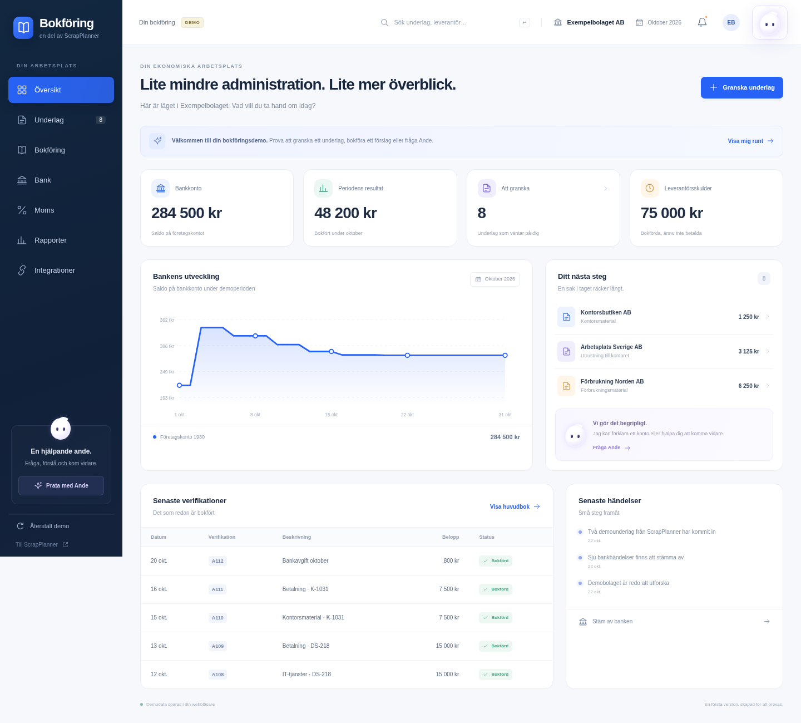
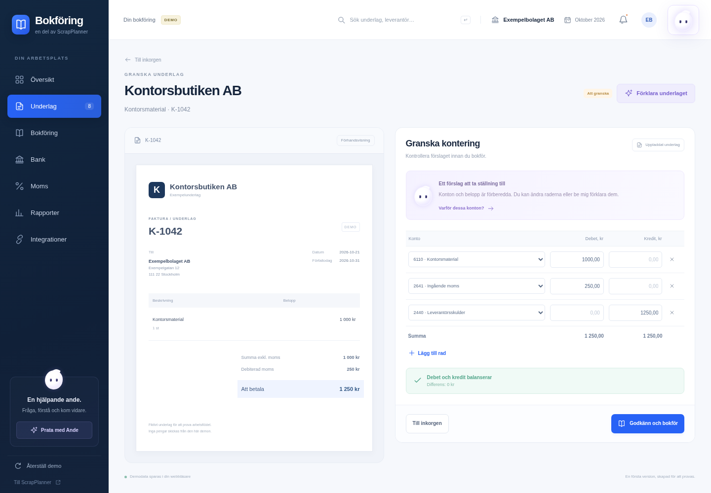

# Bokföring

Här samlas designförslag för ett **fristående bokföringsprogram med egen webbapp, eget API och en AI-assistent**. Skrotappen är en tänkt ansluten källa; bokföringsprogrammet ska även kunna användas självständigt och ta emot underlag från andra system.

**Status 2026-10-22:** klickbar demo i `public/bokforing/`, med efterföljande rättningar av kända konterings-, lagrings- och layoutfel. Publicering av rättningarna på Render är ett separat steg; den ursprungliga liveversionen är verifierad. De tio bildmockuperna nedan finns kvar som designunderlag. Detta är en testmiljö med fiktiv bokföring, inte ett system för skarp redovisning.

## Klickbar demo

Publik demo, verifierad 2026-10-22: **https://app.scrapplanner.com/bokforing**.

- Översikt med beräknade nyckeltal och senaste verifikationer.
- Underlagsinkorg och fakturavy med redigerbara konteringsrader.
- Demobokföring som kontrollerar belopp, moms, balans och underlagsversion samt stoppar dubbel bokföring.
- Huvudbok, bankmatchning, momsunderlag och rapporter som följer demobokens poster.
- En svävande demoassistent med kontextfrågor och exempelbaserade svar.
- Sparat demoläge i den egna webbläsaren och möjlighet att återställa exemplen.

Rättningarna begränsar inköpseditorns kontoval till det stödjade inköpsfallet och kontrollerar kostnadsnetto, skuld och tillåtna momsrader även i bokföringsfunktionen. En vanlig inköpsfaktura kan exempelvis inte få extra omvända momsrader eller bokas som en ökning av bankkontot. Ande ligger i reserverad plats i sidhuvudet.

Sparandet samordnas mellan uppdaterade demoflikar med Web Locks och kontroll av aktuell lagringsrevision. En gammal flik får inte skriva över nyare demodata. En bokning visas som genomförd först efter lyckad skrivning och återläsning. Vid konflikt, sparfel eller osäker kvittens pausas skrivningen med en synlig banner och **Läs in senaste demodata**. Den åtgärden återställer osparade ändringar i editorn. Ogiltiga äldre demodata bevaras tills användaren uttryckligen väljer reset.

Stäng och öppna äldre demoflikar efter publicering av rättningarna. Samordningen skyddar flikar som använder den uppdaterade koden; tidigare öppna versioner och direkt ändring av localStorage omfattas inte. Om webbläsaren saknar stöd för Web Locks visas demon i läsläge. Det är fortfarande browserlokal demodata, inte ett serverarkiv eller ett skydd mot manipulation.

Demon kräver ingen inloggning. Den använder en egen lagringsnyckel i webbläsaren och gör inga anrop till appens produktions-API:er, betalningstjänster eller externa AI-leverantörer. AI-svaren i denna version är exempelbaserade. Underlag och rapporter avser enbart Exempelbolaget AB.

Appservern mappar exakt `/bokforing` och `/bokforing/` till den fristående demosidan. Övrig autentisering och åtkomst till bolag ändras inte. Källkoden finns i [public/bokforing](../public/bokforing/).

Skärmbilder från den körbara demon:

Bygg med `npm run build` och starta med `npm start`. Appens vanliga driftinställningar gäller. Publicering på app-domänen följer [driftguidens manuella Render-deploy](../docs/drift/README.md#uppdatera-och-kontrollera); en GitHub-push betyder inte ensam att den nya versionen är live.

Verifierat lokalt efter rättningarna: produktionsbygge, 48 modelltester, 23 lagringstester, sex pilotpolicytester och ett HTTP-integrationstest. Tio browserregressioner täcker bland annat två flikar, sparfel, osäker kvittens, reset och pekarklick på femradig kontering på dator/mobil. Se [uppföljningen med rättningar och avgränsning](granskning/2026-10-22-uppfoljning.md).

## Provgranskning av liveversionen

[Provrapport 2026-10-22](granskning/2026-10-22.md) beskriver 15 genomförda scenarier mot den ursprungliga liveversionen, inklusive medvetna fel, reset och mobilbokföring. Den bevaras som historiskt underlag för rättningarna ovan. Rapporten innehåller reproduktionssteg och en beskrivning för extern granskning. Ett godtyckligt sakligt fel mellan tillåtna kostnadsslag kan fortfarande kräva mänsklig bedömning; rättningarna är inte ett godkännande av full regelefterlevnad.

## Bildmockuper

Bildernas belopp, konton, förklaringar och statusar är fiktiva illustrationer och ska inte användas som redovisningsregler.

## Bildöversikt

Klicka på en bild för att öppna PNG-originalet. Numren 01–10 används när vi väljer och kombinerar favoriter.

| Förslag | Förslag |
| --- | --- |
| **01 · Nordisk översikt**  Klassisk ljus översikt med nyckeltal, kassaflöde och senaste verifikationer. | **02 · Grön avstämning**  Luftig bankavstämning med bankhändelser och bokföringsposter sida vid sida. |
| **03 · Mörk ekonomicockpit**  Mörk ekonomivy med resultat, prognos, periodstatus och avvikelser. | **04 · Underlag och kontering**  Fakturaunderlag och konteringsförslag sida vid sida med AI-förklaring. |
| **05 · Lugn arbetsdag**  Varm och uppgiftsstyrd startsida med tydligt nästa steg. | **06 · Huvudbok för proffs**  Tät huvudbok med filter, debet/kredit, dokumentlänkar och AI-hjälp. |
| **07 · Samtal med AI-anden**  Samtalsvy för frågor, källstödda förklaringar och förslag att granska. | **08 · Periodavslut steg för steg**  Guidad checklista för underlag, bank, reskontra, moms och periodavslut. |
| **09 · Förberett för granskning**  Granskningsvy med rapporter, öppna frågor, avstämningar och dokument. | **10 · Bokföring på språng**  Mobil granskning och godkännande tillsammans med en datorvy. |

## Alla bilder

| Nr | Bild | Inriktning |
| --- | --- | --- |
| 01 | [Nordisk översikt](mockups/01-nordisk-oversikt.png) | Klassisk ljus översikt med nyckeltal, kassaflöde och senaste verifikationer. |
| 02 | [Grön avstämning](mockups/02-gron-avstamning.png) | Luftig bankavstämning med bankhändelser och bokföringsposter sida vid sida. |
| 03 | [Mörk ekonomicockpit](mockups/03-mork-ekonomicockpit.png) | Mörk ekonomivy med resultat, prognos, periodstatus och avvikelser. |
| 04 | [Underlag och kontering](mockups/04-underlag-och-kontering.png) | Fakturaunderlag och konteringsförslag sida vid sida med AI-förklaring. |
| 05 | [Lugn arbetsdag](mockups/05-lugn-arbetsdag.png) | Varm och uppgiftsstyrd startsida med tydligt nästa steg. |
| 06 | [Huvudbok för proffs](mockups/06-huvudbok-for-proffs.png) | Tät huvudbok med filter, debet/kredit, dokumentlänkar och AI-hjälp. |
| 07 | [Samtal med AI-anden](mockups/07-samtal-med-ai-anden.png) | Samtalsvy för frågor, källstödda förklaringar och förslag att granska. |
| 08 | [Periodavslut steg för steg](mockups/08-periodavslut-steg-for-steg.png) | Guidad checklista för underlag, bank, reskontra, moms och periodavslut. |
| 09 | [Förberett för granskning](mockups/09-forberett-for-granskning.png) | Granskningsvy med rapporter, öppna frågor, avstämningar och dokument. |
| 10 | [Bokföring på språng](mockups/10-bokforing-pa-sprang.png) | Mobil granskning och godkännande tillsammans med en datorvy. |

## Fortsatt utveckling

Den klickbara demon kombinerar den ljusa översikten, vyn för underlag och kontering samt den svävande AI-assistenten. Prova arbetsflödena före nästa designbeslut. Ett skarpt fristående system kräver bland annat eget server-API, behörigheter, beständig och spårbar bokföring, periodlåsning, säker dokumentarkivering och redovisningsgranskning. Dessa delar ingår inte i webbläsardemon.

Bilderna ligger i [mockups/](mockups/). Övriga projektmockuper finns i [den gemensamma översikten](../docs/mockups/README.md).
