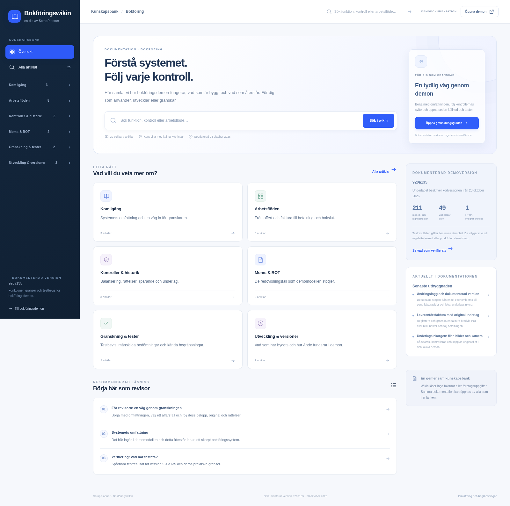
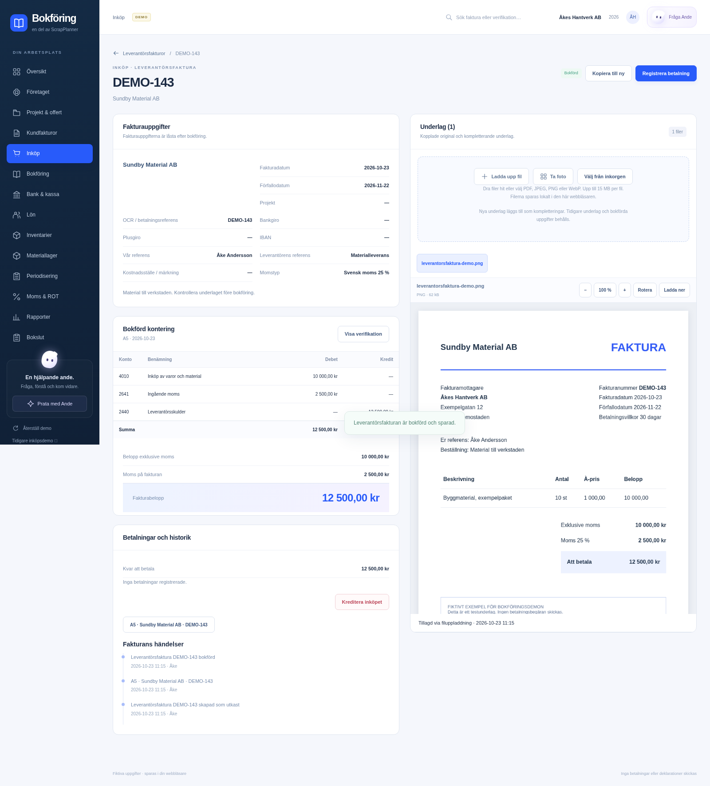
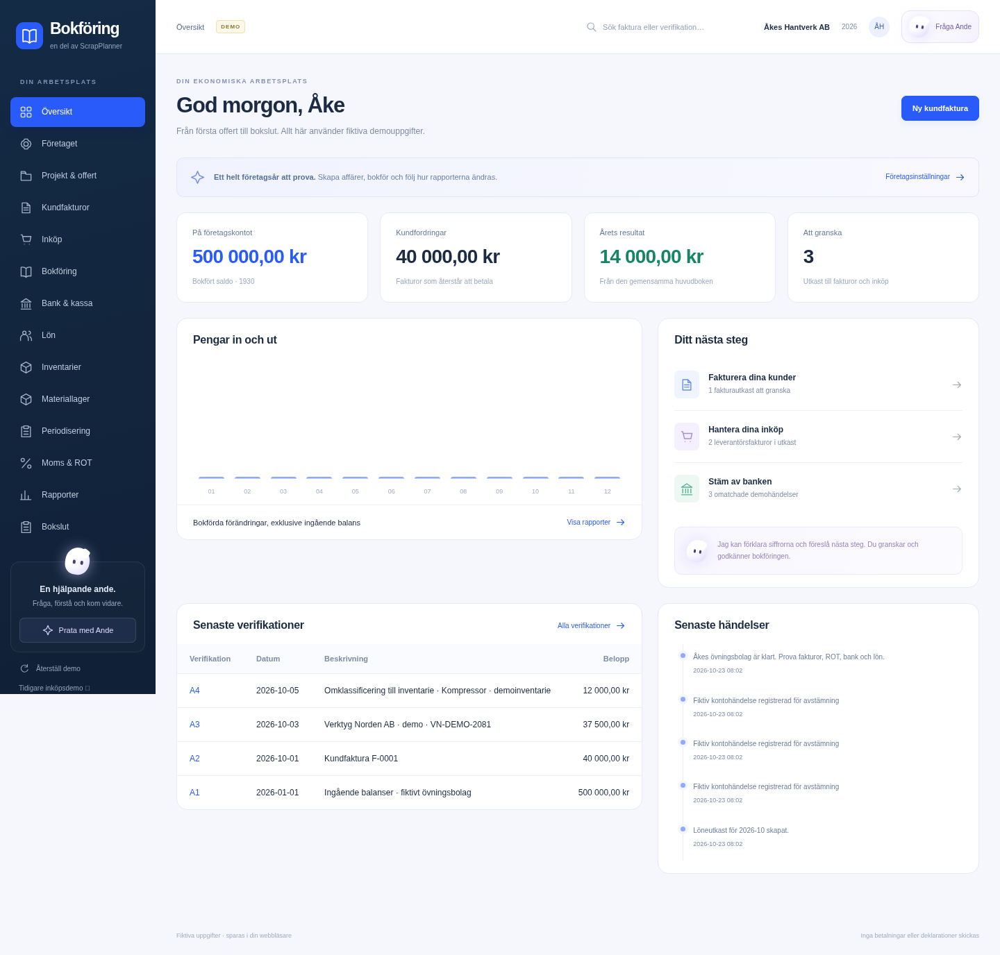
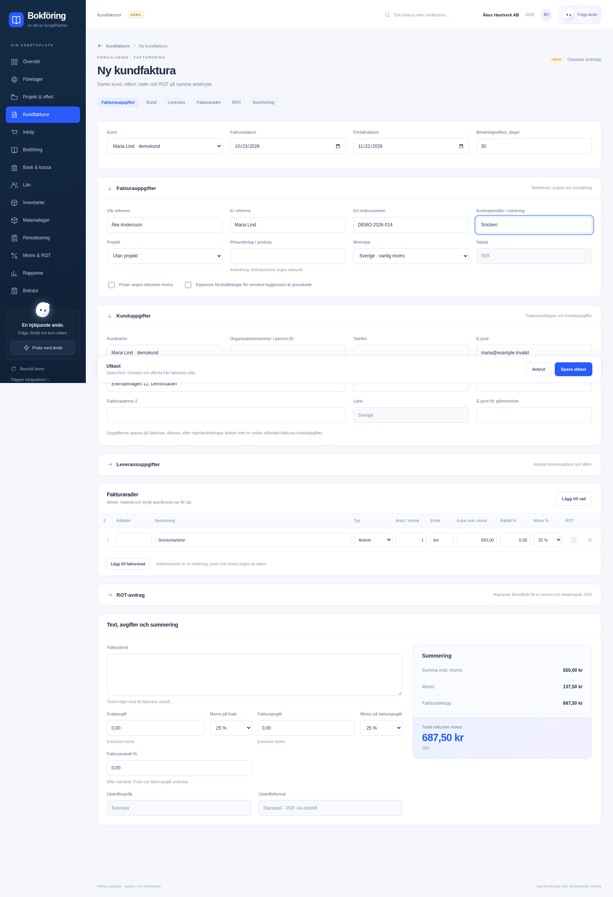
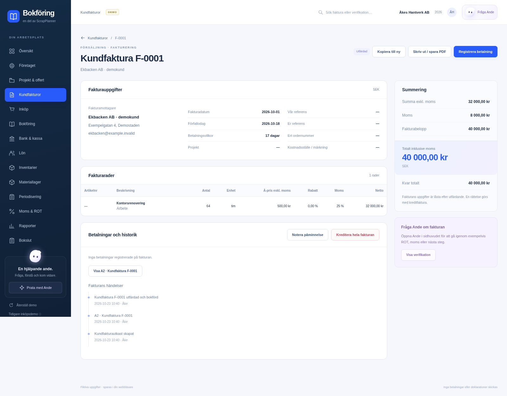

# Bokföring

Här samlas designförslag för ett **fristående bokföringsprogram med egen webbapp, eget API och en AI-assistent**. Skrotappen är en tänkt ansluten källa; bokföringsprogrammet ska även kunna användas självständigt och ta emot underlag från andra system.

**Nytt: [Tio mockuper för hela ekonomiarbetet i Åkes Hantverk AB](helhet-mockups/README.md)** – företagsstart, offert och faktura, inköp, betalningar, lön, inventarier, moms och bokslut i en sammanhängande designserie. Bilderna visar planerad funktionalitet; de första tio stilförslagen finns kvar nedan.

**Status 2026-10-23:** en utökad ekonomidemo är kodad i `public/bokforing/suite/`. Kund- och leverantörsfakturor har egna arbetsytor. Flerkontering, krediter/återbetalningar, individuella löner, utökad moms/ROT, kommersiella flöden och fortsatt bokföring nästa år delar samma verifikationsbok. Uppgifterna är fiktiva och sparas lokalt. Den tidigare inköpsdemon och bildmockuperna bevaras. En GitHub-push måste följas upp mot faktisk deploystatus: automatisk deploy innebär inte att versionen redan är live.

### Den senaste utbyggnaden

- **[Krediter och återbetalningar](https://app.scrapplanner.com/bokforing/#settlements):** delkrediter, krediter efter betalning, återbetalningar och kvittning mellan samma motparts fakturor. Originalen bevaras. ROT och intäktsperiodiserade kundfakturor spärras tills särskilda återföringsflöden finns.
- **Leverantörsfakturor:** flera konteringsrader med individuell momssats, momstyp och avdragsandel. Blandad svensk moms, momsfritt och omvänd byggmoms kan kombineras.
- **[Individuell lön](https://app.scrapplanner.com/bokforing/#payroll-v2):** versionerade officiella 2026-tabeller, profiler, individuell frånvaro/semester/förmån, komplettering, bokföring, utbetalning och vissa rättelser. [Exakt löneomfattning](lon-regler-och-avgransning.md).
- **[Moms och ROT](https://app.scrapplanner.com/bokforing/#tax-v2):** klassificerade betalda EU-/utlandsaffärer och importmoms, deklarationsfält, periodval och fastställande. ROT kan fördelas på flera personer och delas upp efter kundbetalningar, med beslut, utbetalningar och återkrav. [Omfattning och gränser](moms-och-rot-utbyggnad.md).
- **[Artiklar och avtal](https://app.scrapplanner.com/bokforing/#commercial):** artikelregister, kundpriser, återkommande fakturautkast, påminnelseunderlag, lageruttag till projekt och intäktsperiodisering. Pågående arbeten har ett dokumenterat bedömningsunderlag. [Kommersiella flöden](utveckling/kommersiella-floden.md).
- **[Bokslut och nästa år](https://app.scrapplanner.com/bokforing/#year-end):** versionshistorik för bokslutsbilagor, granskningsunderlag för bolagsskatt/årsredovisning och fortsatt bokföring med bevarade äldre år, öppna fakturor och planer. [Årshantering](bokslut-och-rakenskapsar.md).
- **Ande:** [arkitektur för personlig assistent per kundbolag](ai-ande-saas.md). Detta är en plan; extern AI, bolagsavgränsad serveråtkomst och personligt minne är inte anslutna i demon.

Flera valutor och kontantmetoden är fortfarande planerade. [Den tekniska genomgången](utveckling/valuta-och-kontantmetod.md) beskriver vilka beräkningar, modelländringar och provfall som behövs; inga tomma valutaval eller metodväxlingar har aktiverats.

## Sökbar wiki för användare och granskare

Den klickbara wikimockupen finns efter publicering på **https://app.scrapplanner.com/bokforing/wiki/** och öppnas även via **Wiki & granskning** i appmenyn. Den innehåller 27 artiklar inom sex områden: kom igång, arbetsflöden, kontroller, moms/ROT, granskning och utveckling.

Sök på exempelvis `radera faktura`, `ROT`, `underlag` eller `sparfel`, filtrera på område och dela länken till en enskild artikel. **För revisorn** ger en läsordning från omfattning och kända begränsningar till konkreta flöden, kod och tester. Artiklarna skiljer mellan implementerat i demon, avgränsade funktioner, planerat arbete och guider.

Wikin är en publik läsvy. Den läser inte besökarens bokföring, dokumentdatabas eller företagsuppgifter och ger inga granskningsgodkännanden. Beskrivningarna och testantalen avser uttryckligen demoversion `c5134ec`; källänkar till kod och dokumentation är låsta till samma version. Det är dokumentation av programmets funktion, inte ett revisionsutlåtande.

Innehållet underhålls i [wiki/content.js](../public/bokforing/wiki/content.js), separat från layout och sökning. Vid nya funktionsändringar ska berörda artiklar, begränsningar, versionsreferens och testbevis uppdateras tillsammans. Det finns ännu inget redaktörsgränssnitt eller gemensamma granskningsanteckningar.

[Granskningsguiden](preview/wiki-granskning.png) · [Wiki på mobil](preview/wiki-mobil.png)

Wikietappen är lokalt verifierad med produktionsbygge, ett HTTP-integrationstest och sju browserfall: sex för wikin och en befintlig mobilregression för bokföringsappen. Sökning, delbara adresser, filter, källor, statusar och isolering från bokföringsdata ingår.

## Klickbar demo

Efter publicering öppnas den utökade versionen på **https://app.scrapplanner.com/bokforing**. Den tidigare inköpsversionen finns då på `/bokforing/klassisk.html` med sina tidigare sparade exempel. Ingen inloggning, betalning eller extern anslutning behövs för att prova ekonomidemon.

| Område | Vad som går att prova |
| --- | --- |
| Företaget | Bolagsuppgifter, momsperiod och ingående balanser. Startbolaget använder kalenderår 2026, SEK och faktureringsmetoden. Efter årsavslut kan nästa räkenskapsår öppnas med bevarad historik. |
| Projekt och offert | Kunder, projekt, tid/material, offert, registrerat kundgodkännande och fakturautkast från offert. Lageruttag kan kopplas till projektmaterial; pågående arbeten har ett separat bedömningsunderlag. |
| Artiklar och avtal | Artikelregister, kundpriser och fakturautkast med frysta prisuppgifter. Återkommande planer skapar utkast en gång per period. Daterade påminnelseunderlag sparas utan att något skickas. |
| Kundfakturor | Egna fakturasidor, kund-/leveransuppgifter, referenser, villkor, artikelnummer/enhet, rabatter, avgifter och pris inklusive/exklusive moms. Utfärdande med verifikation och fakturanummer, kopia till nytt utkast, utskrift/spara som PDF och delbetalningar. |
| Krediter och återbetalningar | Separata kreditnotor för hela eller delar av fakturarader, även efter betalning, samt återbetalning och kvittning för samma motpart. Originalfakturans uppgifter bevaras. ROT och intäktsperiodiserade kundfakturor kräver särskilda återföringsflöden och spärras här. |
| ROT | Markerade arbetsrader efter rabatt och beräkning för betalningsår 2026. Det reserverade totalbeloppet kan fördelas på flera personer och begäras i delar efter kundbetalning. Demobeslut, avslag, skatteutbetalning och återkrav kan följas. Material, resor och avgifter ingår inte i ROT-underlaget. [Aktuell omfattning](moms-och-rot-utbyggnad.md). |
| Inköp | Egna leverantörsfakturasidor med underlagsvisare, lokal fil-/kamerainkorg, dokumentkoppling, kontakt-/betalningsreferenser och redigerbara utkast. Flera konteringsrader med individuell momssats, avdragsandel och vanlig moms, momsfritt eller bekräftad omvänd byggmoms. Bokföring och delbetalning samt separat kredit-/återbetalningsflöde. |
| Bank, kassa och skatt | Fiktiva kontohändelser, matchning, betalning mot befintlig händelse, avgifter, kassa-/skatteöverföringar, lån och ränta. |
| Bokföring | Gemensam huvudbok, manuella verifikationer inom stödda konton, balansering, bevarade original och länkade rättelser. Dokumentstyrda konton hanteras i sina egna flöden. |
| Lön | Individuella löneprofiler, stödda officiella skattetabeller för 2026, månads-/timlön, frånvaro, semester, förmåner, utlägg och kompletteringar. Lönebesked, bokföring, demoutbetalning, skattereglering och vissa rättelser. AGI exporteras som gransknings-CSV; se löneområdets uttryckliga gränser. |
| Inventarier | Omklassificering av ett redan bokfört utrustningsinköp, nyttjandeperiod, månadsavskrivning, utrangering och försäljning. |
| Materiallager | Artiklar, inleveranser, uttag, inventering och periodisk lagervärdering med bokföringsunderlag. Ett projektuttag minskar lagret och skapar en kopplad materialrad utan dubbel kostnadsbokning. |
| Periodisering | Förutbetalda kostnader och intäkter med spårbara månadsplaner, exakt fördelning i ören och kontroller före period-/årsavslut. Planer kan fortsätta över årsskifte. |
| Moms och rapporter | Momsunderlag med verifikationskoppling, stödda klassificerade betalda EU-/utlandsaffärer och importmoms, deklarationsfält, fastställande och reglering via skattekonto. Resultat, balans, jämförelse mellan räkenskapsår och gransknings-CSV. |
| Avslut och granskning | Avstämningschecklista, periodlåsning, dokumenterad upplåsning, versionerade bokslutsbilagor och bokning av årets resultat. Nästa år kan öppnas med bevarad historik, reskontra och planer. Granskningspaket samt bolagsskatte- och årsredovisningsunderlag är arbetsmaterial. |

### Fakturering på egna sidor

**Kundfakturor** visar listan. Klick på en faktura öppnar dess egen sida med uppgifter, summering, betalningar och historik. **Ny kundfaktura** öppnar en stor arbetsyta med sektioner för villkor, kund, leverans, fakturarader, ROT och avgifter. En varning skyddar osparade ändringar när du lämnar arbetsytan.

Spara först ett utkast. Från fakturans sida kan du granska och utfärda, registrera betalning, kopiera till nytt utkast eller skriva ut/spara PDF. Utfärdade uppgifter fryses; en rättelse sker genom det kreditflöde som stöds. Kund- och säljaruppgifter på nya fakturor sparas som egna dokumentuppgifter, så senare registerändringar inte ändrar återutskriften. Äldre sparade demofakturor kan fortsatt öppnas utan reset.

Artikelnummer, enhet, referenser och leveransuppgifter är dokumentuppgifter. Rabatter, avgifter och prisets momsgrund påverkar beräkningen, moms, ROT-underlag och verifikation. Kostnadsställe är ännu märkning utan egen dimensionsrapport. Artikelregistret och kundpriserna kan skapa fakturautkast med frysta prisuppgifter.

Se [den tidigare jämförelsen med Fortnox-bilderna](fakturering-jamforelse.md) för utgångsläget före den senaste etappen. OCR-generering, kontantfaktura, flera valutor och RUT återstår. Återkommande fakturautkast och intäktsperiodisering finns nu i Artiklar & avtal.

### Leverantörsfakturor och inkomna underlag

**Inköp → Inkomna underlag** öppnar en lokal inkorg. Välj **Ladda upp fil**, dra in filer eller använd **Ta foto** på en mobil som stöder kameravalet. PDF, JPEG, PNG och WebP stöds: högst 15 MB per fil, 10 filer åt gången, 100 MB totalt och 20 kopplade underlag per faktura. Identiska filinnehåll känns igen med SHA-256 även om filnamnet är ett annat.

Från ett okopplat underlag kan du välja **Skapa fakturautkast** eller **Koppla till befintlig**. En påminnelse eller komplettering ska kopplas till den befintliga fakturan i stället för att registreras som en ny skuld. Nytt och redigerat utkast öppnas på egen sida, med originalunderlaget bredvid fakturauppgifter och konteringsförslag på större skärmar. Bilder kan zoomas och roteras i visningen; originalfilen ändras inte. PDF visas med webbläsarens PDF-stöd och kan laddas ned.

Fyll uppgifterna manuellt och spara utkastet innan du granskar och bokför. Flera konteringsrader kan ha olika konton, momssatser, momstyper och avdragsandelar. Ingen OCR-/AI-tolkning eller e-postmottagning är ansluten. OCR/betalningsreferens, bankgiro, plusgiro och IBAN är sparade dokumentuppgifter; de validerar inte betalningsmottagaren och utlöser ingen betalning. Kostnadsställe är märkning, inte en färdig redovisningsdimension. Verklig fleranvändarattest återstår. Kreditnotor, återbetalningar och kvittning hanteras i **Krediter & återbetalningar**.

Kopplade originalfiler kontrolleras vid sparande och bokföring. Efter bokföring kan fler underlag läggas till som kompletteringar med historik, utan att ursprungliga uppgifter, bilagor, verifikation eller skuld skrivs om. Utkast kan få underlag bortkopplade; filer som är kopplade till sparade fakturor kan inte tas bort genom inkorgen. En fakturakopia får varken det gamla fakturanumret, originalets underlag eller betalningar.

Filerna ligger separat i IndexedDB-databasen `scrapplanner-bokforing-documents-v1`; fakturadata innehåller dokumentens metadata och kopplingar. **Återställ demo återställer bokföringen och tar bort kopplingarna, men behåller uppladdade filer i inkorgen.** Filerna kan därefter kopplas på nytt eller tas bort som okopplade underlag. Rensad browserdata kan ta bort dem. Detta är ingen serverarkivering eller garanti för långsiktigt bevarande.

Se [leverantörsflödet och de tidigare förslagen för övriga arbetsytor](leverantorsfakturor-och-arbetsytor.md) för utgångsläget. Den senaste etappen tillför egna arbetsytor för lön, moms/ROT, krediter, artiklar/avtal och bokslut. Verifikationssidan, projekt-/offertredigering och bankavstämning har fortfarande utrymme för mer detaljerade arbetsflöden.

Prova uppladdningen med [ett fiktivt fakturaunderlag](exempel/leverantorsfaktura-demo.png). Spara bilden och välj den i **Inkomna underlag**, skapa sedan ett utkast och ange fakturans uppgifter. Bilden är märkt som testunderlag och innebär ingen verklig betalningsbegäran.

[Ny leverantörsfaktura](preview/leverantorsfaktura-ny.png) · [Mobilvy](preview/leverantorsfaktura-mobil.png) · [Underlagsinkorg](preview/underlagsinkorg.png)

Skärmbilder från den körbara ekonomidemon:

[Öppna fakturans mobilbild](preview/faktura-mobil.png) eller [ekonomiöversikten på mobil](preview/ekonomi-mobile.png). Den tidigare [ROT-bilden](preview/ekonomi-rot.png) visar gränssnittet före ombyggnaden av fakturasidorna.

### Prova ett sammanhängande ROT-flöde

Detta exempel använder grundflödet för en person. Flerpersonsfördelning, delbegäranden och återkrav provas i den nya arbetsytan **Moms & ROT** enligt [dess dokumenterade flöde](moms-och-rot-utbyggnad.md).

1. Öppna **Kundfakturor** och välj ROT-utkastet för Maria. Arbete 17 600 kr, material 8 000 kr och resa 800 kr ger 33 000 kr inklusive moms.
2. Granska och utfärda fakturan. Planerat ROT blir 6 600 kr och kundens del 26 400 kr.
3. Registrera kundbetalningen på 26 400 kr. Förbered sedan demobegäran och bekräfta utfört arbete samt elektronisk betalning.
4. Registrera ett demobeslut: 6 600 kr för fullt godkännande eller exempelvis 5 000 kr för delvis avslag.
5. Registrera skatteutbetalningen. Vid ett beslut på 5 000 kr ligger 1 600 kr kvar att få från kunden. Följ samma belopp i huvudboken och rapporterna.

På **Bank & kassa** finns också tre omatchade exempel. Kund- och leverantörsbetalningarnas formulär kan använda en befintlig kontohändelse, så att en andra händelse inte skapas för samma betalning. Bankavgiften bokförs direkt i bankvyn.

### Kontroller och sparande

Modellen kräver balanserade konteringar, giltiga datum och konton samt heltalsbelopp i ören. Den stoppar bland annat dubbla källbokningar, överbetalning, bokning i låsta perioder, samma ROT-utrymme på flera demofakturor och ändring/radering av befintliga verifikationer genom programmets funktioner. Utfärdade fakturor fryses och rättas med kredit. Behandlingshistoriken registrerar modellåtgärder; den är inte en extern revisionslogg.

Sparade uppgifter kontrolleras även mot fakturor, reskontra, betalningar, löner, inventarier, lager, periodisering och moms. Två uppdaterade flikar samordnas med Web Locks och lagringsrevision. En ändring visas som sparad först efter lyckad skrivning och återläsning. Vid konflikt eller sparfel visas en banner; läs in senaste innan du fortsätter. Ogiltiga tidigare data bevaras tills du uttryckligen väljer reset.

Den utökade versionen använder nyckeln `scrapplanner-bokforing-suite-v2`. Den tidigare inköpsdemons nyckel `scrapplanner-bokforing-demo-v1` lämnas orörd. **Återställ demo** kräver bekräftelse och ersätter den nya versionens fiktiva bokföringsdata. Uppladdade filer i den separata dokumentdatabasen behålls, medan kopplingarna till fakturorna återställs. Browserlagring och modellkontroller skyddar inte mot en person som ändrar data direkt i webbläsaren.

### Den här versionens gränser

Detta är en sammanhängande testversion med avgränsade affärsfall, inte ett färdiggranskat redovisningsprogram för skarp drift. Ande ger exempelbaserade förklaringar; ingen extern språkmodell eller auktorisation ingår. Lönearbetsytan har officiella tabeller 29–42, kolumn 1/3, för stödda 2026-fall upp till 80 000 kr/månad. Profiler, avtal och faktisk rätt till avdrag kräver bedömning. Full semesterintjäning, kollektivavtal, pension, negativa rättelser efter utbetalning och ytterligare skattesituationer återstår.

Grundfakturans ROT-beräkning använder en person. Den nya ROT-arbetsytan kan fördela fakturans redan reserverade totalbelopp på upp till tio personer, utan att öka totalen, och förbereda proportionella delbegäranden. Stöd finns för betalningar under 2026 och begäran till januari 2027; andra betalningsår är spärrade. Faktisk avdragsrätt, ägande och skatteutrymme verifieras inte. RUT, generella ROT-krediter och mer omfattande husarbetsfall återstår.

Materiallager värderas som handelsvaror på 1460/4960. Projektuttag kan kopplas till lagerrörelser, men pågående arbeten har bara bedömningsunderlag och ingen automatisk värderingsmotor. Upplupna kostnader kan behöva granskad manuell verifikation. Utlands-/momsstödet omfattar angivna klassificerade betalda affärer, inte varje internationellt fakturaflöde. Flera valutor och kontantmetoden saknas. Kredit-/återbetalningsflödet behåller signerade saldon i reskontran; automatisk bokslutsomklassificering av kundtillgodon och leverantörsfordringar återstår.

Granskningspaket, AGI-CSV, bolagsskatteberäkning och årsredovisningsunderlag är arbetsmaterial. De är inte färdiga myndighetsfiler, en komplett K2/K3-årsredovisning eller inkomstdeklaration. Nästa räkenskapsår kan öppnas utan att historiken återställs. Den lokala filinkorgen ersätter inte serverlagring, behörigheter, e-postmottagning, långsiktig arkivering, säkerhetskopiering, SIE eller externa API-/myndighetsanslutningar. Ingen full regelefterlevnad eller extern redovisningsgranskning är verifierad.

### Körning och verifiering

Bygg med `npm run build` och starta med `npm start`. [Driftguiden](../docs/drift/README.md#uppdatera-och-kontrollera) beskriver separat publicering på Render. Inga nya miljövariabler, databasändringar eller produktionsanslutningar införs.

Modell- och lagringstester finns i `server/bokforing-*.test.mjs`. Browserproven i `tests/bokforing-*.spec.ts` omfattar även de nya arbetsytorna för krediter, individuell lön, moms/ROT, kommersiella flöden och årshantering. Regressionstesterna för den tidigare versionen är kvar. Se även [provgranskningen av den äldre versionen](granskning/2026-10-22.md) och dess [uppföljning](granskning/2026-10-22-uppfoljning.md).

**Verifierat för den senaste utbyggnaden 2026-10-23:** produktionsbygge, slutlig typkontroll, 320 modell-/lagringstester, ett isolerat HTTP-test och 75 unika browserfall mot byggd app/server. Ett längre lagerprov nådde först sin tidigare totalgräns; samma prov passerade med längre tidsmarginal och oförändrade kontroller. [Verifieringsrapport och körinstruktioner](granskning/2026-10-23-utbyggnad.md).

**Historisk verifiering av leverantörsetappen 2026-10-23:** produktionsbygge, 211 modell-/lagringstester inklusive den tidigare demon, ett HTTP-integrationstest och 49 browserfall mot den då byggda servern. De antalen gäller etappen före den senaste funktionsutbyggnaden. Proven täckte egna kund- och leverantörsfakturasidor, PDF/bilder, riktig IndexedDB-lagring, dubbletter, filgränser, kvotfel, ändrade original, bilagekomplettering utan ny skuld, osparade ändringar och sena svar efter navigering/reset. Tidigare betalnings-, kredit-, ROT-, löne-, moms-, lager- och periodiseringsflöden ingick också. Drag och släpp samt visning vid 1600 och 390 pixlar provades manuellt utan JavaScript-fel eller horisontellt sidöverflöde. Kameraprovet använde filinput med kameraattribut; fysisk kamerahårdvara provades inte. Detta är teknisk verifiering av demofallen, ingen redovisningscertifiering.

## Tidigare inköpsdemo

Den ursprungliga versionen verifierades på app-domänen 2026-10-22. Efter publicering av den nya ekonomidemon ligger den tidigare versionen på **https://app.scrapplanner.com/bokforing/klassisk.html**.

- Översikt med beräknade nyckeltal och senaste verifikationer.
- Underlagsinkorg och fakturavy med redigerbara konteringsrader.
- Demobokföring som kontrollerar belopp, moms, balans och underlagsversion samt stoppar dubbel bokföring.
- Huvudbok, bankmatchning, momsunderlag och rapporter som följer demobokens poster.
- En svävande demoassistent med kontextfrågor och exempelbaserade svar.
- Sparat demoläge i den egna webbläsaren och möjlighet att återställa exemplen.

Rättningarna begränsar inköpseditorns kontoval till det stödjade inköpsfallet och kontrollerar kostnadsnetto, skuld och tillåtna momsrader även i bokföringsfunktionen. En vanlig inköpsfaktura kan exempelvis inte få extra omvända momsrader eller bokas som en ökning av bankkontot. Ande ligger i reserverad plats i sidhuvudet.

Sparandet samordnas mellan uppdaterade demoflikar med Web Locks och kontroll av aktuell lagringsrevision. En gammal flik får inte skriva över nyare demodata. En bokning visas som genomförd först efter lyckad skrivning och återläsning. Vid konflikt, sparfel eller osäker kvittens pausas skrivningen med en synlig banner och **Läs in senaste demodata**. Den åtgärden återställer osparade ändringar i editorn. Ogiltiga äldre demodata bevaras tills användaren uttryckligen väljer reset.

Stäng och öppna äldre demoflikar efter publicering av rättningarna. Samordningen skyddar flikar som använder den uppdaterade koden; tidigare öppna versioner och direkt ändring av localStorage omfattas inte. Om webbläsaren saknar stöd för Web Locks visas demon i läsläge. Det är fortfarande browserlokal demodata, inte ett serverarkiv eller ett skydd mot manipulation.

Demon kräver ingen inloggning. Den använder en egen lagringsnyckel i webbläsaren och gör inga anrop till appens produktions-API:er, betalningstjänster eller externa AI-leverantörer. AI-svaren i denna version är exempelbaserade. Underlag och rapporter avser enbart Exempelbolaget AB.

Appservern mappar exakt `/bokforing` och `/bokforing/` till den fristående demosidan. Övrig autentisering och åtkomst till bolag ändras inte. Källkoden finns i [public/bokforing](../public/bokforing/).

Skärmbilder från den körbara demon:

Bygg med `npm run build` och starta med `npm start`. Appens vanliga driftinställningar gäller. Följ [driftguidens kontroll av Render-deploy](../docs/drift/README.md#uppdatera-och-kontrollera); faktisk version och deploystatus ska kontrolleras efter en GitHub-push oavsett om tjänsten använder automatisk eller manuell deploy.

Verifierat lokalt efter rättningarna: produktionsbygge, 48 modelltester, 23 lagringstester, sex pilotpolicytester och ett HTTP-integrationstest. Tio browserregressioner täcker bland annat två flikar, sparfel, osäker kvittens, reset och pekarklick på femradig kontering på dator/mobil. Se [uppföljningen med rättningar och avgränsning](granskning/2026-10-22-uppfoljning.md).

## Provgranskning av liveversionen

[Provrapport 2026-10-22](granskning/2026-10-22.md) beskriver 15 genomförda scenarier mot den ursprungliga liveversionen, inklusive medvetna fel, reset och mobilbokföring. Den bevaras som historiskt underlag för rättningarna ovan. Rapporten innehåller reproduktionssteg och en beskrivning för extern granskning. Ett godtyckligt sakligt fel mellan tillåtna kostnadsslag kan fortfarande kräva mänsklig bedömning; rättningarna är inte ett godkännande av full regelefterlevnad.

## Bildmockuper

Bildernas belopp, konton, förklaringar och statusar är fiktiva illustrationer och ska inte användas som redovisningsregler.

## Bildöversikt

Klicka på en bild för att öppna PNG-originalet. Numren 01–10 används när vi väljer och kombinerar favoriter.

| Förslag | Förslag |
| --- | --- |
| **01 · Nordisk översikt**  Klassisk ljus översikt med nyckeltal, kassaflöde och senaste verifikationer. | **02 · Grön avstämning**  Luftig bankavstämning med bankhändelser och bokföringsposter sida vid sida. |
| **03 · Mörk ekonomicockpit**  Mörk ekonomivy med resultat, prognos, periodstatus och avvikelser. | **04 · Underlag och kontering**  Fakturaunderlag och konteringsförslag sida vid sida med AI-förklaring. |
| **05 · Lugn arbetsdag**  Varm och uppgiftsstyrd startsida med tydligt nästa steg. | **06 · Huvudbok för proffs**  Tät huvudbok med filter, debet/kredit, dokumentlänkar och AI-hjälp. |
| **07 · Samtal med AI-anden**  Samtalsvy för frågor, källstödda förklaringar och förslag att granska. | **08 · Periodavslut steg för steg**  Guidad checklista för underlag, bank, reskontra, moms och periodavslut. |
| **09 · Förberett för granskning**  Granskningsvy med rapporter, öppna frågor, avstämningar och dokument. | **10 · Bokföring på språng**  Mobil granskning och godkännande tillsammans med en datorvy. |

## Alla bilder

| Nr | Bild | Inriktning |
| --- | --- | --- |
| 01 | [Nordisk översikt](mockups/01-nordisk-oversikt.png) | Klassisk ljus översikt med nyckeltal, kassaflöde och senaste verifikationer. |
| 02 | [Grön avstämning](mockups/02-gron-avstamning.png) | Luftig bankavstämning med bankhändelser och bokföringsposter sida vid sida. |
| 03 | [Mörk ekonomicockpit](mockups/03-mork-ekonomicockpit.png) | Mörk ekonomivy med resultat, prognos, periodstatus och avvikelser. |
| 04 | [Underlag och kontering](mockups/04-underlag-och-kontering.png) | Fakturaunderlag och konteringsförslag sida vid sida med AI-förklaring. |
| 05 | [Lugn arbetsdag](mockups/05-lugn-arbetsdag.png) | Varm och uppgiftsstyrd startsida med tydligt nästa steg. |
| 06 | [Huvudbok för proffs](mockups/06-huvudbok-for-proffs.png) | Tät huvudbok med filter, debet/kredit, dokumentlänkar och AI-hjälp. |
| 07 | [Samtal med AI-anden](mockups/07-samtal-med-ai-anden.png) | Samtalsvy för frågor, källstödda förklaringar och förslag att granska. |
| 08 | [Periodavslut steg för steg](mockups/08-periodavslut-steg-for-steg.png) | Guidad checklista för underlag, bank, reskontra, moms och periodavslut. |
| 09 | [Förberett för granskning](mockups/09-forberett-for-granskning.png) | Granskningsvy med rapporter, öppna frågor, avstämningar och dokument. |
| 10 | [Bokföring på språng](mockups/10-bokforing-pa-sprang.png) | Mobil granskning och godkännande tillsammans med en datorvy. |

## Fortsatt utveckling

Den klickbara demon kombinerar den ljusa översikten, arbetsytor för ekonomiarbetet och den svävande demoassistenten. Prova arbetsflödena före nästa designbeslut. Ett skarpt fristående system kräver bland annat eget server-API, behörigheter, beständig och spårbar bokföring, säker dokumentarkivering och redovisningsgranskning. Periodlåsning och flera andra kontroller finns i den lokala modellen, men serverstödd lagring och åtkomstkontroll återstår.

Bilderna ligger i [mockups/](mockups/). Övriga projektmockuper finns i [den gemensamma översikten](../docs/mockups/README.md).
