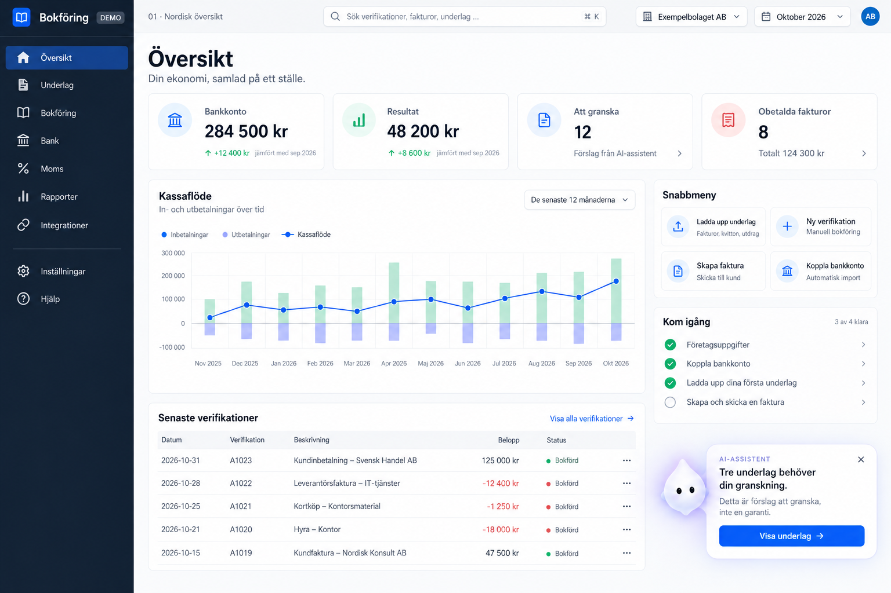
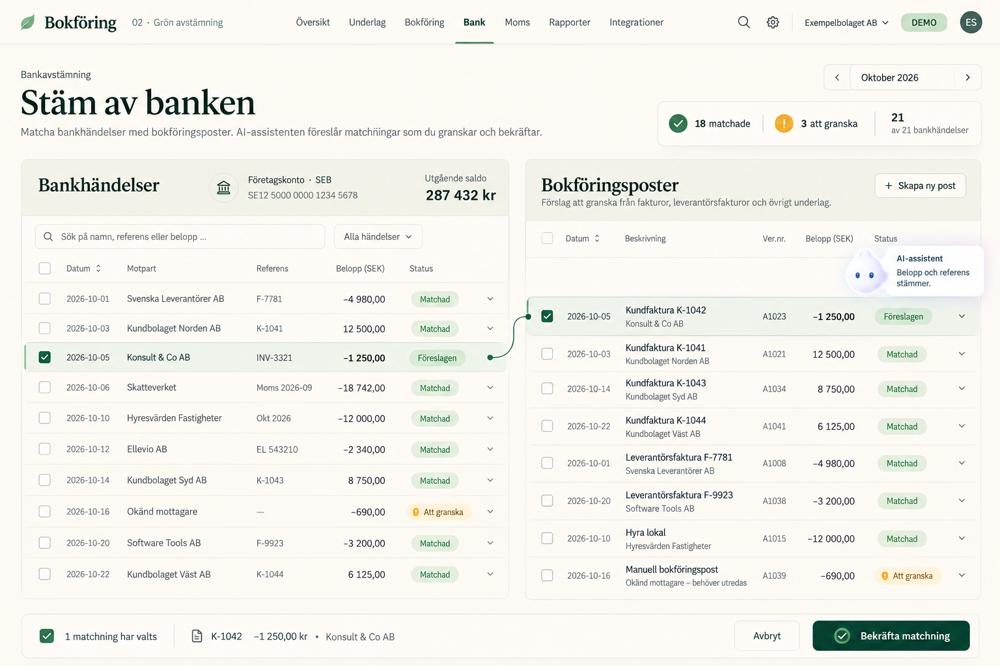
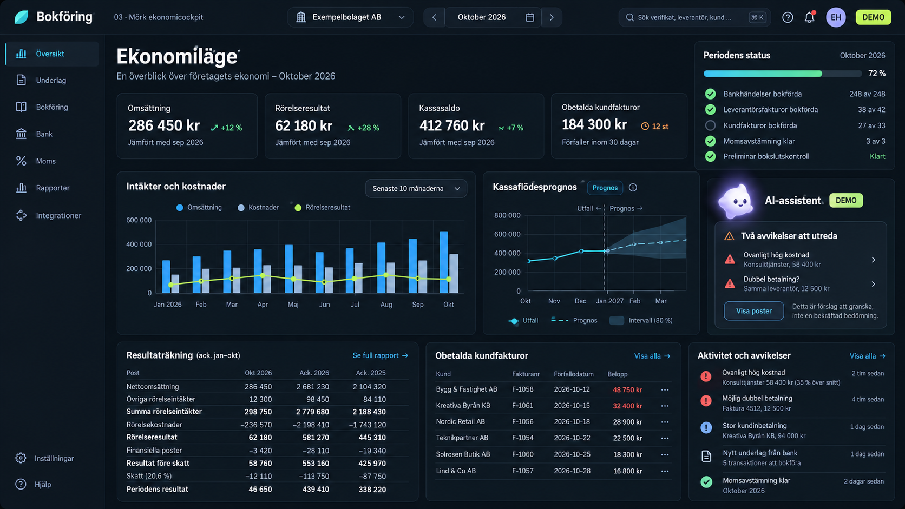
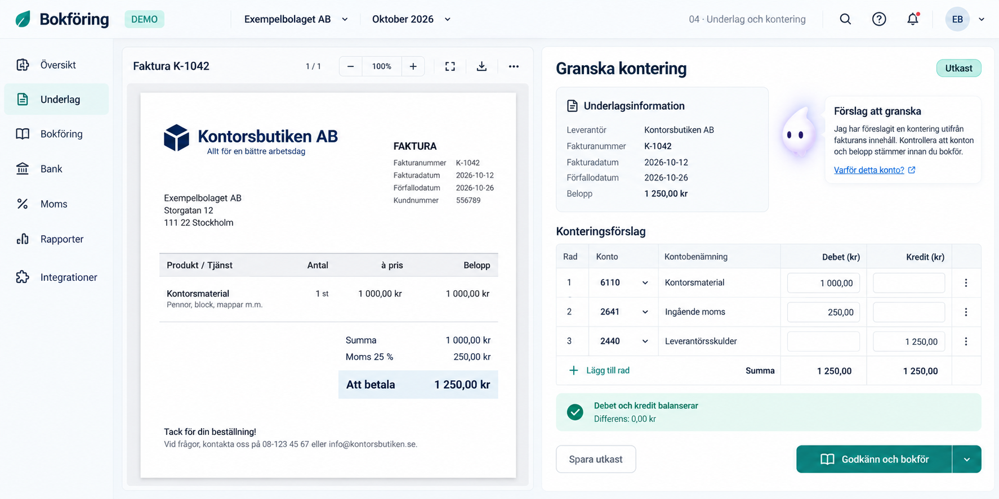
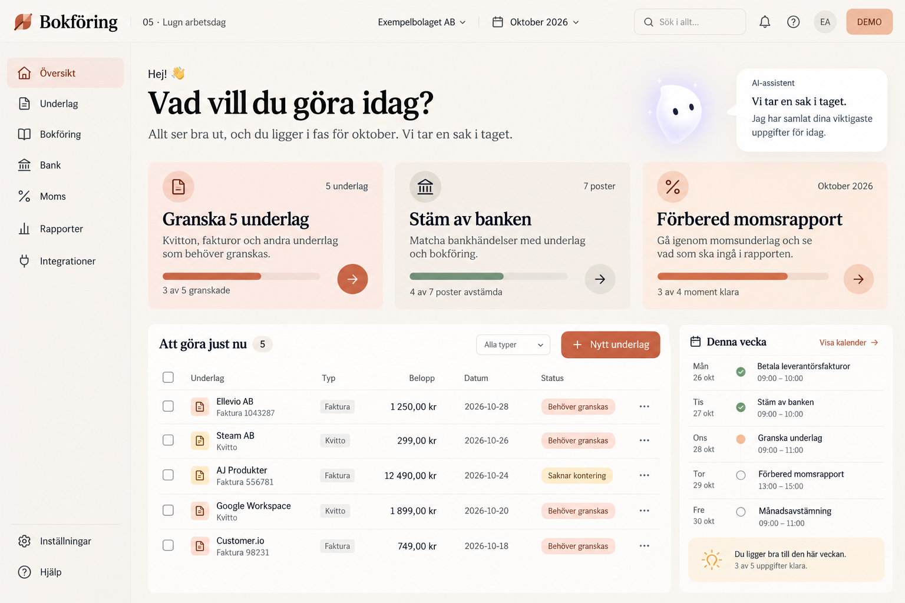
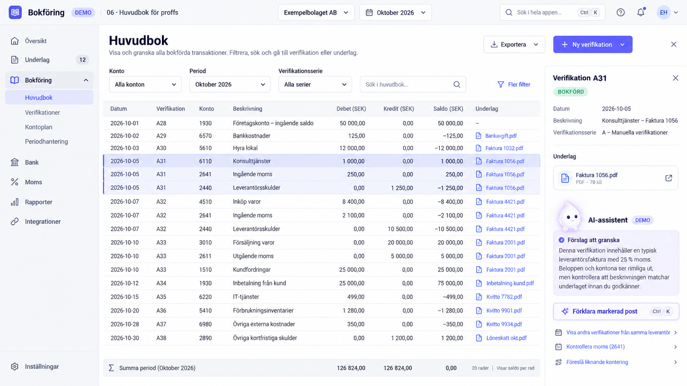
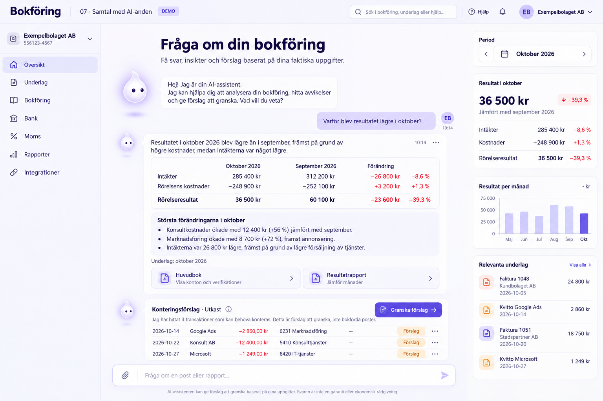
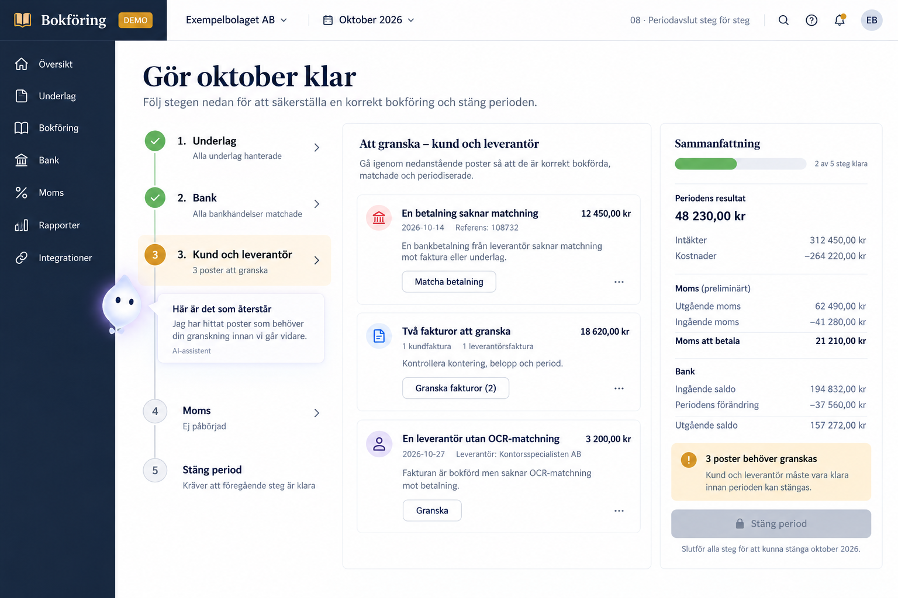
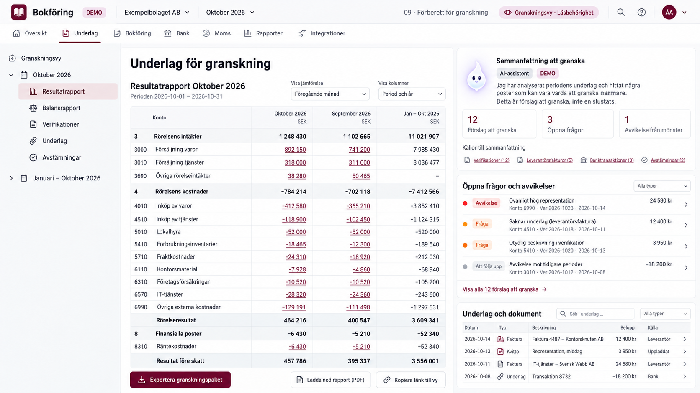
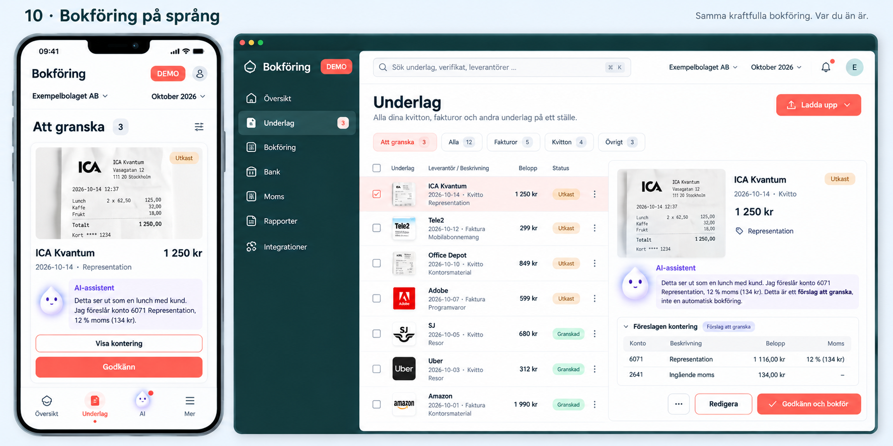

# Bokföring

Här samlas designförslag för ett **fristående bokföringsprogram med egen webbapp, eget API och en AI-assistent**. Skrotappen är en tänkt ansluten källa; bokföringsprogrammet ska även kunna användas självständigt och ta emot underlag från andra system.

**Status 2026-10-22:** tio statiska bildmockuper för val av utseende och arbetssätt. Detta är designunderlag inför en testversion, inte en implementerad bokföringsmodul. Bildernas belopp, konton, förklaringar och statusar är fiktiva illustrationer och ska inte användas som redovisningsregler.

## Bildöversikt

Klicka på en bild för att öppna PNG-originalet. Numren 01–10 används när vi väljer och kombinerar favoriter.

| Förslag | Förslag |
| --- | --- |
| **01 · Nordisk översikt**  Klassisk ljus översikt med nyckeltal, kassaflöde och senaste verifikationer. | **02 · Grön avstämning**  Luftig bankavstämning med bankhändelser och bokföringsposter sida vid sida. |
| **03 · Mörk ekonomicockpit**  Mörk ekonomivy med resultat, prognos, periodstatus och avvikelser. | **04 · Underlag och kontering**  Fakturaunderlag och konteringsförslag sida vid sida med AI-förklaring. |
| **05 · Lugn arbetsdag**  Varm och uppgiftsstyrd startsida med tydligt nästa steg. | **06 · Huvudbok för proffs**  Tät huvudbok med filter, debet/kredit, dokumentlänkar och AI-hjälp. |
| **07 · Samtal med AI-anden**  Samtalsvy för frågor, källstödda förklaringar och förslag att granska. | **08 · Periodavslut steg för steg**  Guidad checklista för underlag, bank, reskontra, moms och periodavslut. |
| **09 · Förberett för granskning**  Granskningsvy med rapporter, öppna frågor, avstämningar och dokument. | **10 · Bokföring på språng**  Mobil granskning och godkännande tillsammans med en datorvy. |

## Alla bilder

| Nr | Bild | Inriktning |
| --- | --- | --- |
| 01 | [Nordisk översikt](mockups/01-nordisk-oversikt.png) | Klassisk ljus översikt med nyckeltal, kassaflöde och senaste verifikationer. |
| 02 | [Grön avstämning](mockups/02-gron-avstamning.png) | Luftig bankavstämning med bankhändelser och bokföringsposter sida vid sida. |
| 03 | [Mörk ekonomicockpit](mockups/03-mork-ekonomicockpit.png) | Mörk ekonomivy med resultat, prognos, periodstatus och avvikelser. |
| 04 | [Underlag och kontering](mockups/04-underlag-och-kontering.png) | Fakturaunderlag och konteringsförslag sida vid sida med AI-förklaring. |
| 05 | [Lugn arbetsdag](mockups/05-lugn-arbetsdag.png) | Varm och uppgiftsstyrd startsida med tydligt nästa steg. |
| 06 | [Huvudbok för proffs](mockups/06-huvudbok-for-proffs.png) | Tät huvudbok med filter, debet/kredit, dokumentlänkar och AI-hjälp. |
| 07 | [Samtal med AI-anden](mockups/07-samtal-med-ai-anden.png) | Samtalsvy för frågor, källstödda förklaringar och förslag att granska. |
| 08 | [Periodavslut steg för steg](mockups/08-periodavslut-steg-for-steg.png) | Guidad checklista för underlag, bank, reskontra, moms och periodavslut. |
| 09 | [Förberett för granskning](mockups/09-forberett-for-granskning.png) | Granskningsvy med rapporter, öppna frågor, avstämningar och dokument. |
| 10 | [Bokföring på språng](mockups/10-bokforing-pa-sprang.png) | Mobil granskning och godkännande tillsammans med en datorvy. |

## Nästa designsteg

Välj en eller flera riktningar som grund för den klickbara testversionen. Layout, konteringsvy, AI-samtal och mobilvy kan kombineras. AI-assistentens förslag ska skiljas från godkända och bokförda poster i den fortsatta implementationen.

Bilderna ligger i [mockups/](mockups/). Övriga projektmockuper finns i [den gemensamma översikten](../docs/mockups/README.md).
