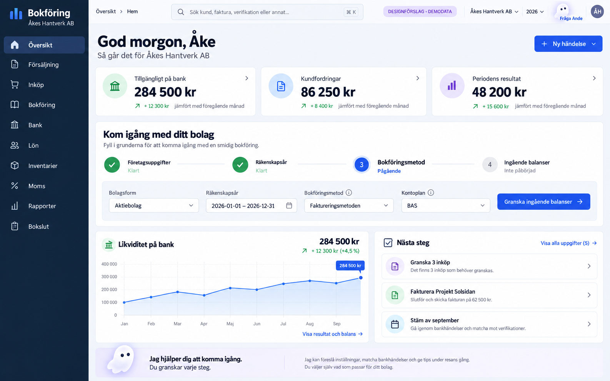
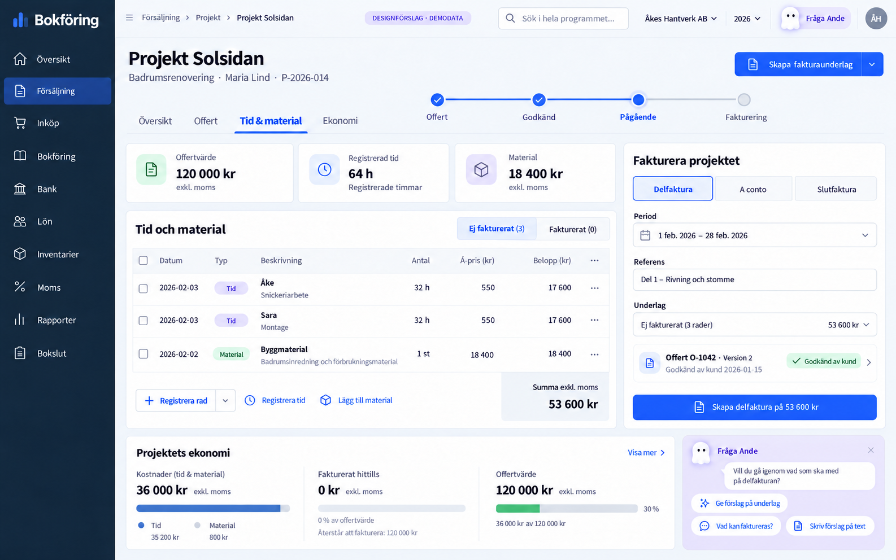
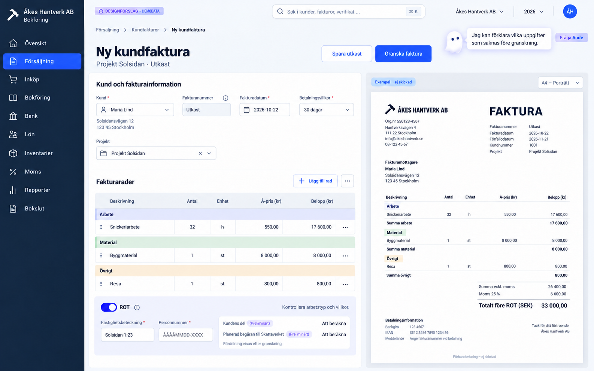
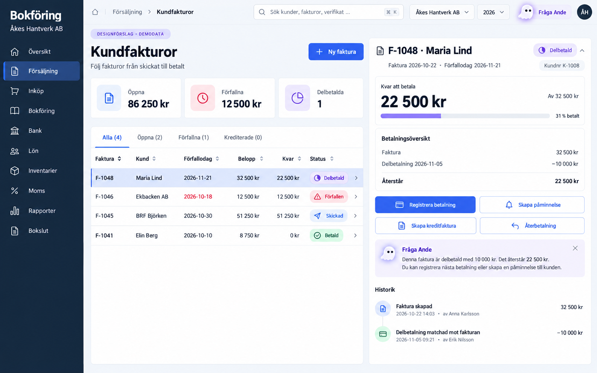
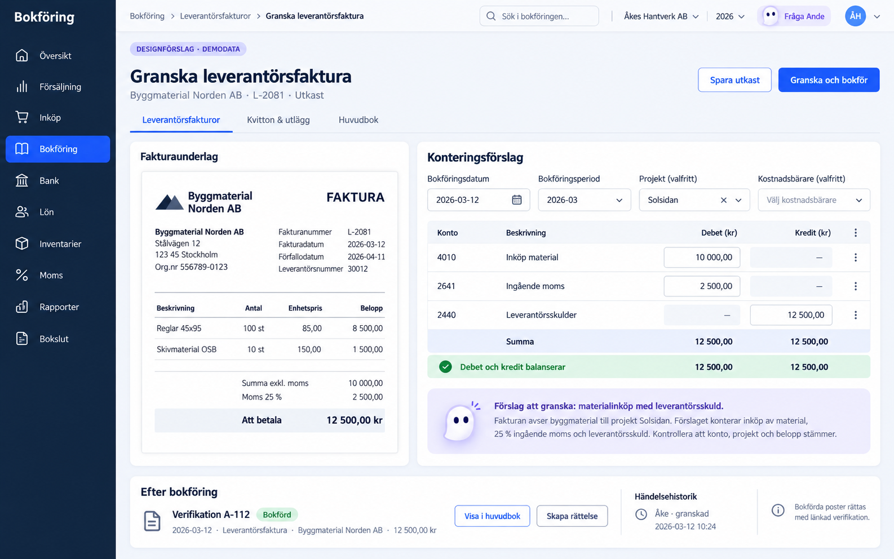
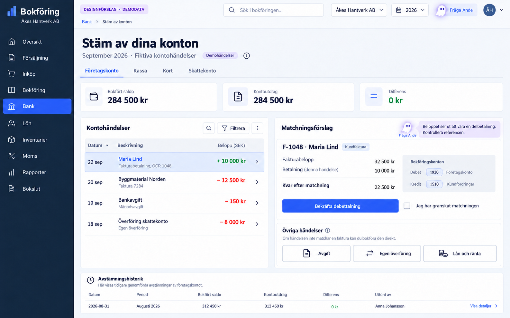
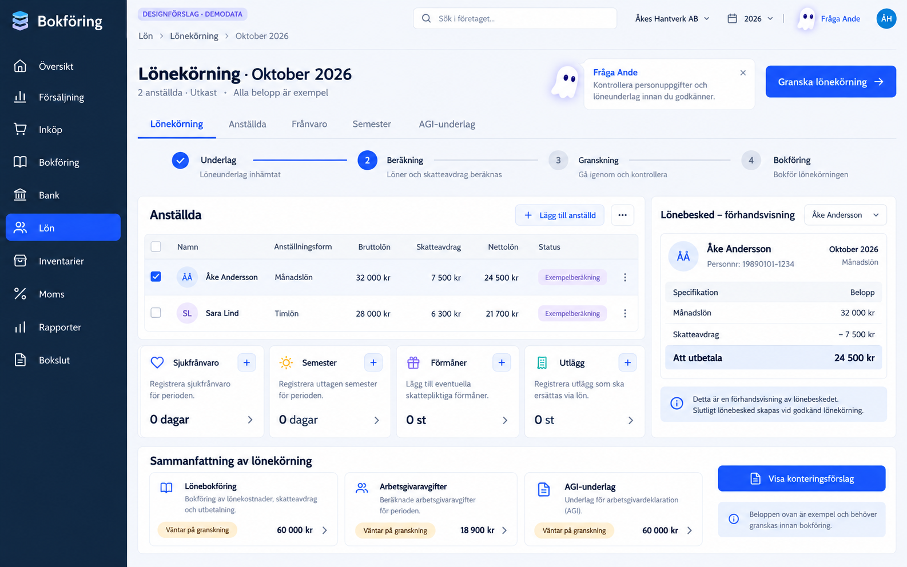
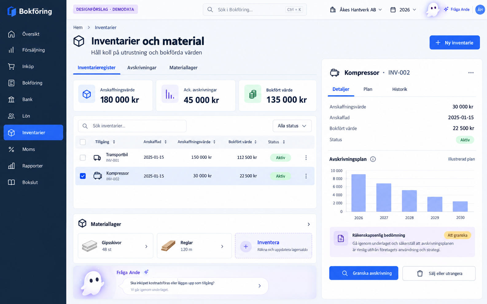
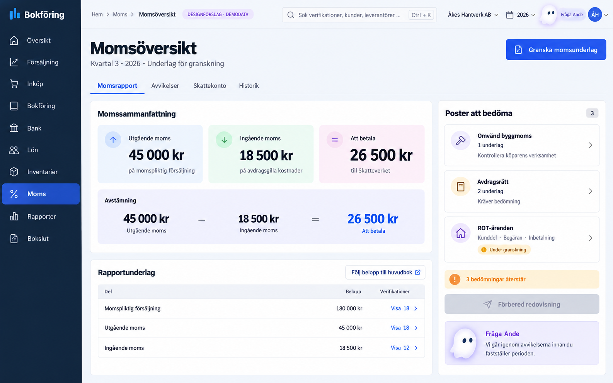
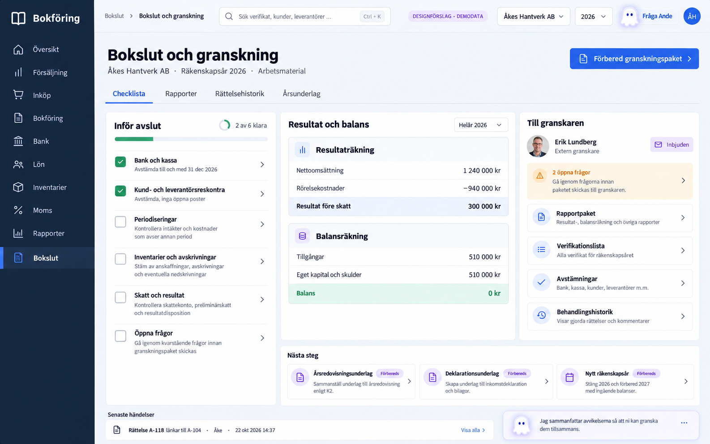

# Tio mockuper för företagets ekonomi

En sammanhängande designserie för ett planerat, fristående bokföringssystem med **Åkes Hantverk AB** som exempelbolag. Samma mörkblå meny, blå knappar och lavendelfärgade AI-assistent, Ande, följer arbetet från företagsstart till bokslut.

**Designförslag för planerad funktionalitet · Fiktiva uppgifter.** Bilderna visar produktens tänkta omfattning, inte vad som redan är implementerat. Belopp och statusar är fristående exempel i varje bild och ska inte stämmas av mellan skärmarna. Ande föreslår och förklarar; användaren granskar och fattar beslut.

[Till bokföringsprojektet och demon](../README.md) · [Öppna den klickbara demon](https://app.scrapplanner.com/bokforing) · [De första tio stilförslagen](../README.md#bildmockuper)

**Uppföljning 2026-10-23:** en sammanhängande ekonomidemo är nu kodad utifrån flödena. Se [aktuella funktioner och gränser](../README.md#klickbar-demo); denna sida behåller de ursprungliga designbilderna. Publicering på app-domänen görs separat.

## Åkes ekonomiarbete under året

Åke startar bolaget och lägger upp räkenskapsåret, lämnar offerter, registrerar tid och material och fakturerar sina kunder. Inköp, kundbetalningar och löner bokförs och stäms av. Inventarier och moms följs upp innan perioder avslutas och årets rapporter förbereds för granskning.

## Bildgalleri

Klicka på en bild för att öppna PNG-originalet i full storlek.

| Företagets arbetsflöden | Företagets arbetsflöden |
| --- | --- |
| **01 · Företagsstart och översikt**  Bolagsuppgifter, räkenskapsår, bokföringsmetod och ingående balanser. En översikt samlar likviditet, periodstatus och nästa uppgift. | **02 · Offert, projekt och tid**  Offert och kundgodkännande följs av projektets tid, material och kostnader. Underlaget kan förberedas för del- eller slutfakturering. |
| **03 · Kundfaktura och ROT**  Fakturaredigering och förhandsvisning med arbete, material och övriga kostnader. Ett valbart ROT-flöde samlar uppgifter för bedömning och uppföljning. | **04 · Kundfordringar och betalningar**  Öppna, förfallna och delbetalda fakturor med betalningshistorik. Påminnelser, kreditfakturor och återbetalningar hör till samma kundflöde. |
| **05 · Inköp, kontering och huvudbok**  Leverantörsfakturor och utlägg kopplas till kontering, kontroll och betalningsstatus. Bokförda verifikationer kan följas till huvudbok och spårbara rättelser. | **06 · Bank, kassa och skattekonto**  Kontohändelser och bokföring möts i matchning och avstämning. Separata vyer för företagskonto, kassa och skattekonto visar det som behöver utredas. |
| **07 · Lön och AGI**  Månads- och timlön med frånvaro, semester och förmåner. Lönekörningen förbereder lönebesked, lönebokföring och arbetsgivardeklaration på individnivå. | **08 · Inventarier och materiallager**  Verktyg, maskiner och utrustning följs från anskaffning till avskrivning och avyttring. Materiallager får en egen vy för mängd, värde och rörelser. |
| **09 · Moms och skatteöversikt**  Momsunderlag med vägen tillbaka till varje verifikation. Omvänd byggmoms, avdragsbedömningar och andra granskningsfrågor får tydliga kontrollpunkter. | **10 · Bokslut, rapporter och granskning**  Avstämningar, periodiseringar, inventarier och skulder samlas inför avslut. Resultat, balans, rättelsehistorik samt årsredovisnings- och deklarationsunderlag förbereds för granskning. |

## Nästa steg

Använd bilderna för att välja arbetsflöden och prioritera den fortsatta utvecklingen. Den [klickbara demoversionens aktuella omfång](../README.md#klickbar-demo) beskrivs separat i projektets README.
