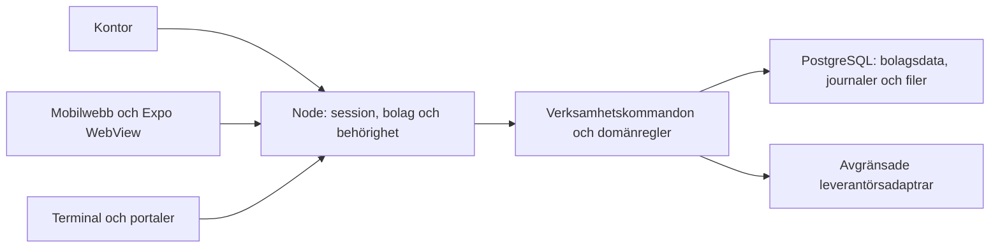

# Arkitektur och ansvar

ScrapPlanner är en modulär monolit: kontor, mobilwebb, portaler och API delar
en Node-tjänst och verksamhetsdatabas. Hemsidan i `website/` byggs separat.
[Drift](drift/README.md) · [Utveckling och prov](utveckling.md) · [ÄL](Andringslistan.txt).

## Modulgränser

| Ansvar | Plats och regel |
| --- | --- |
| Presentation och lokala formulär | `src/office/`, `src/pages/` och respektive portal; avgör inte serverns rättigheter |
| Delade schemas och beräkningar | Återexporteras av `server/domain-models.ts` och byggs till `dist-server/`; ingen separat kopia av affärsreglerna |
| Autentisering och bolagsval | Plattform, personalsessioner och `server/tenant-gateway.mjs`; bolag hämtas från betrodd serverkontext |
| Verksamhetskommandon | Servermoduler för kund, vägning, attest, miljö, personal och transport |
| Databastransaktioner | `server/database-runtime.mjs` och respektive repository; nästlade flöden delar korrekt kontext |
| Dokument och leveranser | Frysta underlag, beständiga jobb och respektive leverantörs egna regler för omförsök |
| Återhämtning i klienten | `src/shared-data.ts` och återhämtningshjälpen; en lokal kö ersätter inte serverns bekräftelse |

Domänregler återanvänds idag från bland annat `src/office/`. En senare
extraktion till ett neutralt domänområde ska bevara beteendet och göras i
små steg. Säkerhetsbeslut som kräver aktuell autentiserad kontext förblir
serveransvar även om klienten använder samma schemas eller behörighetsnamn.

## Garantier att bevara vid ändringar

- **Bolag och aktör:** servern väljer bolagsschema och kontrollerar faktisk
  och utförande användare. Klientens bolags-ID, headers eller synliga menyval
  ger ingen behörighet. Sessionsgeneration stoppar sena svar efter kontextbyte.
- **Sparstatus:** ett lokalt formulär, hållbart köad ändring och serverbekräftat
  underlag är olika tillstånd. Full cache får inte blockera frisk serverläsning,
  men en osänd skrivning får inte lovas sparad utan en hållbar återhämtningskö.
- **Återhämtning:** köer binds till bolag och verklig/utförande identitet.
  En ny session använder aktuell serverbehörighet före återspelning. Ursprunglig
  basversion behövs för att stoppa konflikter i stället för att skriva över dem.
- **Frysta underlag:** kundgodkännande, attest och dokument använder avsedd
  underlagsversion. Jämförelser får normalisera likvärdig formatering utan att
  skriva om ett original eller dess hash.
- **Nätfel och behörighet:** ett misslyckat uppdateringsanrop är inte samma
  sak som indragen åtkomst. Behåll redigeringsutkast vid övergående fel och
  stoppa sparande som kräver ett aktuellt beroende. Faktisk åtkomstförlust
  ska fortfarande rensa skyddad information.
- **Externa åtgärder:** bokföring, mejl, SMS och betalningar har olika
  kvittenser och omförsöksregler. Ett accepterat anrop bevisar inte slutlig
  leverans eller betalning. Återställning av kod/databas återtar inte en sändning.

## Granska en förändring

Beskriv det konkreta felet eller behovet, slutligt beteende och regressionen
som visar att det fungerar. Håll mekaniska flyttar åtskilda från ändrade
affärsregler. Extrahera ett sammanhängande ansvar åt gången; dela inte stora
filer enbart för att minska radantalet.

Typkontrollen omfattar frontendens TypeScript och Expo. Handskrivna serverfiler
i `.mjs` behöver egna tester och granskning. En framtida gradvis typning av
serverkontrakt ska inte beskrivas som redan genomförd.

Kapacitetsgränser ska mätas med representativa datamängder. Samlade
domändokument och pooler per bolag behöver följas upp, men filstorlek eller
poolernas konfigurerade max är inte en uppmätt gräns för antal användare.
Se driftguiden för nuvarande instansmodell och backup-/återställningsgränser.
