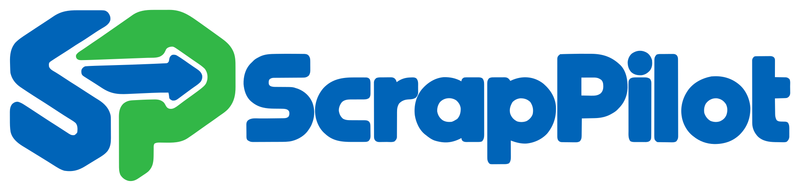

# ScrapPilot



Den aktuella blå/gröna produktloggan infördes 2026-10-13 i kontor 0.22.2
och mobilwebb 0.8.1. Rundade konturer och bokstäver är vektorbanor,
utan inbäddade rasterbilder eller beroende av typsnitt.

| Färg | RGB / HEX |
| --- | --- |
| Blå | 0, 100, 184 / `#0064B8` |
| Återvinningsgrön | 50, 183, 71 / `#32B747` |

## Original och exporter

- [Logga i SVG](scrappilot-logo.svg) — master för webb och skalbar produktion.
- [SP-symbol i SVG](scrappilot-symbol.svg) — för appikon och små ytor.
- [Logga i vektor-PDF](scrappilot-logo-print.pdf) — konturer för tryckleverantörer.
- [Logga i PNG](scrappilot-logo-vector.png) och [symbol i PNG](scrappilot-symbol-vector.png) — transparenta exporter från samma SVG.
- [Förberedd bildreferens](scrappilot-logo-prepared.png) — transparent bildvariant av den nya loggan; SVG-masterfilerna styr produktionens jämna tvåfärgsexporter.

Appens gemensamma resurser finns i `public/images/scrappilot-logo.svg` och
`scrappilot-symbol.svg`. Samma original används av kontor, inloggning,
plattformsadministration, mobilwebb, terminal, kund- och chaufförsportaler.
Expo-wrappern använder PNG-exporten på anslutningsskärmen.

Favicon finns som SVG, ICO med 16/32/48 px och PNG. Apple-hemskärmsikonen
är 180 px. Ikoner i 192/512 px finns för framtida webbinstallation.
Expo använder `expo/assets/icon.png` (1024 px), `adaptive-icon.png` med
extra marginal för Androids ikonmasker och `splash.png` som startbild.
Ikonerna är konfigurerade för nästa eget nativebygge; Expo Go behåller sin
egen launcherikon. Favicon-länkar är versionerade för att undvika gammal cache.

Generera om alla produktionsexporter från SVG-masterfilerna:

```sh
node scripts/export-brand-assets.mjs
```

Exporteraren använder projektets befintliga Sharp och PDFKit.
Tryck-PDF:n innehåller vektorbanor, inte en inbäddad PNG.

JEROC Återvinning är ett kundbolag och behåller sin företagsidentitet på
avräkningar och transportdokument. Kundloggor och redan arkiverade PDF:er
påverkas inte av byte av produktlogga.

Tidigare `scrappilot-logo-rounded.png`, `scrappilot-logo.png` och
`*-recycling-green.*` är historiska designreferenser. Använd masterfilerna
ovan för nya exporter och tryck. Behåll proportionerna och ett lugnt utrymme
runt loggan; vid liten brodyr passar SP-symbolen bättre än hela ordmärket.
