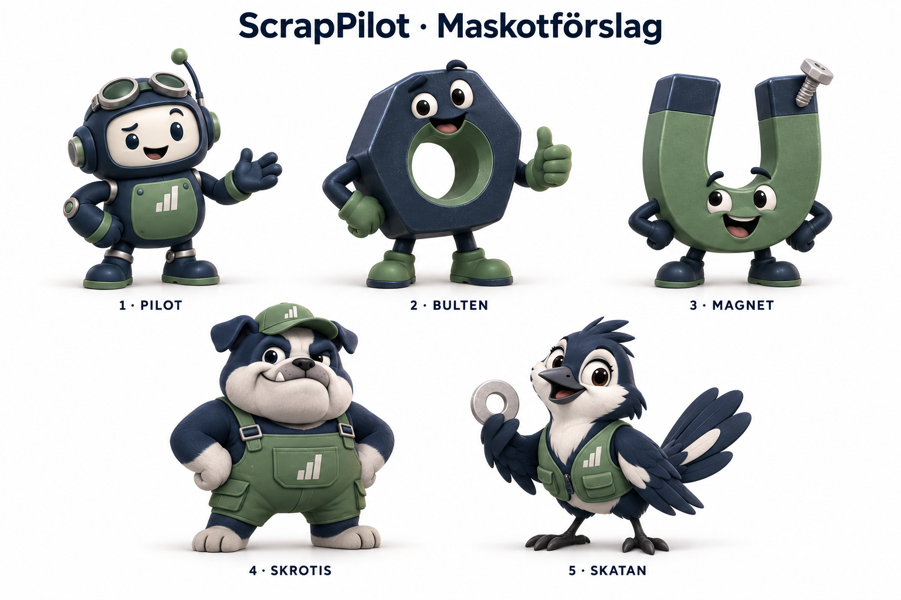

# ScrapPilot – maskotförslag

Fem alternativ skapade 2026-10-13 för val av maskot inför en animerad video.
Inget alternativ är ännu valt eller infört i appen.

1. **Pilot** – en liten robot med pilotglasögon.
2. **Bulten** – en vandrande sexkantsmutter.
3. **Magnet** – en glad hästskomagnet med en skruv som fastnat på toppen.
4. **Skrotis** – en bulldogg i arbetskläder.
5. **Skatan** – en nyfiken skrotsamlare med en bricka.

Färgerna följer ScrapPilots marinblå och dova gröna med neutrala detaljer.
När ett alternativ är valt kan en separat karaktärsbild och en referens med
flera vinklar tas fram för Nano Banana och videoproduktionen.
