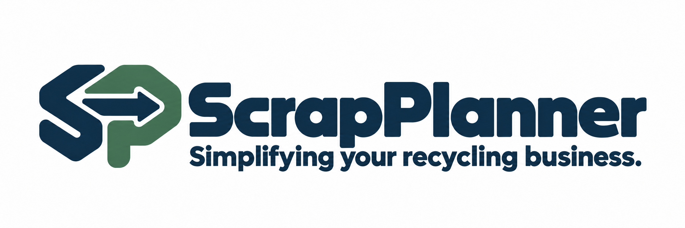

# ScrapPlanner – aktuell produktlogga

**Simplifying your recycling business.**

[Öppna korrigerad presentationsbild](scrapplanner-logo-concept-v2.png)

Uppdaterad 2026-10-20: första a:ets övre vänstra kontur är jämnad för att
stämma med den rundade bokstavsformen i resten av ordmärket.

Den korrigerade presentationsbilden används nu på hemsidan och i appens
produktlogga. Bolagens egna uppladdade loggor har fortfarande företräde i
bolagsvyn. Systemadmin behåller ScrapPlanner i den övre produktlisten.

Appresurserna exporteras med `node scripts/export-scrapplanner-assets.mjs`
från hemsidans godkända `website/source-assets/logo.png` och den fristående
SP-symbolen i `website/public/favicon.svg`. Exporten tar bort ordmärkets yttre
presentationsmarginaler och skapar favicon, mobilikoner och Expo-resurser.
Ordmärket är ett rasteroriginal; SP-symbolen är vektor.

Förslaget bygger vidare på den befintliga SP-symbolen och kombinerar
avrundade former med ett seriöst, industriellt B2B-uttryck. Riktningen är
platt och avsedd för högst två tryckfärger.

| Avsedd palett | HEX |
| --- | --- |
| Mörk marinblå | `#123047` |
| Dämpad grön | `#46725C` |

Den genererade bilden är ett konceptunderlag. Tabellen anger önskad
färgriktning; slutliga färgvärden och original behöver fastställas inför
produktion.

Tidigare utkast: [första presentationsbilden](scrapplanner-logo-concept.png) ·
[första transparenta konceptbilden](scrapplanner-logo-transparent-concept.png).

[Tillbaka till varumärkesmaterialet](../README.md)

[Bildmockuper av ScrapPlanners publika hemsida](../../mockups/scrapplanner-hemsida/README.md)
