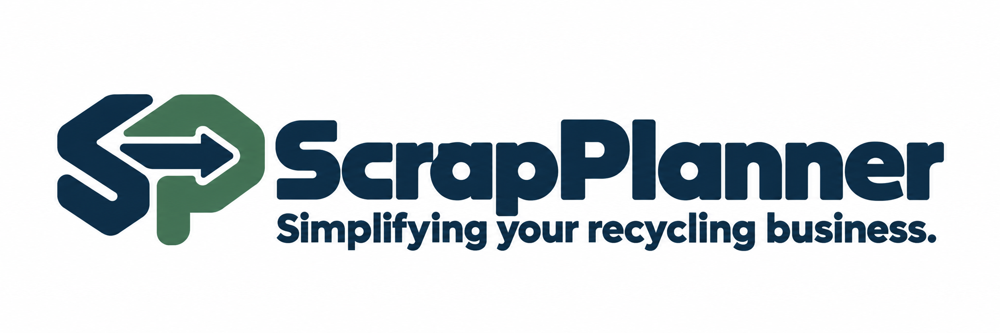

# ScrapPlanner – loggförslag

**Simplifying your recycling business.**

[Öppna presentationsbilden](scrapplanner-logo-concept.png) ·
[Transparent konceptbild](scrapplanner-logo-transparent-concept.png)

Detta är en statisk **mockup** för bedömning av ScrapPlanners visuella
riktning. Den ersätter ännu inga produktionsloggor eller andra appresurser.

Förslaget bygger vidare på den befintliga SP-symbolen och kombinerar
avrundade former med ett seriöst, industriellt B2B-uttryck. Riktningen är
platt och avsedd för högst två tryckfärger.

| Avsedd palett | HEX |
| --- | --- |
| Mörk marinblå | `#123047` |
| Dämpad grön | `#46725C` |

Den genererade bilden är ett konceptunderlag. Tabellen anger önskad
färgriktning; slutliga färgvärden och original behöver fastställas inför
produktion.

[Tillbaka till varumärkesmaterialet](../README.md)
