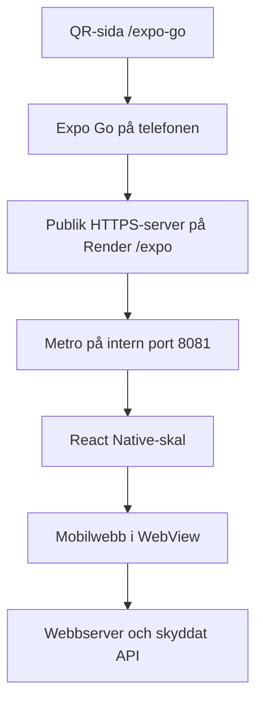

# Återanvänd Expo Go med QR-sida på Render

Detta beskriver ScrapPilots implementation, granskad i koden 2026-10-17.
Använd receptet i ett annat projekt med dess egna adresser, Expo-projekt och
inloggning. Ingen av ScrapPilots hemligheter eller demokonton ska följa med.

## Så fungerar vår lösning

1. Besökaren öppnar [QR-sidan på Render](https://jeroc-atervinning.onrender.com/expo-go).
2. Sidan kontrollerar att mobilens paket är förberett och visar QR-kod samt
   **Öppna i Expo Go**. Länken är
   `exps://jeroc-atervinning.onrender.com/expo`.
3. Expo Go hämtar manifest och mobilpaket genom vår vanliga HTTPS-server.
   Servern vidarebefordrar till Metro på en intern port, normalt `8081`.
4. Mobilpaketet startar vårt React Native-skal. Det visar mobilwebbappen i
   en WebView med stöd för skärmytor, laddningsfel och Androids bakåtknapp.
5. Webbappen använder samma backend, inloggning, behörigheter och databas som
   vanligt. Expo ger ingen extra behörighet till bolagens data.



Webb/API och Metro körs i **samma Render Web Service** i testlösningen.
En separat Expo-host behövs alltså inte här. Detta använder en fast HTTPS-adress,
inte en LAN-adress eller en tillfällig tunnel från en dator.

Om det andra projektet redan har egna React Native-vyer: behåll dem och
återanvänd server-, QR- och statusdelarna. WebView är vårt val för att återanvända
mobilwebben, inget krav för en sådan QR-sida.

## Delarna att återanvända

| Del | Referens i detta repo |
| --- | --- |
| Expo-projekt, beroenden och låsfil | [expo/](../expo/) |
| WebView-skal | [expo/App.tsx](../expo/App.tsx) |
| Projektnamn, ägare, ikoner och plattformar | [expo/app.json](../expo/app.json) |
| Metro-cache | [expo/metro.config.js](../expo/metro.config.js) |
| Metro-process, proxy, status och återförsök | [server/expo-go.mjs](../server/expo-go.mjs) |
| Koppling till HTTP-serverns rutter | [server/index.mjs](../server/index.mjs) |
| QR-sida och QR-bild | [public/expo-go.html](../public/expo-go.html), [public/expo-go-qr.svg](../public/expo-go-qr.svg) |
| Förberedelse av paket vid deploy | [scripts/expo-prebuild.mjs](../scripts/expo-prebuild.mjs) |
| Byggkommandon och Render-inställningar | [package.json](../package.json), [render.yaml](../render.yaml) |

Servermodulen kan användas som referens separat. Anpassa rutterna till det nya
projektets server i stället för att kopiera hela ScrapPilots backend.

Vår proxy tillåter bara `/`, `/manifest`, `/index.exp`, `/index.bundle` och
`/index.ts.bundle`, även bakom prefixet `/expo`. Ett projekt med annan
entrypunkt, Expo Router, lokala nativebilder eller monorepomoduler kan behöva
anpassade paket-/assetvägar och Metro-konfiguration. Utöka då tillåtna vägar
precist; öppna inte hela Metro-servern.

## Inställningar och deploy

Vårt repo använder Expo `~57.0.27`, React Native `0.86.3` och WebView `13.16.1`.
Render använder Node `24.19.0`. I ett nytt projekt ska Expo SDK och dess beroenden
passa den Expo Go-version som faktiskt är installerad på testtelefonerna.
Använd Expos versionsanpassade installation i stället för att blanda versioner.

| Variabel | Funktion |
| --- | --- |
| `EXPO_TOKEN` | Expo-token för det egna projektets konto/åtkomst. Serverhemlighet i Render Environment, aldrig i frontend eller Git. Vår implementation aktiverar Expo när denna finns. |
| `EXPO_GO_ENABLED` | Valfri. Värdet `false` stänger av Expo-delen. |
| `RENDER_EXTERNAL_URL` | Publik serveradress som Render tillhandahåller. Används först i vår implementation. |
| `EXPO_PUBLIC_WEB_APP_URL` | Publik adress till webbappen i WebView; används också som reserv för serveradressen utanför Render. Värdet byggs in i mobilpaketet och får inte innehålla hemligheter. |
| `EXPO_INTERNAL_PORT` | Valfri intern Metro-port, normalt `8081`. Ska skilja sig från webbserverns `PORT`. |

**Adressdetalj:** vår Render-startkod sätter både `EXPO_PACKAGER_PROXY_URL` och
WebView-adressen till samma publika serveradress. `RENDER_EXTERNAL_URL` har
företräde. Om webbappen ligger på en annan domän i nästa projekt behöver dess
WebView-adress separeras från Metro-proxyns publika adress i startkoden.

Våra Render-kommandon:

```text
Build Command: npm ci --include=dev --no-audit --no-fund && npm run build:render
Start Command: npm start
Health Check Path: /healthz
```

`build:render` bygger webben, installerar Expo-beroenden från låsfilen, kör
typkontroll och förbereder mobilpaketen. `npm start` startar HTTP-servern som
i sin tur startar Metro som underprocess:

```text
expo start --lan --go --port 8081 --max-workers 1 --no-dev --minify
```

Här används `--lan` tillsammans med den publika proxyadressen; mobilen ska
fortfarande ansluta via Render-HTTPS. Port `8081` exponeras inte separat.

Vårt **`npm run expo:prebuild` är ett eget script för att värma Metro-cachen**.
Det är inte `npx expo prebuild`, som skapar nativeprojekt för iOS/Android.
Förberedelsen använder samma paketprofil som telefonen och gör inga
Expo-kontoanrop i byggsteget. Driftstarten kan förbereda paketen om cache saknas.

## QR-sida och stabil start

- Byt `name`, `slug`, `owner`, varumärke och bilder till det nya projektets.
- Byt djuplänken till `exps://<egen-domän>/expo` och generera en **ny QR-bild
  med exakt samma länk**. Vår HTML och SVG innehåller fasta adresser;
  en kopierad SVG öppnar annars ScrapPilot. En ny lösning kan generera bilden
  från en gemensam konfiguration för att undvika två adresskällor.
- Behåll samma domän och sökväg mellan vanliga uppdateringar, så kan QR-koden
  återanvändas. En ändrad adress kräver en ny kod.
- Låt sidan hämta `/expo/status`. Vår sida kontrollerar ungefär var tredje
  sekund och har timeout samt paus vid nätverksfel.
- Förbered iOS och Android sekventiellt. Visa öppningsknappen när telefonens
  plattform finns i `warmedPlatforms`; att Metro lyssnar räcker inte.
  `ready: true` betyder hos oss att båda plattformarnas paket är klara.
- Behåll begränsade återförsök, en gemensam pågående förberedelse och paus före
  manuell `POST /expo/retry`. Flera besökare ska inte starta varsin Metro-process.
- Begränsa proxyn till manifest och tillåtna paketvägar. Exponera inte hela
  Metros utvecklingsserver. Behåll plattformskontroll, tidsgränser och gräns för
  paketstorlek från referensimplementationen.
- Låt webb/API och `/healthz` fungera även om den valfria Expo-processen fallerar.
  En sovande Render-tjänst eller tom cache kan fortfarande ge en kallstart.

Expo-kontot och webbappens användarkonto är två olika saker. Vår testinstruktion
använder samma Expo-konto på servern och i Expo Go på iPhone. Kontrollera
projektåtkomst och SDK-stöd på den aktuella telefonen; statusrutten verifierar
paketberedskap, inte Expo-inloggning eller att appen verkligen har öppnats.

Funktioner som kräver andra native-moduler än dem som finns i Expo Go kan kräva
ett eget development build. Prova kamera, mikrofon, externa inloggningsflöden
och andra telefonfunktioner på fysisk telefon; WebView beter sig inte alltid
likadant som en fristående webbläsare.

## Kopiera till Codex i nästa projekt

```text
Bygg en Expo Go-testsida på /expo-go med QR-kod och Öppna i Expo Go-knapp.
Använd ScrapPilots implementation som referens:
https://github.com/NicklasJr93/JEROC-Atervinning/blob/main/docs/expo-go-ateranvandning.md

Börja med att läsa projektets struktur. Behåll befintliga React Native-vyer
om de finns; om appen är en mobilwebb kan ett tunt WebView-skal användas.
Anpassa lösningen till vår backend och domän, med egen Expo-projektidentitet.
Kör Metro internt och nå manifest/paket genom en begränsad HTTPS-proxy.
Visa status per plattform och öppna först när rätt paket är färdigt.
Förbered och återanvänd cachen, med begränsade återförsök och tydliga fel.
Expo-fel får inte stoppa webb/API. Generera QR och öppningslänk från samma
adress. Hemligheter ska bara ligga på servern; bevara appens vanliga auth.
Skriv exakta Render-kommandon och variabler för detta projekt.
Verifiera proxygränser, plattformsstatus och felhantering automatiskt och
ange separat vilka tester som återstår på fysisk iPhone/Android.
Kopiera inga ScrapPilot-konton, lösenord, ägaruppgifter eller varumärken.
```

Referenstester finns i [server/expo-go.test.mjs](../server/expo-go.test.mjs),
[server/expo-prebuild.test.mjs](../server/expo-prebuild.test.mjs) och
[tests/expo-startup.spec.ts](../tests/expo-startup.spec.ts).
Denna guide beskriver kodens konfiguration; den innebär inget nytt test på
fysisk telefon eller ny verifiering av Expo-kontoåtkomst.
