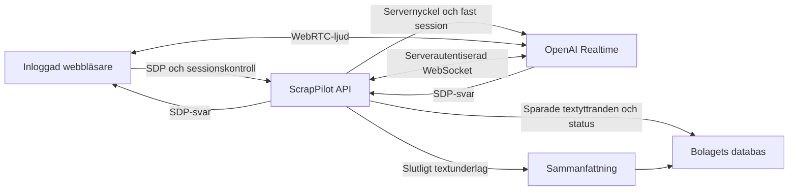

# Svenskt röstmottagningstest med OpenAI

Kontor **0.30.1**, ÄL 131. Mobilwebben ligger kvar på **0.13.0**.
Datum: 2026-10-17.

Testet öppnas på **`/rosttest`**, direkt eller från **Integrationer → Svensk
röstmottagning**. Du spelar en inkommande kund och pratar med mottagaren genom
webbläsarens mikrofon. Samtalet får alltid testnumret **`+46700000000`**, märkt
**TEST**. Numret är ingen verifierad kundidentitet och används inte för att ringa.

Detta är ett webbläsartest. Det ansluter ingen telefonväxel och skickar inte
mejl eller SMS. Det skapar inga arbetsordrar, bokningar eller betalningar.
Testets uppföljningspost sparas däremot på riktigt i det valda bolagets databas.

## Förbered Render

Öppna den befintliga webbtjänsten i Render och välj **Environment → Edit**.
Lägg in API-nyckeln på servern, spara och deploya. Skapa ingen separat databas
för detta test; det använder bolagets befintliga beständiga lagring.

| Variabel | Användning |
| --- | --- |
| `OPENAI_API_KEY` | Krävs för riktig anslutning. Nyckel från det OpenAI-projekt som ska betala testets API-användning. |
| `VOICE_TEST_ENABLED` | Valfri avstängning. Standard är på; `false` eller `0` stänger av nya tester. |
| `VOICE_TEST_MODEL` | Valfri serverinställning. Standard `gpt-realtime-2.1`. Modellåtkomsten måste fungera för projektet. |
| `VOICE_TEST_SUMMARY_MODEL` | Valfri modell för sammanfattning. Standard `gpt-6-luna`. |
| `VOICE_TEST_VOICE` | Valfri röst. Standard `marin`; svenska styrs även av serverns instruktion och transkriptionsspråk `sv`. |

Lägg inte nyckeln i GitHub, chatten, något `VITE_`-fält eller i formuläret.
Webbläsaren får varken serverns API-nyckel eller en egen leverantörsnyckel.
Nyckeln gäller serverns OpenAI-projekt; detta är ingen OAuth-anslutning per kund.

## Prova som operatör

1. Logga in på plattformen och välj rätt bolag. Både ditt verkliga konto och
   den roll du arbetar som måste vara aktiva **Systemadmin eller VD**.
   En aktiv anläggning inom båda kontonas åtkomst behövs också.
2. Öppna `/rosttest`. Kontrollera bolag och att sidan visar TEST. Servern
   väljer en aktiv anläggning inom din åtkomst och sparar dess uppgifter
   tillsammans med samtalet. Om nyckel eller annan förutsättning saknas
   ska starten vara spärrad.
3. Välj **Kontrollera AI-anslutning** för serverns leverantörskontroll.
   Den gör `GET /v1/models/{modell}` och kör ingen talgenerering.
   Ett godkänt anslutningsprov är inte ett prov av mikrofon, högtalare,
   WebRTC-ljud, svensk taligenkänning eller samtalskvalitet.
4. Välj **Starta testsamtal** och tillåt mikrofonen. Sidan behöver HTTPS;
   lokal utveckling kan använda webbläsarens undantag för localhost.
   Inget samtal ska starta enbart genom att du öppnar sidan.
5. Prova ett fiktivt ärende, exempelvis: ”Jag vill lämna metallskrot och
   undrar hur jag går vidare”, eller ”Jag önskar hämtning nästa vecka.”
   Mottagaren ska tala svenska, fråga en sak i taget och hänvisa verkliga
   bokningar och beslut till en kollega. Den ska inte hitta på priser,
   öppettider, tillstånd eller tillgängliga transporttider.
6. Använd mikrofonknappen för att tysta eller slå på mikrofonen. Det avslutar
   inte samtalet eller pausar dess tidsgräns. Avsluta med
   **Avsluta samtalet**. Servern avslutar senast efter tre minuter.
7. Läs den sparade samtalsutskriften och sammanfattningen. Kontrollera mot
   vad du faktiskt sa; de är testunderlag, inte ett bekräftat kundavtal.
8. Ändra **Uppföljningsstatus** mellan **Ny**, **Pågår** och **Klar**.
   Uppdatera sidan och kontrollera att status och innehåll finns kvar.

Samtalsinnehåll, inklusive tal och transkription, skickas till **OpenAI** för
bearbetning. Appen sparar **ingen ljudinspelning**. Den sparar däremot text,
sammanfattning och testärendets metadata. Använd fiktiva kunduppgifter i provet.
Webbläsarens mikrofontillstånd är ett tekniskt tillstånd, inte ett separat
avtal om hur riktiga kundsamtal får behandlas.

## Gränser och återhämtning

| Gräns | Vad den innebär |
| --- | --- |
| 180 sekunder | Hård servergräns från reserverad samtalsstart; anslutningstiden ingår. |
| Ett aktivt samtal per bolag | Även anslutande samtal räknas. Reservationen sker i databasen. |
| Sex starter per rullande timme och konto i bolaget | Kontrolleras för både verkligt och utförande konto, så rollbyte inte ger en ny kvot. |
| 30 starter per kalenderdag och bolag | Dygnet följer `Europe/Stockholm`, inte ett rullande 24-timmarsfönster. |
| 300 sparade samtal per bolag | När testjournalen är full spärras nya starter. Historiken gallras inte automatiskt. |

Ett försök som reserverats men sedan misslyckas hos leverantören räknas.
Avvisad inloggning, felaktig förfrågan, saknad nyckel eller redan nådd kvot
före reservation skapar däremot inte ett nytt samtalsförsök.

Samma försöks-ID återanvänds vid ett osäkert startresultat. Det får inte
skapa ett extra samtal. Appen ska kontrollera journalen innan du startar om;
den gör inte automatiskt ett nytt betalt samtal efter ett anslutningsfel.

Avslut är idempotent. När sidan lämnas gör webbläsaren ett avslutningsförsök
och stänger sina ljudspår och sin WebRTC-anslutning. Ett bolags- eller rollbyte
får inte låta det gamla samtalets ljud fortsätta i bakgrunden. Servern
kontrollerar också fortsatt behörighet och har en egen tidsgräns för
kvarhängande anslutningar. Ett samtal återupptas inte efter serveromstart;
journalen bevaras och ett övergivet samtal markeras avbrutet.

## Arkitektur och betrodda uppgifter

- Plattformens cookie, CSRF-skydd, bolag och sessionsgeneration kontrolleras
  på servern. Klienten får inte välja ett annat bolags journal eller skriva
  samtalsinnehåll som om det kom från leverantören.
- Servern reserverar först ett TEST-samtal och skapar sedan OpenAI-sessionen
  via `POST https://api.openai.com/v1/realtime/calls`, med multipart-fälten
  `sdp` och serverägd sessionskonfiguration. Instruktion, modell, röst och
  transkriptionsspråk kan inte bytas genom webbläsarens startformulär.
- Webbläsaren använder det återlämnade SDP-svaret för WebRTC. När svaret är
  installerat skickas ett uttryckligt `ready`; först då begär servern den
  inledande hälsningen. Ljudet går mellan webbläsaren och OpenAI.
- Servern ansluter separat till
  `wss://api.openai.com/v1/realtime?call_id=…`. Bara den autentiserade
  serveranslutningens transkriptionshändelser får uppdatera den beständiga
  utskriften. Text från webbläsarens datakanal är inte en betrodd journalväg.
- Färdiga användaryttranden och assistentsvar sparas med separata ID:n och
  roller. Avbrutna assistentsvar markeras. De sista händelserna hanteras vid
  avslut innan transkriptet slutmarkeras och sammanfattningen färdigställs.
- Sammanfattning utgår från sparat serverbetrott textunderlag och genereras
  separat genom `POST /v1/responses`. Den kan även ange ämne och om
  testkunden uttryckligen önskade återkoppling. Det utlöser ingen kontakt.
  Vid fel markeras sammanfattningen som reservläge och operatören får läsa
  den bevarade utskriften. Råtext och uppföljningspost får inte försvinna.
  Vid serveravstängning används reservunderlag utan ett nytt AI-anrop.

Leverantörens HTTP-anrop har 20 sekunders tidsgräns och anslutningen av
serverns WebSocket 10 sekunder. Avslut försöker även stänga leverantörens
samtal via dess hangup-gränssnitt; lokal media och serverjournal behöver
ändå hantera att en anslutning redan är bruten.

Journalen ligger i den privata bolagsdomänen `voiceTest` i samma
databasarkitektur som övriga bolagsuppgifter. PostgreSQL används där den
befintliga Render-installationen är konfigurerad för det. Lokala tester kan
använda repositoryts SQLite-adapter. Det levande ljudsamtalets anslutningar
är tillfälliga; samtalspost, text och status är beständiga.

Sparade uppgifter omfattar samtals-ID, försöks-ID, tid, status,
TEST-nummer, anläggningssnapshot, verklig och utförande användare,
transkriptionsrader, sammanfattning och uppföljningsstatus. Ändringshändelser
sparas också. Listan visar de senaste **20** synliga samtalen; äldre poster
bevaras. Automatisk gallring och operatörsradering ingår inte i denna version.
Vid gränsen 300 krävs en separat hantering av den bevarade testjournalen
innan fler tester kan tillåtas; det finns ingen raderingsknapp i röstvyn.

### Interna HTTP-gränssnitt

| Gränssnitt | Syfte |
| --- | --- |
| `GET /api/voice-test` | Säker konfigurationsstatus, senaste samtal och aktivt samtal. |
| `POST /api/voice-test/connection-test` | Uttrycklig kontroll av serverns OpenAI-anslutning. |
| `POST /api/voice-test/calls` | Reservera samtal och utväxla SDP. Kropp: `requestId`, `sdp`. |
| `GET /api/voice-test/calls/:id` | Läs den behörighetskontrollerade sparade samtalsposten. |
| `POST /api/voice-test/calls/:id/ready` | Begär hälsning efter att webbläsaren tagit emot SDP-svaret. |
| `POST /api/voice-test/calls/:id/end` | Avsluta idempotent och färdigställ underlaget. |
| `POST /api/voice-test/calls/:id/status` | Spara `new`, `in_progress` eller `done` för testuppföljningen. |

Ingen av dessa vägar är en telefon-, mejl-, SMS- eller orderadapter.

## Kontroll efter deploy och felsökning

| Symtom | Kontrollera |
| --- | --- |
| Starten är spärrad | Serverns nyckel/avstängningsflagga, aktiv anläggning och båda kontonas roll och åtkomst. |
| AI-anslutningsprovet misslyckas | Projektets API-nyckel och åtkomst till den konfigurerade modellen; serverns HTTPS-anslutning till OpenAI. |
| Ingen mikrofon | HTTPS, webbläsarens mikrofontillstånd och vald ljudenhet. Ingen reserverad OpenAI-start ska krävas om mikrofontillstånd nekas först. |
| Anslutet men inget ljud | Webbläsarens ljuduppspelning, högtalare/hörlurar, WebRTC-nätet och ett riktigt ljudprov. Ett lyckat nyckelprov räcker inte. |
| Ett samtal pågår redan | Öppna den befintliga posten och avsluta den. Starta inte parallella försök för att kringgå spärren. |
| Tim- eller dygnsgränsen är nådd | Vänta tills aktuell kvot åter öppnas. Deploy eller rollbyte ska inte nollställa den beständiga kvoten. |
| Testjournalen är full | Nya starter stoppas efter 300 sparade samtal. Bevara journalen och samordna dess fortsatta hantering; omladdning eller deploy löser inte gränsen. |
| Sparad text eller uppföljning saknas efter omladdning | Kontrollera serverfel och att Render använder den avsedda beständiga databasen. Ett synligt lokalt meddelande är inte en lagringskvittens. |

Ett verkligt acceptansprov ska kontrollera svensk dialog, hörbar hälsning,
turtagning och avbrott, sparade yttranden, sammanfattning, uppföljning efter
omladdning samt stopp vid manuellt avslut och tidsgräns. Kontrollera även
att varken API-nyckel eller betrodda serverkommandon exponeras i klienten.

**Verifieringsgräns:** ett riktigt samtal mot OpenAI och ljudkedjan på Render
är ännu inte verifierat. Lokala kontroller med simulerad leverantör,
WebRTC och mikrofon bevisar programflödet men inte modellåtkomst, verklig
svenska, ljudfördröjning, leverantörskostnad eller beteendet i Render-nätet.
Ingen godkänd faktisk ljudanslutning ska rapporteras förrän provet har körts
med projektets nyckel och en riktig mikrofon.

Lokalt verifierat 2026-10-17: **32/32** riktade server-/adaptertester,
**10 browserfall** (nio i gemensam körning och en separat regression för ett
sent svar efter återkallad behörighet), produktionsbygge och ett prov mot den
byggda webbservern med riktig plattformsinloggning och bolagsval. Den breda
serversviten kördes också: nio sedan tidigare dokumenterade fel kvarstår,
samma fall som i [föregående byggkontroll](../fordon-telematik-bygge-2026-10-16.md).
Tester av mikrofon, WebRTC och OpenAI använder lokala simuleringar; provet
mot byggd server verifierade även att saknad servernyckel spärrar samtalsstart.

## Leverantörens dokumentation

- [WebRTC och SDP-utbyte](https://developers.openai.com/api/docs/guides/realtime-webrtc).
- [Serverkontroll och separat serveranslutning](https://developers.openai.com/api/docs/guides/realtime-server-controls).
- [Realtime-serverhändelser](https://developers.openai.com/api/reference/resources/realtime/server-events).
- [Modellen gpt-realtime-2.1](https://developers.openai.com/api/docs/models/gpt-realtime-2.1).

Implementationen använder Realtime-gränssnittet med `/v1/realtime/calls`
och `call_id` för serveranslutningen. Eventuella GPT-Live-exempel i
leverantörsguiderna är ett annat protokoll och ska inte blandas in här.
