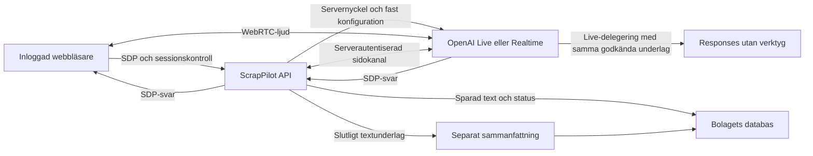

# Svenskt röstmottagningstest med OpenAI

Kontor **0.30.3**, ÄL 131–133. Mobilwebben ligger kvar på **0.13.0**.
Datum: 2026-10-17.

Testet öppnas på **`/rosttest`**, direkt eller med **Testa samtal** i
AI-supportens inställningar. Du spelar en inkommande kund och pratar med
mottagaren genom webbläsarens mikrofon. Samtalet får alltid testnumret
**`+46700000000`**, märkt
**TEST**. Numret är ingen verifierad kundidentitet och används inte för att ringa.

Detta är ett webbläsartest. Det ansluter ingen telefonväxel och skickar inte
mejl eller SMS. Det skapar inga arbetsordrar, bokningar eller betalningar.
Testets uppföljningspost sparas däremot på riktigt i det valda bolagets databas.

AI-supportens bolagsinställningar öppnas under **Integrationer → AI-kundmottagning**,
på `/kontor#/integrations?service=ai-support`. Där hanteras röstval och den
granskade kunskap som får användas i nästa testsamtal. Själva samtalet
genomförs fortfarande på `/rosttest`. Standardmotorn är nu **GPT-Live**,
med modellen **`gpt-live-1`**. Den tidigare Realtime-adaptern finns kvar
som ett uttryckligt serverval.

## Förbered Render

Öppna den befintliga webbtjänsten i Render och välj **Environment → Edit**.
Lägg in API-nyckeln på servern, spara och deploya. Skapa ingen separat databas
för detta test; det använder bolagets befintliga beständiga lagring.
En befintlig `OPENAI_API_KEY` återanvänds. Bytet till GPT-Live kräver ingen
ny obligatorisk miljövariabel.

| Variabel | Användning |
| --- | --- |
| `OPENAI_API_KEY` | Krävs för riktig anslutning. Nyckel från det OpenAI-projekt som ska betala testets API-användning. |
| `VOICE_TEST_ENABLED` | Valfri avstängning. Standard är på; `false` eller `0` stänger av nya tester. |
| `VOICE_TEST_ENGINE` | Valfri. Standard `live`. Sätt uttryckligen `realtime` för att använda den tidigare adaptern. |
| `VOICE_TEST_LIVE_MODEL` | Valfri Live-modell. Standard `gpt-live-1`. |
| `VOICE_TEST_MODEL` | Äldre modellval. I Live-läge används det bara om det anger en Live-modell; ett kvarvarande `gpt-realtime-2.1` ersätts av Live-standardvalet. I Realtime-läge är standard `gpt-realtime-2.1`. |
| `VOICE_TEST_LIVE_BACKEND_MODEL` | Valfri delegerad Responses-modell under Live-samtalet. Standard `gpt-6-luna`; servern väljer resonemangsnivån `low` och inga verktyg. |
| `VOICE_TEST_SUMMARY_MODEL` | Separat modell för sammanfattningen efter samtalet. Standard `gpt-6-luna`; detta är inte den delegerade samtalsmodellen. |
| `VOICE_TEST_VOICE` | Kompatibelt reservval när bolaget inte har sparat en egen röst. Live-standard `meridian`, Realtime-standard `marin`. Svenska styrs också av serverns instruktioner. |

Lägg inte nyckeln i GitHub, chatten, något `VITE_`-fält eller i formuläret.
Webbläsaren får varken serverns API-nyckel eller en egen leverantörsnyckel.
Nyckeln gäller serverns OpenAI-projekt; detta är ingen OAuth-anslutning per kund.
Projektet behöver tillgång till både Live-modellen och den delegerade modellen.

För återgång till tidigare adapter: sätt `VOICE_TEST_ENGINE=realtime`, spara
Render-inställningen och deploya. Modellnamnet ensamt byter inte protokoll.
Ett gammalt Realtime-modellnamn i `VOICE_TEST_MODEL` håller inte kvar den
adaptern när motorvalet är Live.

## Bolagsprofil, röstval och lyssningsprov

Både det verkliga och det utförande kontot behöver vara aktiva **Systemadmin
eller VD** i det valda bolaget. För att ändra bolagsprofilen eller
bolagsgemensam kunskap behöver båda kontona ha obegränsad anläggningsåtkomst.
Anläggningsbegränsade administratörer kan hantera kunskap för aktiva
anläggningar inom båda kontonas åtkomst. Ett svar för **Alla anläggningar**
är bolagsgemensamt, inte ett svar utan anläggningsåtkomst.

Under **Röst & bemötande** finns följande inställningar:

| Fält | Användning |
| --- | --- |
| AI-kundmottagningen är aktiv | Kan stänga av nya samtal för bolaget. Serverns avstängningsflagga gäller också. |
| Bolagsnamn | Det kundvända namnet, högst 160 tecken. |
| Hälsningsfras | Inledningen i nästa samtal, högst 500 tecken. |
| Röst | Ett av den aktiva motorns tillåtna röstnamn nedan. |
| Ton | Vänlig, Professionell eller Lugn. |
| Tempo | Lugnt, Normalt eller Raskt. |
| Uttal och förkortningar | Uttalsanvisningar, högst 2 000 tecken. Inga nya behörigheter eller faktakällor. |

Välj **Spara röst & bemötande** när profilen är granskad. Profilen har inget
separat utkaststeg: sparat bolagsnamn, hälsning och uttal är kundvända
uppgifter som kan skickas till modellen i nästa samtal. Lägg därför inte
in privata uppgifter eller interna instruktioner i dem.

Rösten sparas **per bolag**. Vyn visar aktiv röstmotor, modell och den
sparade rösten för nästa samtal. GPT-Live har 23 förvalda röster:
`alloy`, `ash`, `ballad`, `beacon`, `bossa`, `cedar`, `cinder`, `coral`,
`delta`, `echo`, `gleam`, `marin`, `meridian`, `quartz`, `ripple`, `sage`,
`shida`, `shimmer`, `stone`, `tempo`, `verse`, `vesper` och `willow`.
Nya Live-profiler använder `meridian` om inget annat kompatibelt val finns.

De tio tidigare sparade Realtime-rösterna är också giltiga Live-röster och
bevaras. Servern bevarar röstval per motor, så ett Live-val inte skriver över
ett separat Realtime-val vid återgång. Realtime erbjuder `alloy`, `ash`,
`ballad`, `coral`, `echo`, `sage`, `shimmer`, `verse`, `marin` och `cedar`.

Spara valet innan du börjar ett nytt samtal. Ett redan pågående samtal
behåller sin profil; ändringen gäller nästa samtal. Ingen Render-ändring
behövs för att välja en annan röst som den aktiva motorn stöder.

### Provlyssning med GPT-Live

För GPT-Live är separat TTS-prov avstängt. Välj **Provlyssna i ett testsamtal**,
spara först röstvalet och bedöm det i ett riktigt samtal på `/rosttest`.
Detta provar också hälsning, uttal, svensk dialog och turtagning. Ett
startat testsamtal använder OpenAI:s API och kan kosta pengar. Knappen
beställer inte ett TTS-ljud som påstås representera en Live-röst.

### Separat röstprov vid Realtime-återgång

Med Realtime-adaptern kan **Provlyssna** använda ett separat
**text-till-tal-anrop**, inte ett kort röstsamtal. Det använder
`gpt-4o-mini-tts` och den fasta svenska texten:

> Hej! Det här är ett svenskt röstprov. Välkommen, vad kan jag hjälpa dig med?

Provet använder röst, ton och tempo, men skickar inte bolagsnamnet, den egna
hälsningsfrasen eller uttalslistan till TTS-tjänsten. Dessa delar behöver
bedömas i ett nytt samtal. Provlyssning sparar inte automatiskt ditt röstval.

Att begära provet använder OpenAI:s API och kan kosta pengar. Det kräver
serverns API-nyckel men ingen mikrofon. Fri provtext stöds inte. Svaret är
en kort MP3 som spelas i webbläsaren; appen skapar ingen beständig ljudfil.
Anropet har åtta sekunders tidsgräns och högst 512 KiB ljudsvar. Vid fel
görs inget automatiskt återförsök. Samma röstnamn kan låta annorlunda i ett
riktigt samtal än i detta TTS-prov.

## Kunskap som får användas i kundsamtal

AI-supportens wiki skiljer **utkast** från **publicerat innehåll**. Dessutom
krävs ett uttryckligt godkännande för kundsvar. Att spara text, skapa ett
projektförslag eller importera en artikel innebär inte att innehållet får
användas i ett samtal.

Arbeta i denna ordning:

1. Öppna **Kunskap** och välj **Nytt svar**, eller redigera ett befintligt
   svar. Välj vilka anläggningar svaret gäller och använd **Spara utkast**.
2. Kontrollera att texten är riktig, aktuell och lämplig att återge för en
   kund. Ta bort interna anteckningar, personuppgifter och uppgifter som
   mottagaren inte ska lämna ut.
3. Markera **Jag har kontrollerat att informationen får lämnas till kunder**
   och välj **Publicera svar** eller **Spara och publicera** när granskningen
   är klar. Publiceringsmarkeringen är kontorets beslut; den är ingen
   automatisk kontroll av textens riktighet eller säkerhet.
4. Gör ett nytt testsamtal och kontrollera att mottagaren använder uppgiften
   rätt och hänvisar till personalen när underlag saknas.

Godkännandet binds till just textversionen och dess anläggningar med en
innehållskontrollsumma. Redigering kräver nytt godkännande innan den nya
versionen publiceras. Att spara ett tidigare publicerat svar som utkast tar
bort det från nya samtal. **Arkivera** tar också bort svaret från nya samtal;
tidigare versioner och samtalsloggar bevaras. Ändringar påverkar inte ett
redan startat samtals underlag.

Under **Bra att lära kundmottagningen** finns fasta projektförslag om
materialfrågor, hämtning och öppettider/besök. De är starttexter, inte
automatisk AI-läsning av projektfiler eller databasen. Att välja ett förslag
gör inget OpenAI-anrop; det fyller en osparad utkasttext i formuläret.
Kontrollera texten mot det egna bolagets verkliga arbetssätt och spara som
utkast. Ett generellt förslag är inget löfte om bolagets tjänster,
öppettider, priser eller tillstånd.

Välj **Från artikel → Skapa artikelutkast** för att importera en aktiv
artikels namn, beskrivning och texter om vad som ingår eller inte ingår.
Priser, kundpriser och andra interna registerfält följer inte med. Importen
sparar ett fristående **utkast** utan kundgodkännande. Senare ändringar i
artikelregistret uppdaterar inte den importerade texten automatiskt.
Granska och godkänn varje version separat före publicering.

Öppna **Vad kundmottagningen får se** för att kontrollera det aktuella
godkända wikiunderlaget för den anläggning som förhandsvisningen anger.

| Kunskapsgräns per bolag | Värde |
| --- | --- |
| Sparade svar, inklusive utkast och arkiverade | 100 |
| Publicerade, kundgodkända svar | 20 |
| Sammanlagda tecken i publicerade rubriker och svar | 10 000 |
| Rubrik / svar per post | Högst 160 / 3 000 tecken |

Arkivering frigör publiceringsutrymme men tar inte bort en sparad post.
Ingen automatisk radering ingår. Samtidiga ändringar skyddas med
versionskontroll; välj **Hämta aktuell version** vid konflikt och granska
texten innan du sparar igen.

### Vad modellen faktiskt får se

Servern bygger en uttryckligt tillåten kontext för det valda bolaget:
den sparade kundvända profilen, anläggningens namn och de wikifält som både
är publicerade och godkända för kundsvar. Det är denna begränsade datamängd
som skickas som kunskap till modellen, inte en fri fråga mot hela databasen.

Modellen har inga verktyg som får söka i den allmänna databasen, läsa HR,
löner, bankuppgifter eller kundregister, eller skapa verksamhetsåtgärder.
Samtalets kunskapsbyggare läser bara AI-supportens godkända fält; den slår
inte upp levande artikel- eller prisregister. Artikelimporten använder ett
separat, begränsat fälturval och behöver utkastgranskningen ovan.

Servern avvisar vissa tydliga hemligheter, personnummer, privata
betalningsuppgifter och manipulerande instruktioner redan vid sparande,
även i profil och utkast. Den kontrollen kan inte identifiera allt känsligt
innehåll. Allmän, godkänd information om exempelvis Swish eller kontant
betalning kan vara kundinformation; privata bank- eller kundspecifika
betalningsuppgifter är det inte.

Wikitext skickas som data, med separata fasta instruktioner för mottagaren.
Det minskar risken att en text tolkas som nya kommandon. Det finns ändå
ingen utlovad **100-procentig säkerhet mot promptinjektion eller påhittade
svar**. Att servern begränsar vilken information och vilka verktyg modellen
får tillgång till skyddar de faktiska datavägarna; det garanterar inte att
varje mening som modellen säger är riktig.

Kontoret behöver därför granska texten som publiceras och testa svaren.
Publicera inte hemligheter eller känsliga uppgifter i en kundgodkänd wiki.
Det användaren själv säger i mikrofonen skickas fortfarande till OpenAI;
kunskapsfiltreringen tar inte bort uppgifter ur det inkommande talet.

## Prova som operatör

1. Logga in på plattformen och välj rätt bolag. Både ditt verkliga konto och
   den roll du arbetar som måste vara aktiva **Systemadmin eller VD**.
   En aktiv anläggning inom båda kontonas åtkomst behövs också.
2. Öppna `/rosttest`. Kontrollera bolag och att sidan visar TEST. Servern
   väljer en aktiv anläggning inom din åtkomst och sparar dess uppgifter
   tillsammans med samtalet. Om nyckel eller annan förutsättning saknas
   ska starten vara spärrad.
3. Välj **Kontrollera AI-anslutning** för serverns leverantörskontroll.
   Den gör `GET /v1/models/{modell}` för röstmodellen och, med Live, även
   den delegerade modellen. Den kör ingen talgenerering.
   Ett godkänt anslutningsprov är inte ett prov av mikrofon, högtalare,
   WebRTC-ljud, svensk taligenkänning eller samtalskvalitet.
4. Välj **Starta testsamtal** och tillåt mikrofonen. Sidan behöver HTTPS;
   lokal utveckling kan använda webbläsarens undantag för localhost.
   Inget samtal ska starta enbart genom att du öppnar sidan.
5. Prova ett fiktivt ärende, exempelvis: ”Jag vill lämna metallskrot och
   undrar hur jag går vidare”, eller ”Jag önskar hämtning nästa vecka.”
   Mottagaren ska tala svenska, fråga en sak i taget och hänvisa verkliga
   bokningar och beslut till en kollega. Den ska inte hitta på priser,
   öppettider, tillstånd eller tillgängliga transporttider.
6. Använd mikrofonknappen för att tysta eller slå på mikrofonen. Det avslutar
   inte samtalet eller pausar dess tidsgräns. Avsluta med
   **Avsluta samtalet**. Appen stoppar lokalt och begär leverantörsavslut
   efter tre minuter; läs begränsningen nedan om bekräftat fjärravslut.
7. Läs den sparade samtalsutskriften och sammanfattningen. Kontrollera mot
   vad du faktiskt sa; de är testunderlag, inte ett bekräftat kundavtal.
8. Ändra **Uppföljningsstatus** mellan **Ny**, **Pågår** och **Klar**.
   Uppdatera sidan och kontrollera att status och innehåll finns kvar.

Samtalsinnehåll, inklusive tal och transkription, skickas till **OpenAI** för
bearbetning. Appen sparar **ingen ljudinspelning**. Den sparar däremot text,
sammanfattning och testärendets metadata. Använd fiktiva kunduppgifter i provet.
Webbläsarens mikrofontillstånd är ett tekniskt tillstånd, inte ett separat
avtal om hur riktiga kundsamtal får behandlas.

## Gränser och återhämtning

| Gräns | Vad den innebär |
| --- | --- |
| 180 sekunder | Lokal tidsgräns från reserverad start, inklusive anslutningstid. Browser och server begär stopp; det är ingen garanterad hård treminutersgräns hos OpenAI. |
| Ett aktivt samtal per bolag | Även anslutande samtal räknas. Reservationen sker i databasen. |
| Sex starter per rullande timme och konto i bolaget | Kontrolleras för både verkligt och utförande konto, så rollbyte inte ger en ny kvot. |
| 30 starter per kalenderdag och bolag | Dygnet följer `Europe/Stockholm`, inte ett rullande 24-timmarsfönster. |
| 300 sparade samtal per bolag | När testjournalen är full spärras nya starter. Historiken gallras inte automatiskt. |

Separata TTS-röstprov vid **Realtime-återgång** har egna kvoter.
Live avvisar den vägen före kvotreservation eller leverantörsanrop:

| Gräns för TTS-röstprov | Vad den innebär |
| --- | --- |
| Tio prov per rullande timme och konto i bolaget | Kontrolleras för både verkligt och utförande konto. |
| 50 prov per kalenderdag och bolag | Dygnet följer `Europe/Stockholm`. |
| Ett pågående prov per bolag | Databasen reserverar provet i högst tio sekunder. Leverantörsanropet avbryts senast efter åtta sekunder; serverns övergripande gräns är nio sekunder. |

Reserverade röstprov räknas även om leverantörsanropet sedan misslyckas.
Att ladda om sidan eller byta roll återställer inte kvoten.

Ett försök som reserverats men sedan misslyckas hos leverantören räknas.
Avvisad inloggning, felaktig förfrågan, saknad nyckel eller redan nådd kvot
före reservation skapar däremot inte ett nytt samtalsförsök.

Samma försöks-ID återanvänds vid ett osäkert startresultat. Det får inte
skapa ett extra samtal. Appen ska kontrollera journalen innan du startar om;
den gör inte automatiskt ett nytt betalt samtal efter ett anslutningsfel.

Avslut är idempotent. När sidan lämnas gör webbläsaren ett avslutningsförsök
och stänger sina ljudspår och sin WebRTC-anslutning. Ett bolags- eller rollbyte
får inte låta det gamla samtalets ljud fortsätta i bakgrunden. Servern
kontrollerar också fortsatt behörighet och har en egen tidsgräns för
kvarhängande anslutningar. Ett samtal återupptas inte efter serveromstart;
journalen bevaras och ett övergivet samtal markeras avbrutet.

### Lokalt stopp och bekräftat Live-avslut

När du avslutar stoppas mikrofon och lokal uppspelning direkt. Appen skickar
`session.close` genom serveranslutningen och väntar begränsat på den
betrodda händelsen `session.closed`. Om den inte kommer sparas
`providerConfirmed: false`, och transkriptet markeras ofullständigt.
**Lokalt stopp betyder då inte att fjärrsessionens avslut har bekräftats.**
Det går inte att lova exakt debiterad längd eller en hård fjärrgräns på tre
minuter utifrån den lokala timern. Kontrollera journalens varning och
leverantörens användning vid ett sådant fel; starta inte om automatiskt.

| Teknisk tidsgräns vid normalt Live-avslut | Värde |
| --- | --- |
| Leverantörsadapterns avslutsarbete | Högst 14 sekunder, inklusive väntan på sluthändelser. |
| Applikationens väntan på adaptern | Högst 18 sekunder. |
| Webbläsarens kvarhållna peer-anslutning för avslut | Högst 20 sekunder; mikrofonen är redan stoppad. |
| Klientens REST-anrop för avslut | Högst 35 sekunder, så servern även kan spara och sammanfatta. |

Dessa är väntetider för olika lager, inte extra garanterad samtalstid.
Vid sidstängning, sessionsbyte eller serveravstängning sker stängning som
bästa försök med begränsad väntan. Ingen ny betald session skapas för att
reda ut ett osäkert avslut.

## Arkitektur och betrodda uppgifter

Plattformens cookie, CSRF-skydd, bolag och sessionsgeneration kontrolleras
på servern. Klienten får inte välja ett annat bolags journal eller skriva
samtalsinnehåll som om det kom från leverantören. Browsern använder sin
vanliga `RTCPeerConnection`; API-nyckeln stannar på servern.

### GPT-Live, standardadapter

1. Servern reserverar först ett TEST-samtal. Därefter skickar den JSON till
   `POST https://api.openai.com/v1/live/sessions` med serverägd `session`
   och `transport: {type: webrtc, sdp}`. Ett kontrollerat SDP-svar lämnas
   tillbaka till webbläsaren; ljudet går via WebRTC mellan browser och OpenAI.
2. Servern ansluter med API-nyckeln till
   `wss://api.openai.com/v1/live/sessions/:id/attach`. Denna sidokanal är
   betrodd för journal och stängning. Webbläsarens kanal tillåter inga
   klientkommandon: `allowed_client_events: []`. Tillåtna serverhändelser
   till browsern är endast `session.started`, `session.closed` och `error`.
3. Den inledande svenska hälsningen finns i serverns startkonfiguration.
   Browsern inväntar `session.started` och kvitterar appens `/ready`.
   Den skickar inga egna instruktioner eller kommandon för att skapa svar.
4. Live-modellen använder Responses-delegering under samtalet med den
   servervalda modellen, standard `gpt-6-luna`. Servern sätter
   `reasoning.effort: low`, högst 512 svarstoken, `tools: []` och
   `tool_choice: none`. Delegeringen får bara samma frysta, publicerade och
   kundgodkända underlag. Den får inte läsa verksamhetsdatabasen eller söka
   efter nya uppgifter. Detta är skilt från sammanfattningen efter samtalet.
5. Bara den betrodda sidokanalens `session.input_transcript.delta` och
   `session.output_transcript.delta` får fylla journalen. Originalfragment
   med händelse-ID, start- och sluttid bevaras och kan grupperas till läsbara
   rader. En sådan gruppering är inte ett påstått färdigt talsvar eller en
   ny slutmarkering från leverantören. Dubbletter kontrolleras; motstridiga
   fragment stoppar testet. Browsertext, råljud och delegerat internt
   resonemang skrivs inte in som betrodd transkription.
6. Servern begär `session.close` och verifierar `session.closed` före ett
   bekräftat avslut. Saknad kvittens lämnar den uttryckliga markeringen
   `providerConfirmed: false` och ofullständigt transkript, som beskrivits ovan.

Live-sessionen skapas med `store: false` och utan automatiska triggers.
Det betyder inte att appens egen textjournal är avstängd eller att inget
samtalsinnehåll skickas till OpenAI.

### Realtime, uttrycklig återgång

Med `VOICE_TEST_ENGINE=realtime` används i stället
`POST https://api.openai.com/v1/realtime/calls` med multipart-fälten `sdp`
och serverägd sessionskonfiguration. Serverns sidokanal ansluter till
`wss://api.openai.com/v1/realtime?call_id=…`. Först efter att browsern
installerat SDP-svaret och kvitterat `/ready` begär servern hälsningen.
Denna adapters färdiga yttranden och avbrutna assistentsvar behåller sin
befintliga journalhantering. Protokollens händelser och stängning blandas
inte; Live är inte ett nytt modellnamn i Realtime-anropet.

### Gemensamt underlag och sammanfattning

Starten hämtar en avgränsad kopia av bolagets sparade profil och de
godkända svar som gäller för samtalets anläggning. Servern väljer motor och
modell. Samtalsjournalen kopplar underlaget till protokoll,
kunskapsrevision, policyversion, röst,
kunskapsposternas ID:n och innehållskontrollsumma. Senare profil- eller
wikiändringar förändrar inte det pågående samtalet. Sessionens fasta
säkerhetsinställningar kan inte ändras från startformuläret eller genom tal.

Sammanfattningen utgår från sparad serverbetrodd text och genereras separat
genom `POST /v1/responses`, med `VOICE_TEST_SUMMARY_MODEL`. Den kan ange
ämne och om testkunden uttryckligen önskade återkoppling; det utlöser ingen
kontakt. Vid fel används ett markerat reservunderlag och operatören får
läsa den bevarade utskriften. Råtext och uppföljningspost ska bevaras. Vid
serveravstängning används reservunderlag utan ett nytt AI-anrop.

Leverantörens vanliga HTTP-anrop har 20 sekunders tidsgräns och öppning av
serverns WebSocket tio sekunder. TTS-provet vid Realtime-återgång och den
separata sammanfattningen har åtta sekunder. Live-avslutets särskilda
väntetider och begränsningar står ovan.

Journalen ligger i den privata bolagsdomänen `voiceTest` i samma
databasarkitektur som övriga bolagsuppgifter. PostgreSQL används där den
befintliga Render-installationen är konfigurerad för det. Lokala tester kan
använda repositoryts SQLite-adapter. Det levande ljudsamtalets anslutningar
är tillfälliga; samtalspost, text och status är beständiga.

Profil, wiki, versionshistorik, godkännanden, ändringslogg och
röstprovsreservationer ligger i bolagets privata domän `aiSupport`.
Godkännanden binder textens version och kontrollsumma till verkligt och
utförande konto. Modellens kunskapsbyggare läser bara denna domän;
administrationens separata artikelimport använder det begränsade fälturvalet
ovan. Varken hela bolagsdatabasen eller administrativa API-svar skickas
som modellkontext.

Sparade uppgifter omfattar samtals-ID, försöks-ID, tid, status,
TEST-nummer, anläggningssnapshot, verklig och utförande användare,
transkriptionsrader, sammanfattning och uppföljningsstatus. Ändringshändelser
sparas också. Listan visar de senaste **20** synliga samtalen; äldre poster
bevaras. Automatisk gallring och operatörsradering ingår inte i denna version.
Vid gränsen 300 krävs en separat hantering av den bevarade testjournalen
innan fler tester kan tillåtas; det finns ingen raderingsknapp i röstvyn.

### Interna HTTP-gränssnitt

| Gränssnitt | Syfte |
| --- | --- |
| `GET /api/voice-test` | Säker konfigurationsstatus, senaste samtal och aktivt samtal. |
| `POST /api/voice-test/connection-test` | Uttrycklig kontroll av serverns OpenAI-anslutning. |
| `POST /api/voice-test/calls` | Reservera samtal och utväxla SDP för servervald motor. Kropp: `requestId`, `sdp`; svar anger protokoll. |
| `GET /api/voice-test/calls/:id` | Läs den behörighetskontrollerade sparade samtalsposten. |
| `POST /api/voice-test/calls/:id/ready` | Kvittera installerat SDP och startstatus. Realtime begär då hälsning; Live använder sin startkonfiguration. |
| `POST /api/voice-test/calls/:id/end` | Avsluta idempotent och färdigställ underlaget. |
| `POST /api/voice-test/calls/:id/status` | Spara `new`, `in_progress` eller `done` för testuppföljningen. |

AI-supportens separata gränssnitt använder samma verifierade bolagskontext:

| Gränssnitt | Syfte |
| --- | --- |
| `GET /api/ai-support` | Profil, aktuella röster, motor/modell/röstprovsstatus i `runtime`, synliga wikiposter, förslag, artikelval och exakt kunskapsförhandsvisning. |
| `POST /api/ai-support/settings` | Spara kundvänd profil med `expectedRevision`. |
| `POST /api/ai-support/knowledge` | Skapa eller versionsändra ett utkast/publicerat svar. |
| `POST /api/ai-support/knowledge/from-article` | Skapa ett artikelutkast med `articleId` och tillåtna `siteIds`. |
| `POST /api/ai-support/knowledge/:id/archive` | Arkivera utan att radera historiken. |
| `POST /api/ai-support/preview` | Endast Realtime: fast TTS-röstprov med MP3 som Base64. Live avvisar utan leverantörsanrop eller kvotreservation. |

Wikiändringar kräver `expectedRevision` och stabilt `requestId`.
Publicering kräver `status: published` och ett uttryckligt
`publicApproved: true` för aktuell text. Inställnings- och wiki-anrop
accepterar högst 32 KiB JSON. Servern kontrollerar bolag, båda kontonas
roller, anläggningsscope och CSRF; webbklienten kan inte sätta egna
systeminstruktioner eller ge modellen fler verktyg.

Ingen av dessa vägar är en telefon-, mejl-, SMS- eller orderadapter.

## Kontroll efter deploy och felsökning

| Symtom | Kontrollera |
| --- | --- |
| Starten är spärrad | Serverns nyckel/avstängningsflagga, bolagsprofilens aktivering, aktiv anläggning och båda kontonas roll och åtkomst. |
| Röstvalet går inte att spara | Båda kontona behöver obegränsad anläggningsåtkomst för bolagsprofilen. Vid versionskonflikt: hämta aktuell version och granska dina ändringar. |
| Provlyssna-knapparna är inaktiva | Med Live ska de vara det. Spara röstvalet och använd länken till ett testsamtal; en TTS-fil är inte ett Live-röstprov. |
| Realtime-röstprovet misslyckas | Nyckel, TTS-modellåtkomst, nätanslutning och röstprovets egen tim-/dygnskvot. Ingen automatisk ny beställning görs. |
| Hälsning eller uttal hörs inte i Realtime-provet | TTS-provet använder ett fast manus. Spara profilen och bedöm dessa fält i ett nytt samtal med den aktiva motorn. |
| Wikisvaret används inte | Kontrollera publicering, godkännande av aktuell version, anläggningsval och förhandsvisningen. Starta ett nytt samtal. |
| Importerad artikeltext är gammal | Importen är en fristående textversion. Uppdatera och granska den; levande artikeländringar skickas inte automatiskt till modellen. |
| AI-anslutningsprovet misslyckas | Projektets API-nyckel, åtkomst till röstmodellen och Live-delegeringens modell samt serverns HTTPS-anslutning till OpenAI. |
| Motorn visar oväntat modellnamn | Kontrollera aktiv motor, `VOICE_TEST_LIVE_MODEL` och äldre `VOICE_TEST_MODEL`. Realtime-modellnamn ignoreras som Live-modellval; återgång kräver `VOICE_TEST_ENGINE=realtime`. |
| Avslutet saknar leverantörskvittens | Lokalt ljud är stoppat, men ett giltigt `session.closed` saknas. Läs den ofullständiga journalen och kontrollera leverantörens användning; starta inte om automatiskt. |
| Ingen mikrofon | HTTPS, webbläsarens mikrofontillstånd och vald ljudenhet. Ingen reserverad OpenAI-start ska krävas om mikrofontillstånd nekas först. |
| Anslutet men inget ljud | Webbläsarens ljuduppspelning, högtalare/hörlurar, WebRTC-nätet och ett riktigt ljudprov. Ett lyckat nyckelprov räcker inte. |
| Ett samtal pågår redan | Öppna den befintliga posten och avsluta den. Starta inte parallella försök för att kringgå spärren. |
| Tim- eller dygnsgränsen är nådd | Vänta tills aktuell kvot åter öppnas. Deploy eller rollbyte ska inte nollställa den beständiga kvoten. |
| Testjournalen är full | Nya starter stoppas efter 300 sparade samtal. Bevara journalen och samordna dess fortsatta hantering; omladdning eller deploy löser inte gränsen. |
| Sparad text eller uppföljning saknas efter omladdning | Kontrollera serverfel och att Render använder den avsedda beständiga databasen. Ett synligt lokalt meddelande är inte en lagringskvittens. |

Ett verkligt acceptansprov ska kontrollera svensk dialog, hörbar hälsning,
turtagning och avbrott, sparade textfragment, sammanfattning, uppföljning efter
omladdning samt lokalt stopp och leverantörskvittens vid manuellt avslut
och tidsgräns. Kontrollera även
att varken API-nyckel eller betrodda serverkommandon exponeras i klienten.

**Verifieringsgräns:** ett riktigt samtal mot OpenAI och ljudkedjan på Render
är ännu inte verifierat. Lokala kontroller med simulerad leverantör,
WebRTC och mikrofon bevisar programflödet men inte modellåtkomst, verklig
svenska, ljudfördröjning, leverantörskostnad eller beteendet i Render-nätet.
Ingen godkänd faktisk ljudanslutning ska rapporteras förrän provet har körts
med projektets nyckel och en riktig mikrofon.

Aktuellt bygge **0.30.3 / ÄL 133** verifierades lokalt 2026-10-17:

- **82/82** riktade Live-, Realtime-, AI-support-, adapter- och fabrikstester.
- Fyra gatewayfall för riktig plattformsautentisering, CSRF och bolagsisolering.
- **20/20 browserfall**: tolv röstfall och åtta för AI-inställningar. Live-fallen
  kontrollerar färdig ICE före SDP, korrekt startkvittens, inga klientkommandon,
  timeout utan automatisk återuppringning, mikrofonrensning och Meridian utan
  anrop till det gamla TTS-provet.
- Produktionsbygge och byggd server med riktig lokal plattformsinloggning,
  bolagsval, Live-konfiguration och sparad/publicerad kunskap. Saknad API-nyckel
  blockerar samtalsstart. Ingen blank sida eller JavaScript-krasch observerades.
- Den breda serversviten gav **1 335 godkända, 45 överhoppade och nio fel**.
  Samma nio tidigare dokumenterade fall kvarstår; hela sviten är inte grön.

Mockerna verifierar inte betalt Live-ljud, faktisk modellåtkomst eller svenskt
uttal. Inga verkliga OpenAI-/TTS-/Responses-anrop gjordes i dessa prov.

Föregående bygge **0.30.2 / ÄL 132** verifierades på den återskapade koden
2026-10-17 efter att molnmiljön hade återställts till en äldre snapshot:

- **54/54** riktade AI-support-, röst- och adaptertester.
- Två nya gatewayfall för riktig plattformsautentisering, CSRF och
  bolagsisolering samt två befintliga röst-gatewayfall passerar.
- **Sju olika AI-supportfall** i webbläsaren: publicering/arkivering,
  versionskonflikt, återförsök efter förlorad lagringskvittens,
  röstinställningar och ljudrensning, återkallad behörighet, sent ljudsvar
  efter bolagsbyte samt skydd mot dubbla lyssningsbeställningar.
  **Tio befintliga browserfall** för röstsamtal passerar också.
- Produktionsbygget och den byggda webbservern provades med riktig
  plattformsinloggning och bolagsval. Profil och publicerad kunskap
  återläses från databasen; utkast saknas i samtalsunderlaget. Alla tre
  inställningsflikar öppnas och vald röst visas inför nästa samtal.
  Saknad OpenAI-nyckel spärrar samtalsstart.
- Den breda serversviten gav **1 307 godkända, 45 överhoppade och nio fel**.
  Felen är sedan tidigare dokumenterade i
  [föregående byggkontroll](../fordon-telematik-bygge-2026-10-16.md).
  Hela serversviten är alltså inte grön.

Dessa prov använder simulerad OpenAI-leverantör. Inga betalda modell- eller
TTS-anrop gjordes och den verkliga röstkvaliteten är inte verifierad av dem.

Föregående bygge **0.30.1 / ÄL 131** verifierades lokalt 2026-10-17:
**32/32** riktade server-/adaptertester,
**10 browserfall** (nio i gemensam körning och en separat regression för ett
sent svar efter återkallad behörighet), produktionsbygge och ett prov mot den
byggda webbservern med riktig plattformsinloggning och bolagsval. Den breda
serversviten kördes också: nio sedan tidigare dokumenterade fel kvarstår,
samma fall som i [föregående byggkontroll](../fordon-telematik-bygge-2026-10-16.md).
Tester av mikrofon, WebRTC och OpenAI använder lokala simuleringar; provet
mot byggd server verifierade även att saknad servernyckel spärrar samtalsstart.

## Grundkunskap för JEROC

Kontor **0.30.4 / ÄL 134** erbjuder ett färdigt paket under **Integrationer →
AI-kundmottagning → Kunskap → Grundkunskap för JEROC**. Klicka **Granska
förslagen**, läs svaren och källorna och välj vilka frågor som ska läggas till.
**Lägg till som utkast** sparar utan att agenten får använda dem. För
**Godkänn och publicera** behöver kontoret uttryckligen godkänna de valda svaren.
De används först i ett nytt samtal; ett pågående samtals underlag ändras inte.

Paketets tolv frågor omfattar kabelskrot/kopparkabel, metaller, privatpersoner
och företag, inlämning, hämtning, container/kärl/storsäck, bilbatterier,
elektronik, vitvaror, prisbedömning, Norrtäljes vardagstider och kontakt.
Svaren är sammanfattningar av JEROC:s publika webbplats, kontrollerade
2026-10-17. De anger inga prisbelopp eller utbetalningslöften. Den offentliga
återvinningsadressen används, inte exempeladresser från demodatabasen.

Webbplatsens lördagstider skiljer sig mellan sidorna. Användaren har därför
valt att helt utelämna lördagstiden. Även motstridiga postnummer och aktuell
Rimbo-mottagning utelämnas. Kontoret kan senare granska och komplettera dem.

Paketet finns endast för det ursprungliga JEROC-bolaget, identifierat med det
betrodda tenant-id:t `jeroc-demo`. Både verklig och utförande VD/Systemadmin
behöver global anläggningsåtkomst. Ett bolagsnamn eller ett id som skickas av
klienten öppnar inte paketet för andra bolag. GET sparar eller publicerar inget.

`POST /api/ai-support/knowledge/from-starter-pack` tar `requestId`,
`expectedRevision`, `packId`, `packVersion`, `itemIds`, `status` och
`publicApproved`. Servern hämtar själva svaren och källorna ur den fasta
versionen. Hela batchen omfattas av en transaktion, versionskontroll,
idempotens, auditlogg och samma publiceringsgränser som manuella svar.
Redan importerade frågor skapas inte igen, även om kontoret har ändrat eller
arkiverat dem. Föregående beslut och egna texter skrivs aldrig över.

Proveniens sparas som `source.type: starter_pack` med paketversion, fråge-id
och källor. Det är den ursprungliga källan, inte en automatisk kontroll av
framtida kontorsändringar. Modellen får bara godkänd rubrik och svarstext;
ingen HTML, källsida eller dold verksamhetsinformation hämtas åt modellen.

Källor och färdiga texter finns i
[paketmodulen](../../server/ai-support-jeroc-knowledge.mjs).

Verifierat med 91 riktade servertester, fem gatewayfall och nio
AI-browserfall. Produktionsbygget provades med verklig lokal
plattformsinloggning, granskning/publicering av alla tolv svar, sparad
kunskap och fortsatt navigering. Den breda serversviten gav 1 345 godkända,
45 överhoppade och nio tidigare dokumenterade fel. Testerna gjorde inga
externa eller betalda API-anrop; hörbart svenskt samtal provas separat.

## Leverantörens dokumentation

GPT-Live och Realtime är separata API-familjer. Standardvalet i detta bygge
är Live med serverns JSON-skapande och `/v1/live/sessions/:id/attach`.
Realtime-återgången behåller `/v1/realtime/calls` och `call_id`.
Inställningarna i OpenAI Playground ändrar inte ScrapPilots serverprofil.
Portalen erbjuder förvalda röster, bemötande och granskad kunskap; fri
röstdesign, fritt modellval, webbsökning och verksamhetsverktyg erbjuds inte.

Live-delegeringen hjälper till med svar under pågående samtal. Den ska inte
förväxlas med den separata sammanfattningsmodellen som arbetar efteråt.
Båda modellerna körs genom serverägd konfiguration och kräver projektåtkomst.

- [GPT-Live och modellstöd](https://developers.openai.com/api/docs/models/gpt-live-1).
- [Live med WebRTC](https://developers.openai.com/api/docs/guides/voice-webrtc?api=live).
- [Live-serverkontroll och sidokanal](https://developers.openai.com/api/docs/guides/voice-server-controls?api=live).
- [Live-samtal och röster](https://developers.openai.com/api/docs/guides/live-conversations).
- [Delegering under Live-samtalet](https://developers.openai.com/api/docs/guides/live-delegation).
- [Officiell Live-SDK och API-typer](https://github.com/openai/openai-node/blob/master/src/resources/live/live.ts).
- [Realtime: WebRTC och SDP-utbyte](https://developers.openai.com/api/docs/guides/realtime-webrtc).
- [Realtime: serverkontroll](https://developers.openai.com/api/docs/guides/realtime-server-controls).
- [Realtime-serverhändelser](https://developers.openai.com/api/reference/resources/realtime/server-events).
- [Modellen gpt-realtime-2.1](https://developers.openai.com/api/docs/models/gpt-realtime-2.1).

Guiderna kan visa olika API-flikar. Välj Live-exemplen för standardmotorn;
Realtime-exempel gäller bara den uttryckliga återgångsadaptern.
