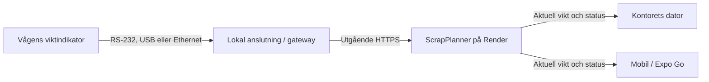

# Vågvikt direkt till vägningsutkast

Utredning och UI-förslag 2026-10-20. Ingen våganslutning är implementerad
eller aktiverad av detta förslag. Vågar och vikter i mockupen är exempel.

[Bildmockup i befintligt kontors- och mobilgränssnitt](../mockups/vagkoppling/README.md).

## Föreslaget arbetsflöde

Placera **Hämta från våg** vid det befintliga viktfältet. En rullista visar
anläggningens kompatibla vågar. Den senast använda vågen kan förväljas;
med en enda våg behövs inget extra val. Listan är ett registrerat urval
för anläggningen, inte en sökning efter alla närliggande Bluetooth-enheter.

1. Välj material och våg. Visningen visar aktuell vikt, enhet och status,
   exempelvis **248,5 kg · Stabil · Uppdaterad nyss**.
2. Tryck **Hämta vikt**. En aktuell, stabil avläsning fyller det vanliga
   viktfältet. Ett kvitto i vyn visar vågens namn och hämtningstid.
3. Granska och använd den befintliga sparknappen. Det hämtade värdet är
   fryst; senare avläsningar förändrar inte automatiskt materialraden.

Manuell inmatning finns kvar. En frånkopplad våg eller en gammal/instabil
avläsning får inte användas som om den vore aktuell. Senast kända vikt
kan visas som inaktuell med inaktiverad hämtningsknapp. Tillgänglighet
och stabilitet visas med text, inte enbart med färg.

På fordonsvägningen används samma princip vid **Vikt vid infart** och
**Vikt vid utfart**, med tydliga knapptexter för vilket fält som fylls.
Befintlig netto- och avdragsberäkning behålls. Vågens bruttovikt,
nettovikt och eventuell tara måste särskiljas så att tara inte dras av
två gånger. Ett redan låst eller godkänt underlag ändras inte av en
inkommande vågavläsning.

Vågar bör konfigureras under **Anläggningar → Vågar**, med namn, modell,
kopplad anslutning, material-/fordonsvåg, kapacitet, enhet/upplösning
och anslutningsstatus. Fabriks- och modellnamn i ett register innebär
inte att enheten har en färdig adapter.

## Rekommenderad anslutning

En befintlig lokal dator eller en liten gateway läser viktindikatorns
dataport och skickar avläsningar till ScrapPlanner. Gatewayen kan
ansluta till internet med nätverkskabel, Wi-Fi eller en lämplig
mobilanslutning. Wi-Fi mellan gateway och nätverk är inte samma sak som
att vågen själv har ett trådlöst vågprotokoll.

Detta ger samma viktkälla till dator och telefon och fungerar med
dagens webbapp och Expo Go-skal. Render kan inte direkt ansluta till
en lokal USB-kabel eller en privat nätverksadress hos JEROC; någon
åtkomlig dataväg behöver finnas. Vi föredrar utgående anslutning från
anläggningen. Vissa indikatorer eller befintliga vågsystem har redan
en dokumenterad nätverks-/molntjänst som kan ersätta en separat gateway.

| Möjlig anslutning | Vad som behövs |
| --- | --- |
| RS-232 / seriell port | Rätt kabel, ibland USB–seriell-adapter, samt dokumentation för baudrate, dataramar och viktprotokoll. |
| USB | Kontroll av om enheten presenterar seriell port, tangentbord, HID eller ett leverantörsspecifikt gränssnitt. En USB-port betyder inte automatiskt att viktdata kan läsas. |
| Ethernet / Wi-Fi | Dokumenterat API eller protokoll, exempelvis TCP-viktström eller Modbus om just den modellen stöder det. Nätverksport innebär inte automatiskt ett webb-API. |
| Bluetooth | Rätt typ av Bluetooth och dokumenterat viktprotokoll: BLE/GATT och klassisk seriell Bluetooth är olika saker. Direktstöd i mobilappen behöver utredas för aktuell modell. |
| Befintligt vågprogram | Ett tillgängligt API eller export-/integrationsgränssnitt, inklusive rätt att använda det och hantering av stabilitet/tid. |

Bluetooth är alltså ett alternativ, inte ett krav. Direkt Bluetooth
från webbgränssnittet är inte en bra gemensam bas för dagens klienter:
Web Bluetooth gäller BLE och saknar stöd i Safari/iOS enligt MDN:s
kompatibilitetsdata vid genomgången. Även Web Serial har begränsat
webbläsarstöd. Vårt nuvarande Expo Go-skal är en WebView utan en särskild
Bluetooth-brygga; egen native-koppling kan behöva ett utvecklingsbygge
med rätt bibliotek. En lokal gateway kan däremot hantera Bluetooth om
just vågen kräver det och protokollet är tillgängligt.

## Det vi behöver få fram hos JEROC

- Vågens **viktindikator/display: fabrikat och modell**, samt manual.
  Indikatorn kan ha ett annat fabrikat än själva vågplattformen.
- Vilka dataportar och eventuella integrationslicenser som finns, och
  om en port redan används av ett annat vågprogram eller en skrivare.
- Tillgängligt viktprotokoll eller ett exempel på riktiga dataramar:
  vikt, enhet, stabilitetsflagga, brutto/netto och tara.
- Om första inkopplingen gäller materialvåg eller fordonsvåg, samt
  tillgång till lokal dator/gateway, ström och nätverk vid vågen.

Vi bör först läsa data från en våg utan att styra nollställning eller
tara, kontrollera avläsningarna mot displayen och därefter ansluta
hämtningen till utkastet. Val av adapter, kabel och trådlös teknik
bestäms efter modellen; vi föreslår inget särskilt inköp innan dess.
Om avlästa värden ska ligga till grund för betalning behöver leverantören
också bekräfta vilken godkänd datautgång och vilka vågkrav som gäller.

## Delar som behöver byggas

Nuvarande kod har manuell viktinmatning och sparande, men inget register
över fysiska vågar, ingen indikatoradapter och inget API för livevikter.
En första leverans behöver:

- Anläggningsbundet vågregister och en adapter för första indikatorn.
- Autentiserad gateway som normaliserar till kg och rapporterar våg-ID,
  avläsnings-ID/sekvens, mättid, mottagningstid, enhet, stabilitet och
  brutto/netto när dessa uppgifter faktiskt finns i protokollet.
- Behörighetskontrollerad visning i dator/mobil samt serverkontroll av
  anläggning, våg, aktualitet, stabilitet och att utkastet får ändras när
  vikten hämtas. Bolag hämtas från registrerad enhets-/användarkontext.
- Ett uttryckligt hämtningsval som bevarar avläsningens ursprung i
  historiken: våg, vikt, tid och användare. Dubbeltryck ska inte skapa
  dubbla materialrader; manuell ändring av hämtad vikt ska framgå.

Stabilitet måste följa indikatorns dokumenterade signal eller en
uttryckligen utredd modell. Att en siffra ser stilla ut i några sekunder
ska inte beskrivas som en bekräftad stabil vågavläsning utan stöd för det.

## Källor och befintliga kodställen

- [MDN: Web Bluetooth](https://developer.mozilla.org/en-US/docs/Web/API/Web_Bluetooth_API).
- [MDN: Web Serial](https://developer.mozilla.org/en-US/docs/Web/API/Web_Serial_API).
- [Expo: egna native-bibliotek och utvecklingsbyggen](https://docs.expo.dev/workflow/customizing/).
- Mobil materialvikt: `src/pages/Weighing.tsx`, `WeightPage`.
- Mobil infart/utfart: `src/pages/Vehicle.tsx`.
- Kontorets viktmodaler: `src/office/AddWeighingArticleModal.tsx` och
  `src/office/EditWeighingRowModal.tsx`.
- Arbetsorderns förberedda vägning:
  `src/office/logistics/WorkOrderWeighing.tsx`.
- Kontorets materialrader och vägningskort: `src/office/OfficeApp.tsx`.
- Befintligt mobilskal: [Expo Go Live](../expo-go-live.md).

Browserstöd kontrollerades mot ovanstående dokumentation och MDN:s
browser-compat-data 2026-10-20. Ingen specifik vågmanual har granskats
innan fabrikat och modell är kända.
