# Fordon, telematik och körjournal – samlade bildmockuper

Detta är **statiska designförslag med fiktiva data**, inte en leverans av färdiga funktioner.
Sidan samlar 20 bilder för granskning av webb, app och hårdvara. Bilderna är inte klickbara appflöden; bildlänkarna öppnar bara originalen i full storlek.

[Översikt](#oversikt) · [Daglig webb](#daglig-webb) · [Daglig app](#daglig-app) · [Enhetsadmin](#enhetsadmin) · [Export](#export) · [Test och hårdvara](#test-hardvara) · [Kompletteringslåset](#kompletteringslas)

## Översikt

| Område | Bilder | Vad förslagen visar |
| --- | ---: | --- |
| [Daglig webb](#daglig-webb) | 6 | Fordon, fordonskort, underhåll, körjournal, förare och karta. |
| [Daglig app](#daglig-app) | 5 | Mitt fordon, resehistorik, komplettering och fordonskontroll. |
| [Enhetsadmin](#enhetsadmin) | 4 | Systemadmins lager, bolagets enheter, fordonskoppling och fordonsbyte. |
| [Export](#export) | 2 | Exportval och förhandsvisning av körjournal. |
| [Test och hårdvara](#test-hardvara) | 3 | Digital testbil och ett möjligt fysiskt förarpanelskoncept. |
| **Totalt** | **20** | **12 tidigare bilder och 8 kompletterande bilder.** |

**Navigation:** Fordon & maskiner öppnar den vanliga fordonsöversikten. Körjournal och GPS-enheter hör till samma arbetsyta; GPS-enheter är en sekundär flik för administration, inte bolagets huvudingång. Systemadmins centrala enhetslager är separat.

**Reviderat upplägg:** ScrapPilot förbereder, aktiverar och tilldelar puckarna till bolaget. Bolaget väljer bara fordon i en dropdown. Appaktivering och QR-engångskoder är bortvalda; bilden för detta har ersatts av ett fordonsbyte.

**Gemensamt före/efter-scenario:** De tidigare appbilderna visar klockan **08:52 den 16 oktober 2026**, då två resor ännu behöver kompletteras. De nya vardags- och exportbilderna visar **09:05 samma dag**, efter att uppgifterna sparats. Exemplet gäller **Niklas**, **PQR678 · Servicebilen · VW Transporter**, med **JEROC Norrtälje** som utgångspunkt:

| Resa | Sträcka | Mätarställning | Sparat tjänstesyfte i efter-läget |
| --- | ---: | --- | --- |
| 07:12–07:37 · JEROC Norrtälje → Verkstad Nord, Rimbo | 22,4 km | 124 580,0 → 124 602,4 km | Hämtning hos Verkstad Nord · AO 1184. |
| 08:25–08:50 · Verkstad Nord, Rimbo → JEROC Norrtälje | 22,4 km | 124 602,4 → 124 624,8 km | Återresa efter hämtning hos Verkstad Nord. |
| **Två klara resor** | **44,8 km** | | |

Detta är exempeluppgifter, inte bevis för fysisk telemetri, en viss persons körning eller verifierad status hos Skatteverket. Äldre fordons- och enhetsbilder innehåller även andra fristående exempel.

## Daglig webb

### 1. Fordonsöversikt

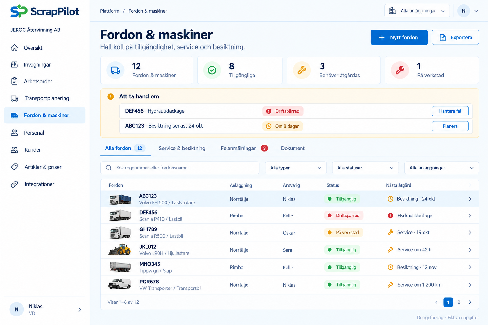

Gemensam översikt för fordon och maskiner, med sökning, filter, tillgänglighet och kommande åtgärder. Detta är den föreslagna huvudingången för det dagliga arbetet.

[Öppna i full storlek](../fordonsadministration/01_Fordonsoversikt.png)

### 2. Fordonskort

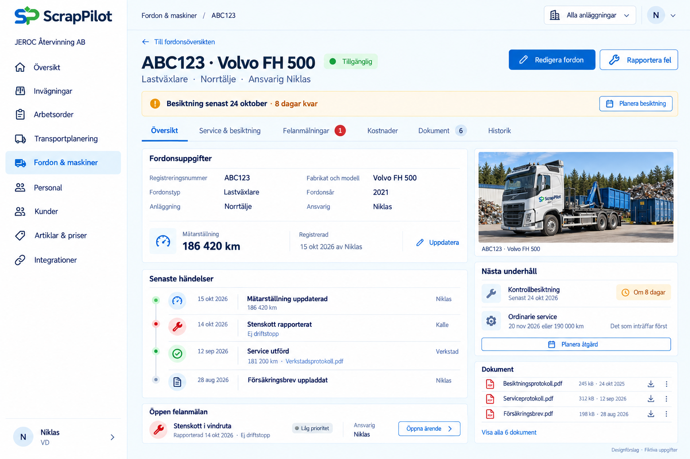

Samlar fordonets uppgifter och förslag till flikar för underhåll, fel, dokument och kostnader. En visad mätarställning innebär inte i sig att en riktig fordonsanslutning är byggd.

[Öppna i full storlek](../fordonsadministration/02_Fordonskort.png)

### 3. Service och besiktning

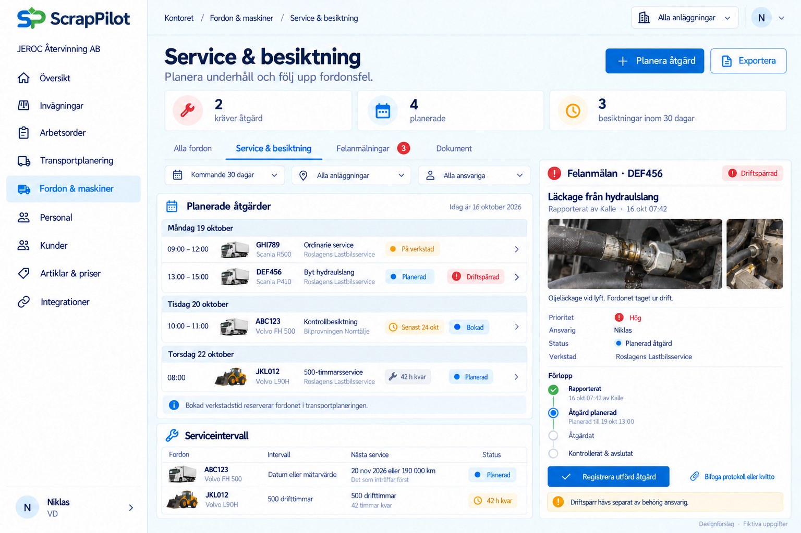

Planering med ansvarig och åtgärdsstatus samt en detaljpanel för fel och bilagor. Servicepåminnelse, daglig kontroll, kontrollbesiktning och driftspärr är skilda uppgifter.

[Öppna i full storlek](../fordonsadministration/03_Service_och_besiktning.png)

### 4. Körjournal med sidopanel

Visar körjournalens historik, filter och kompletteringsstatus med en vald resa till höger. Bildens två ofullständiga resor hör till före-läget, innan de nya historik- och exportbildernas uppgifter har sparats.

[Öppna i full storlek](../korjournal/01_Webb_Korjournal.png)

### 5. Förarhantering

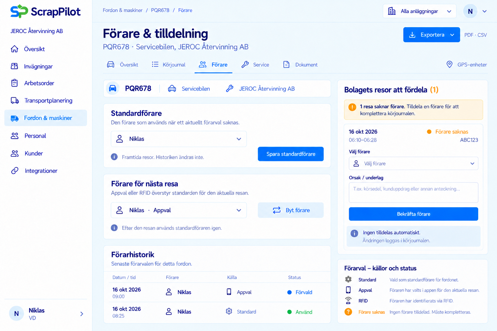

Översikt över förare, fordonskopplingar och föraridentifiering. En standardförare ska kunna skiljas från ett aktuellt appval eller ett faktiskt blipp; en bokning bevisar inte vem som körde.

Standardförare gäller kommande resor. Ett aktuellt appval eller blipp kan ersätta standarden för just den resan; gamla resor ändras inte av ett nytt standardval. Okända eller motstridiga förare får en separat granskningskö med orsak och ändringshistorik.

[Öppna i full storlek](03_Webb_Forarhantering.png)

### 6. Kartöversikt

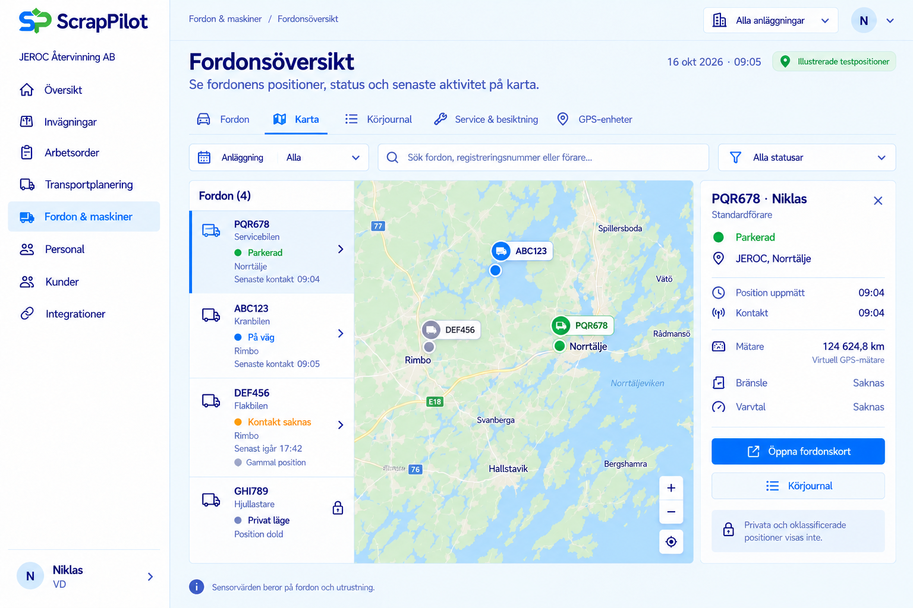

Daglig översikt över fordonens visade position och status, med möjlighet att välja ett fordon. Positionens aktualitet behöver framgå; privata resors rutter ska vara skyddade enligt körjournalsförslaget.

En gammal position märks som gammal och saknade sensorvärden visas som **Saknas**, inte noll. Privata och oklassificerade positioner ska inte visas i bolagets kartöversikt. Datakälla och tidpunkt skiljer illustrerade GPS-värden från verifierade fordonsvärden.

[Öppna i full storlek](04_Webb_Kartoversikt.png)

## Daglig app

### 7. Mitt fordon

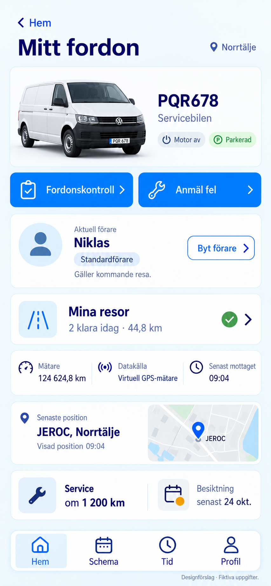

Förarens samlade ingång till sitt fordon, status och nästa praktiska åtgärd. Bilden visar efter-läget klockan 09:05, när de två tidigare resorna är kompletterade.

[Öppna i full storlek](01_App_Mitt_fordon.png)

### 8. Mina resor – efter komplettering

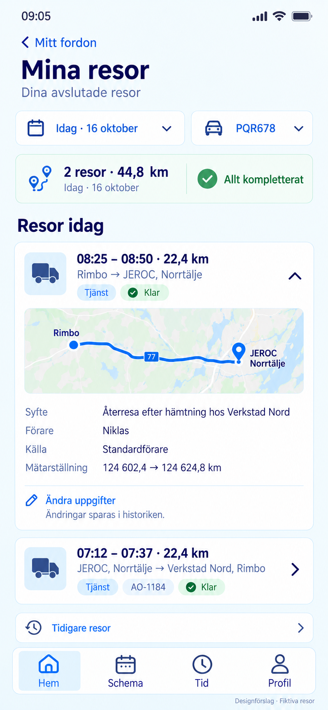

Historiken visar de två klara resorna och totalt 44,8 km. Denna bild visar läget **efter** komplettering och är ingen alternativ väg runt kompletteringslåset.

[Öppna i full storlek](02_App_Mina_resor.png)

### 9. Resor att komplettera – före

Före-läget klockan 08:52: den senaste ofullständiga resan är det aktiva kortet, med nästa kort bakom. **2 kvar** räknar båda korten. Föraren väljer uttryckligen Privat eller Tjänst.

[Öppna i full storlek](../korjournal/02_App_Resor_att_komplettera.png)

### 10. Komplettera samma resa

Samma aktiva kort efter valet Tjänst. Föraren väljer en arbetsorder eller skriver ett konkret tjänstesyfte och använder **Spara och nästa**; först serverbekräftad lagring låter kön gå vidare.

[Öppna i full storlek](../korjournal/03_App_Komplettera_resa.png)

### 11. Fordonskontroll och felanmälan

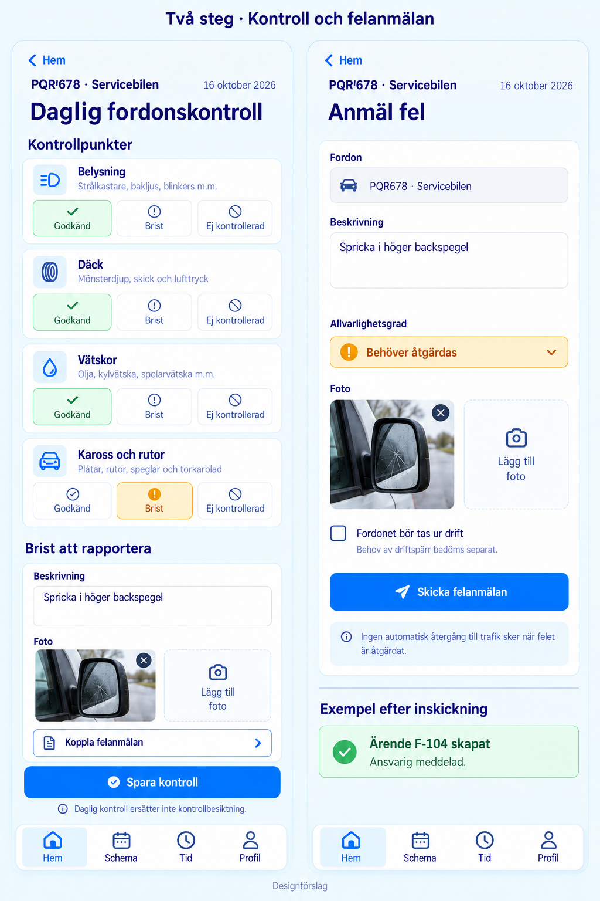

Förslag till mobil kontroll och felrapportering med tydlig koppling till det valda fordonet. En rapporterad eller åtgärdad brist ska inte automatiskt tolkas som godkänd kontrollbesiktning eller hävd driftspärr.

[Öppna i full storlek](08_App_Fordonskontroll_Felanmalan.png)

## Enhetsadmin

### 12. Systemadmins enhetslager

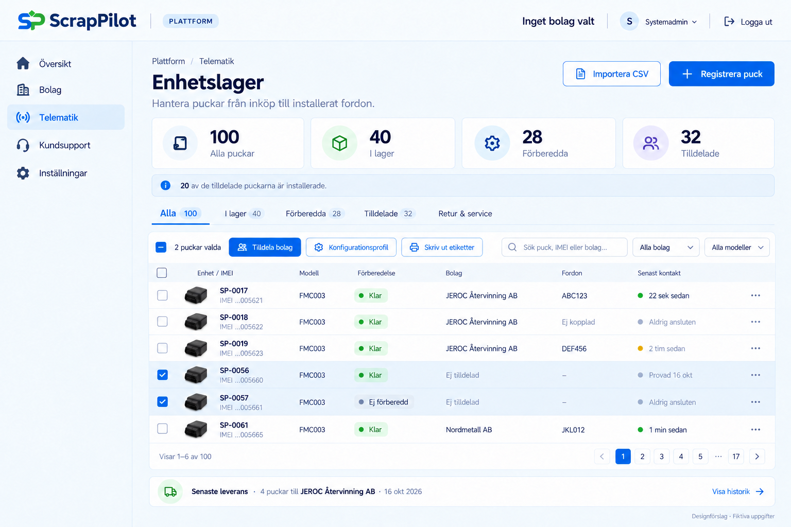

Förbered puckar, hantera enhetsprofiler och tilldela enheter till rätt bolag. Detta är plattformsadministration, skild från bolagets dagliga fordonsarbete.

[Öppna i full storlek](../telematikenheter/01_Systemadmin_Enhetslager.png)

### 13. Bolagets GPS-enheter

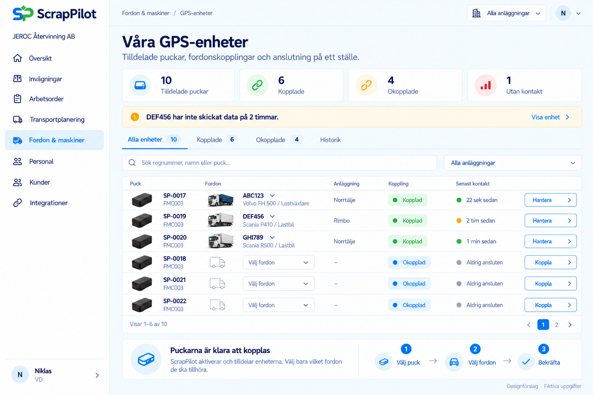

Bolaget ser bara sina redan aktiverade, tilldelade enheter på den sekundära fliken GPS-enheter. I fordonskolumnens dropdown väljs ett befintligt fordon. Livscykelstatus, fordonskoppling och anslutningsstatus är olika uppgifter; en levererad puck behöver inte vara uppkopplad. Kunden ska inte aktivera eller skanna enheten.

En ledig puck får en kort kopplingsbekräftelse. Ändras valet för en redan kopplad puck öppnas **Byt fordon**; själva dropdownvalet flyttar inte några resor eller ändrar kopplingen direkt.

[Öppna i full storlek](../telematikenheter/02_Bolag_GPS_enheter.png)

### 14. Koppla puck till befintligt fordon

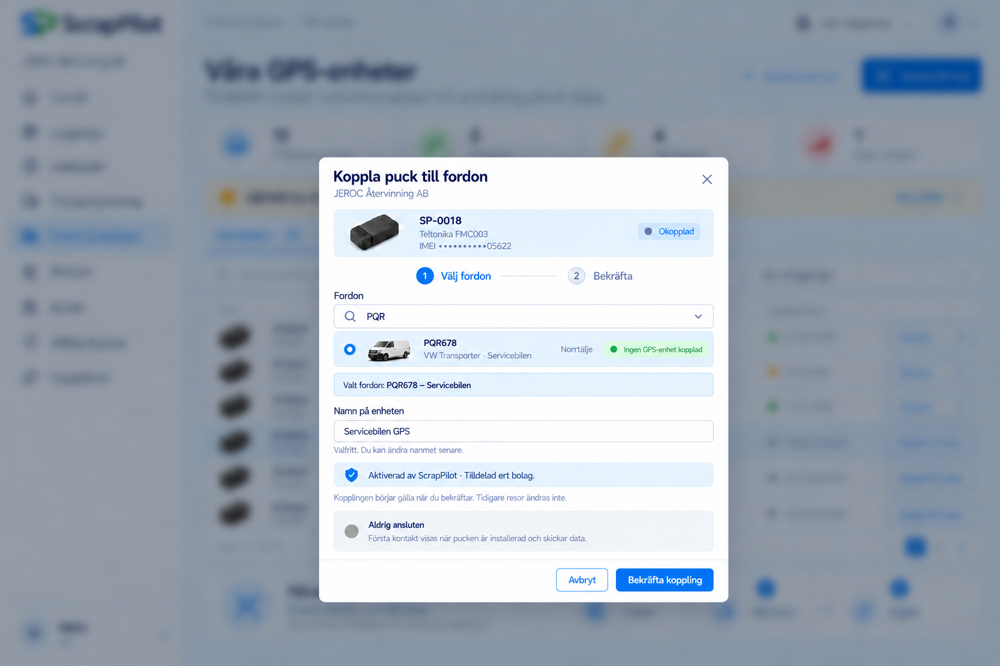

Välj ett befintligt fordon i dropdownen och bekräfta kopplingen för en redan aktiverad puck. Tidigare resor ändras inte. Första kontakt visas separat när pucken väl är installerad och skickar data.

[Öppna i full storlek](../telematikenheter/03_Koppla_puck_till_fordon.png)

### 15. Flytta puck till annat fordon

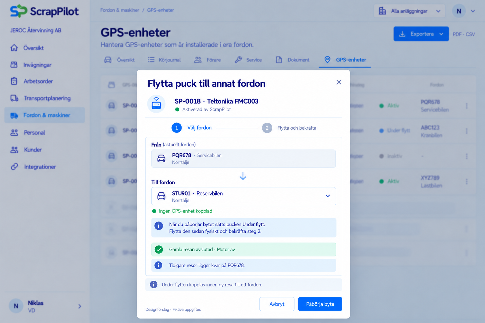

Välj nytt fordon och se **Från → Till** innan bytet påbörjas. Den gamla resan ska vara avslutad och motorn av. **Påbörja byte** stänger den gamla kopplingen och sätter pucken **Under flytt**. Efter den fysiska flytten bekräftas det nya fordonet i steg 2, medan motorn fortfarande är av.

Gamla resor ligger kvar på sitt fordon. Sena eller osäkra mätpunkter får inte automatiskt hamna på det nya fordonet, och puckens gamla mätarvärde får inte bli den nya bilens mätarställning. Pågående resa eller okänt läge efter kontaktavbrott blockerar normalbytet; särskild hantering krävs för en trasig eller frånkopplad puck.

[Öppna i full storlek](05_Webb_Byt_fordon.png) · [Rutin och specialfall](../../integrationer/telematik/enhetskoppling.md)

## Export

### 16. Exportera körjournal på webben

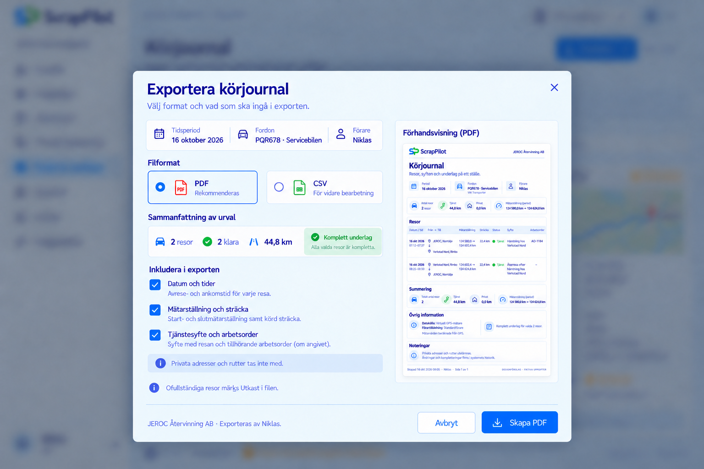

Exportval för period och urval. Scenariot visar två klara resor den 16 oktober, totalt 44,8 km. Export med saknade obligatoriska uppgifter ska i stället märkas **Utkast – ofullständiga uppgifter**, och luckorna ska följa med i filen.

[Öppna i full storlek](06_Webb_Exportera_korjournal.png)

### 17. Körjournal – PDF-förhandsvisning

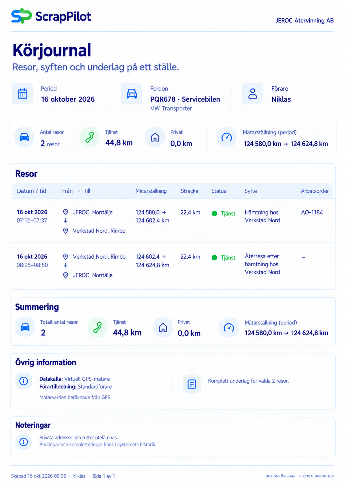

Förslag till dokumentlayout för samma två kompletterade resor, med mätarställningar, körsträcka och tjänstesyften. Detta är en PNG-bild av en PDF-förhandsvisning, inte en genererad körjournals-PDF eller ett myndighetsgodkännande.

[Öppna i full storlek](07_Korjournal_PDF_Forhandsvisning.png)

## Test och hårdvara

### 18. Digital testbil

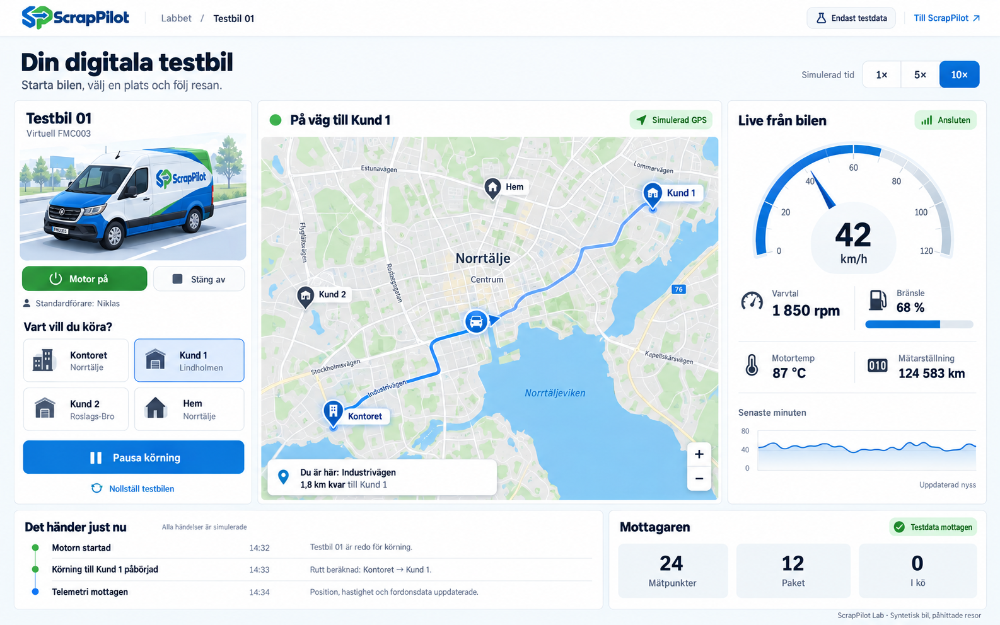

Den tidigare godkända bilden för testbilens kontrollpanel. En separat syntetisk simulator och mottagartjänst har därefter byggts; läs [testbilens faktiska funktion och begränsningar](../../integrationer/telematik/testbil.md). Själva bilden här är fortfarande statisk och visar ingen ansluten fysisk bil.

[Öppna i full storlek](../testbil/01_Testbil_Dashboard.png)

### 19. Förarpanel – hårdvarukoncept

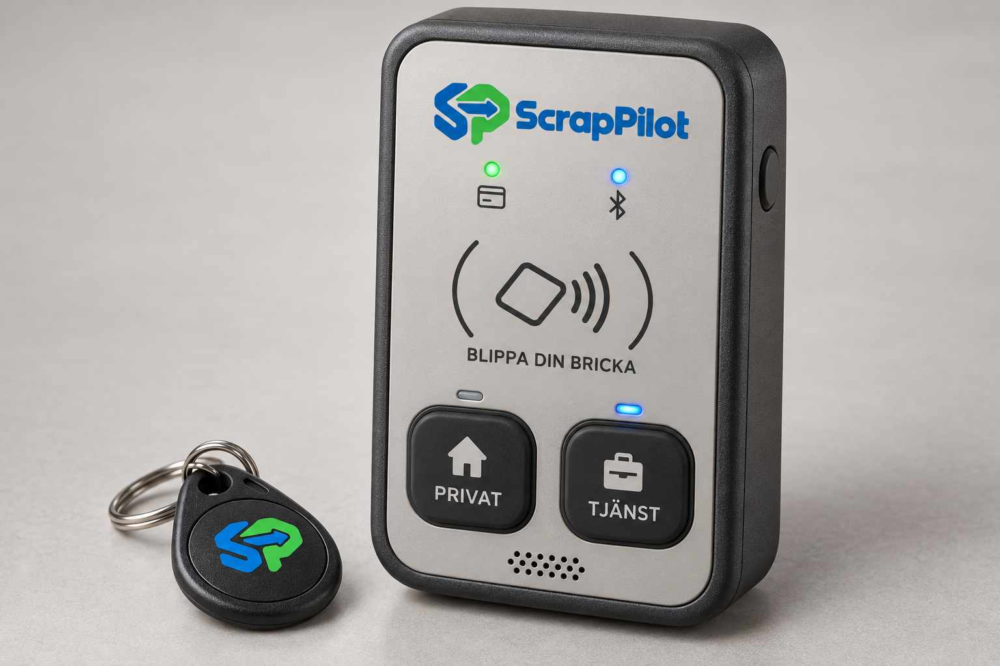

Formgivningsförslag med RFID-blipp, Privat/Tjänst-knappar, lampor och summer. Bilden är inte ett kopplingsschema, verifierad elektronik eller tillverkningsunderlag.

[Öppna i full storlek](../forarpanel/01_ScrapPilot_Forarpanel_Hardvarukoncept.png)

### 20. Förarpanel – föreslagen montering

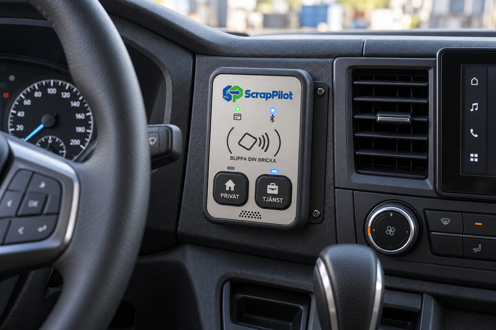

Illustrerar panelens tänkta placering och infästning. Faktisk kapsling, matning, kommunikation och installation behöver konstrueras och provas för det aktuella fordonet.

[Öppna i full storlek](../forarpanel/02_ScrapPilot_Forarpanel_Installerad.png)

## Kompletteringslåset i förslaget

Semilåset följer [de tidigare fastställda körjournalskraven](../korjournal/README.md#flödeskrav-för-en-framtida-implementation):

- När appen öppnas, åter blir aktiv eller får en ny avslutad egen resa visas kompletteringsläget när appen är säker att använda. Alla avslutade egna resor med saknade obligatoriska uppgifter omfattas, även äldre datum.
- Vanliga arbetsflöden och vanlig appnavigation är låsta tills kön är klar. Ingen stängknapp, **Senare**, **Hoppa över** eller tillbaka till appen erbjuds i detta läge.
- Senaste resan visas först. Det aktiva kortet byts inte ut medan föraren fyller i det.
- **Spara och nästa** tar bort kortet först efter serverbekräftad giltig lagring. Fel eller okänt resultat behåller både kort och inmatning; antalet kvar får inte minska utan bekräftelse. En redan fullständigt sparad resa efterfrågas inte igen.
- Tjänst kräver ett uttryckligt arbetsorderval eller konkret manuellt syfte. Snabbval är skrivhjälp, inte automatisk sparning. Privat kräver inget tjänstesyfte och rensar arbetsorder och tjänsteuppgifter.
- Ingen interaktion framtvingas under körning. Okänd förare hanteras separat och blir inte automatiskt den inloggade personen. Tekniska luckor får egen granskning; föraren ska inte hitta på sensorvärden för att komma vidare.

De nya vyerna **Mitt fordon** och **Mina resor** visar efter-läget när de två exemplens uppgifter är sparade. De ändrar inte låsreglerna ovan.

## Underlag och faktisk implementation

Fördjupning till respektive bildserie: [fordonsadministration](../fordonsadministration/README.md), [telematikenheter](../telematikenheter/README.md), [körjournal](../korjournal/README.md), [testbil](../testbil/README.md) och [förarpanel](../forarpanel/README.md).

Vad som faktiskt är byggt, lokalt verifierat och återstår före fysisk pilot beskrivs separat i [telematikens integrationsdokumentation](../../integrationer/telematik/README.md) och [mottagartjänstens dokumentation](../../integrationer/telematik/mottagartjanst.md). Denna bildsida aktiverar inga fordons-, GPS-, export- eller hårdvarufunktioner.
