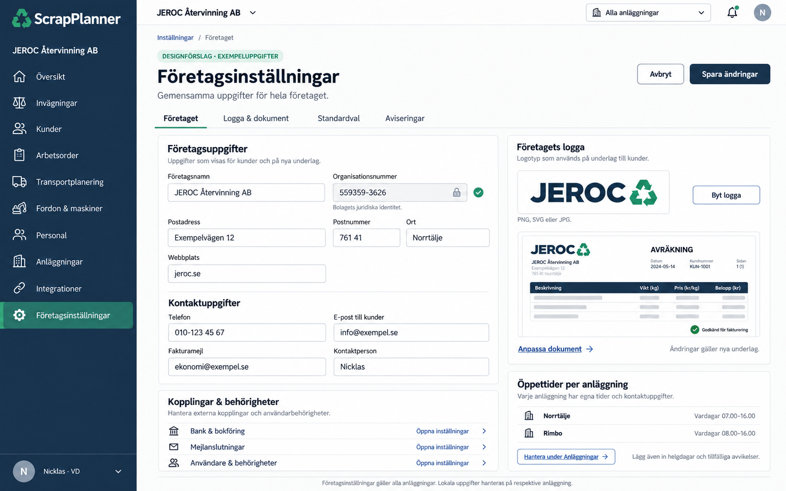

# Företagsinställningar – VD-vy

Statisk bildmockup framtagen **20 oktober 2026**. Förslag till företagsgemensamma inställningar i ScrapPlanner. Kontaktuppgifter, logga och öppettider i bilden är exempel. Ingen appkod eller interaktiv demo ingår.

[Öppna bilden i full storlek](01_Foretagsinstallningar_VD.png)

## Föreslagen uppdelning

| Flik | Innehåll |
| --- | --- |
| Företaget | Företagsnamn, juridisk identitet, postadress, webbplats, publikt telefonnummer, kundmejl, fakturamejl och kontaktperson. |
| Logga & dokument | Företagets logotyp, dokumenttexter, sidfot och förhandsvisning av nya underlag. |
| Standardval | Språk, betalningsvillkor och relevanta förval för nya kunder och underlag. |
| Aviseringar | Mottagare för kundförfrågningar, bokningar, integrationsfel och påminnelser. |

Sidan föreslås vara tillgänglig för VD och särskilt behöriga administratörer i det egna bolaget. ScrapPlanners produktlogga finns kvar i navigationen; kundbolagets logga används på dess dokument och kundytor.

## Öppettider hör till anläggningen

Adress, lokalt telefonnummer, kontaktmejl, veckans öppettider, helgdagar och tillfälliga avvikelser hanteras under **Anläggningar**. Norrtälje och Rimbo kan därför ha olika tider. Företagsinställningarna visar bara en sammanfattning och en genväg dit.

Bank, bokföring, mejlanslutningar samt användare och behörigheter öppnas genom genvägar till sina befintliga arbetsytor. Samma uppgift ska inte behöva underhållas på två ställen.

Godkända publika kontaktuppgifter och öppettider kan senare återanvändas i kundportalen och som godkänd kunskap till AI-supporten.

## Inför implementation

- Organisationsnumret är bolagets juridiska identitet och visas låst; profilredigering ska inte kunna byta bolag eller organisationsidentitet.
- Logga och dokumenttexter gäller nya underlag. Redan låsta dokument behåller sina ursprungliga uppgifter och sin historik.
- Redigerbar företagsprofil, loggauppladdning och anläggningarnas öppettider är föreslagna funktioner, inte levererade genom denna bild.

[Alla bildmockuper](../README.md)
