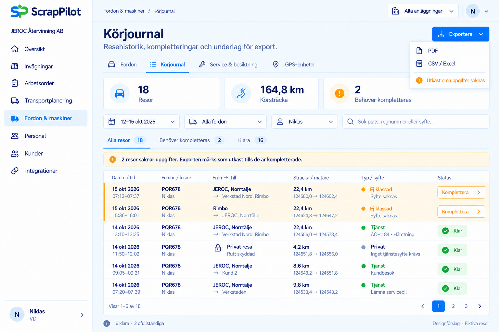
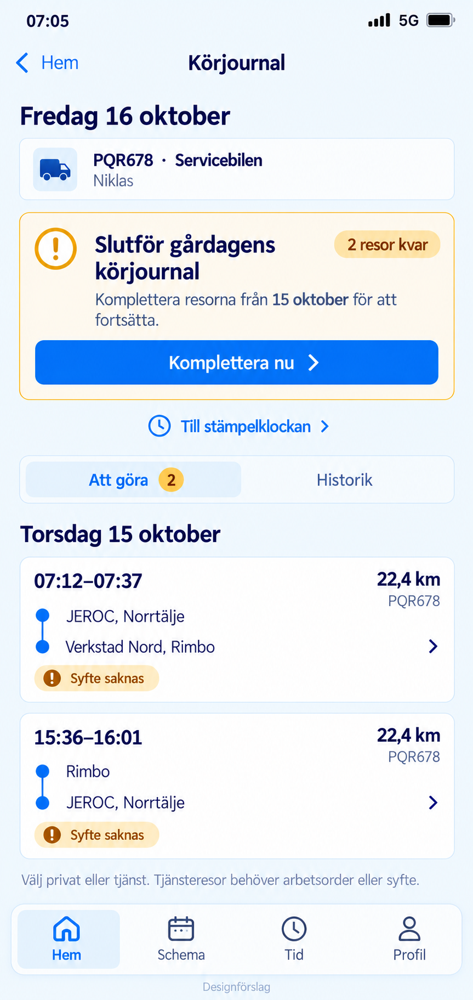
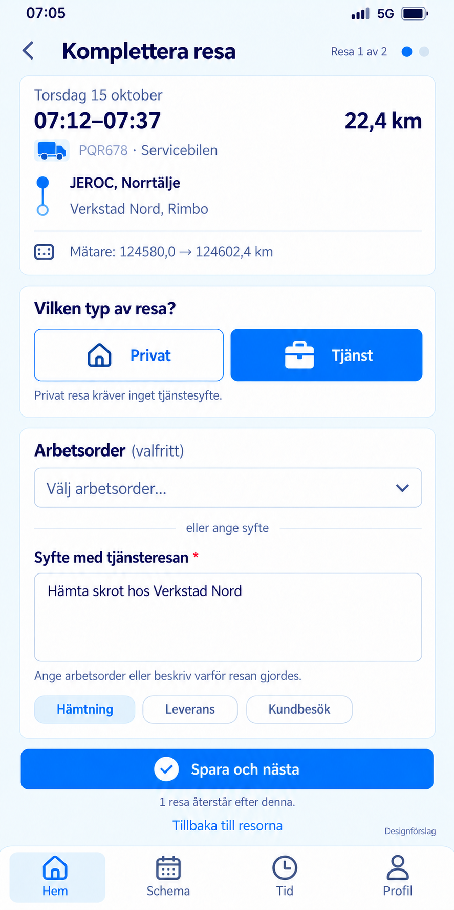

# Körjournal – bildmockuper

Tre statiska bildmockuper framtagna 2026-10-16 med fiktiva personer, resor och fordonsuppgifter. Leveransen innehåller ingen appkod. Beteenden och funktionella garantier nedan är designkrav, inte implementerad funktion.

## 1. Webb: körjournal och export

Körjournalen ligger under **Fordon & maskiner**, på fliken **Körjournal**. **GPS-enheter** är en sekundär flik. Vyn visar historik, filter och sammanfattningen **18 resor · 16 klara · 2 ofullständiga**. PDF- och CSV-export med saknade uppgifter ska tydligt märkas **Utkast – ofullständiga uppgifter**. Privata resors rutt är dold.

## 2. App: resor att komplettera

Mobilöversikten visar morgonen den **16 oktober 2026**: **Slutför gårdagens körjournal**, **2 resor** och **Komplettera nu**. Vyn har **Att göra / Historik**, medan appens befintliga bottenmeny **Hem / Schema / Tid / Profil** behålls.

Samma två avslutade resor utan angivet syfte visas i webb och app, båda för **Niklas**, fordon **PQR678**, den **15 oktober 2026**:

- **07:12–07:37:** JEROC Norrtälje → Verkstad Nord, Rimbo, **22,4 km**. Mätarställning **124 580,0 → 124 602,4 km**.
- **15:36–16:01:** Rimbo → JEROC Norrtälje, **22,4 km**.

## 3. App: komplettera en resa

Formuläret visar **Resa 1 av 2**. **Tjänst** är valt genom ett uttryckligt användarval. Användaren kan antingen välja en arbetsorder eller ange ett konkret manuellt tjänstesyfte; exemplet har syftet **Hämta skrot hos Verkstad Nord**. Primär åtgärd är **Spara och nästa**. **Privat** ska rensa arbetsorder och tjänstesyfte och kräver inget sådant syfte.

## Flödeskrav för en framtida implementation

- Förfallna, avslutade resor ska obligatoriskt kompletteras. Vanliga arbetsflöden begränsas tills detta är gjort, på samma sätt som vid saknad tidsregistrering. Det finns ingen **Hoppa över**-åtgärd.
- Nödvändig åtkomst till stämpelklocka och frånvaro ska finnas kvar. Ingen interaktion ska ske under aktiv körning; komplettering sker när fordonet står stilla.
- Okänd förare hanteras separat och får inte automatiskt tilldelas den inloggade användaren. Standardförare eller gissad arbetsplats får inte automatiskt göra en resa till tjänsteresa.
- Export med luckor får aldrig framstå som komplett. Saknade uppgifter och utkaststatus ska följa med i exporten.

Se även [tidigare fordonsmockuper](../fordonsadministration/README.md), [mockuper för GPS-enheter](../telematikenheter/README.md) och [telematikens integrationsdokumentation](../../integrationer/telematik/README.md).
