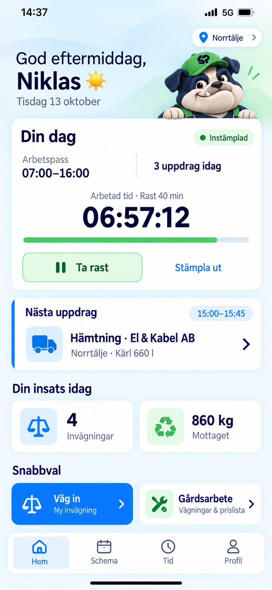

# ScrapPilot – mobilens hemskärm

Statisk bildmockup, 2026-10-13. Ett förslag till en mer personlig hemskärm.

[Öppna bilden](01_Hem_Skrotis_Stampelklocka.png)

- Hälsning efter tid på dagen, anläggningsväljare och en liten Skrotis.
- Din dag med arbetspass, uppdrag och stämpelklocka för en medarbetare som
  har klockan aktiverad. Arbetad tid och rast hålls åtskilda.
- Nästa uppdrag med tid, kund, plats och en genväg till uppdraget.
- Personliga exempel för dagens invägningar och mottagna vikt.
- Snabbval till ny invägning och gårdsarbete.
- Gemensam bottenmeny: Hem, Schema, Tid och Profil.

Alla värden och uppdrag är fiktiva exempel. Bilden ändrar inte appens
funktioner, behörigheter eller beräkningar. Statistik och visning av
maskoten är designförslag. Planerat arbete räknas inte som registrerad tid.

Skrotis utgår från den [valda maskoten](../../branding/mascot/README.md).
Utformningen bygger vidare på de [befintliga huvudvyerna](../mobil-huvudvyer/README.md).
