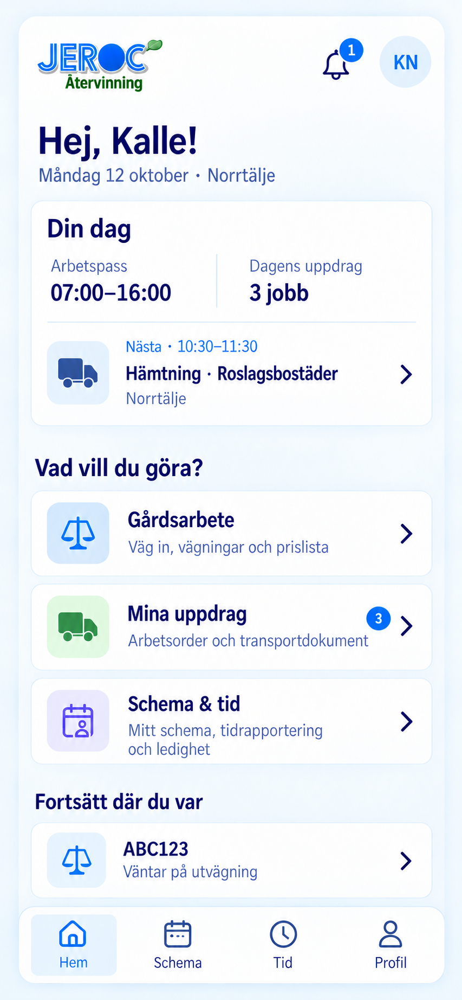
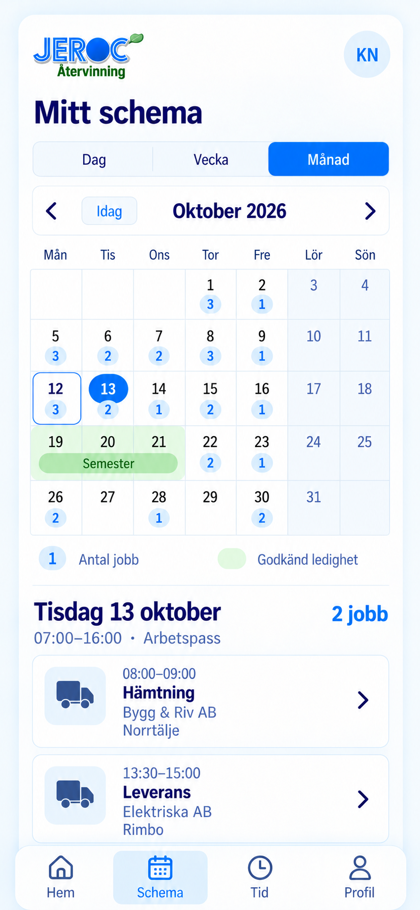
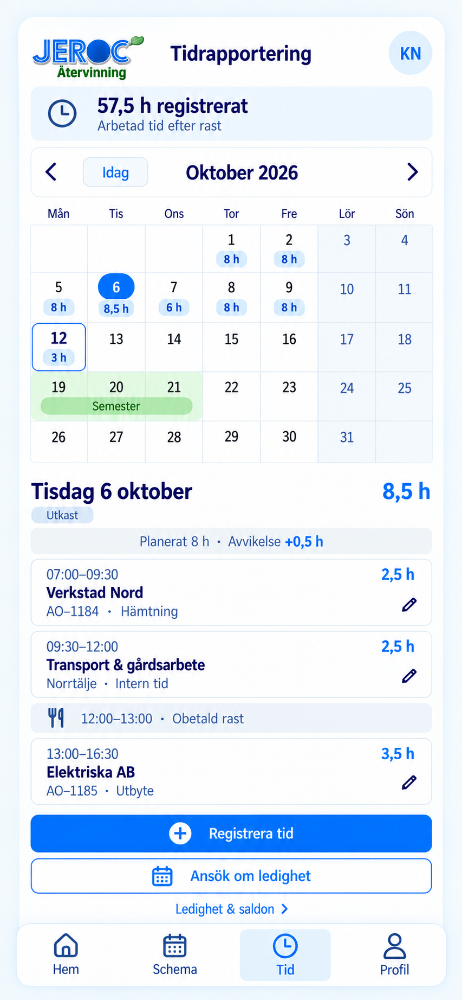
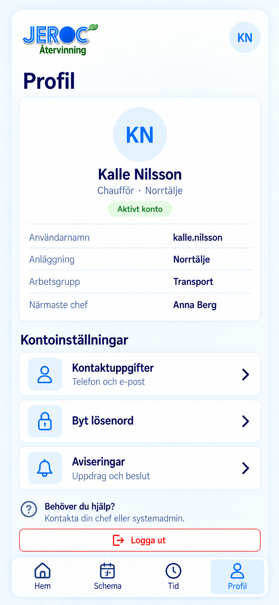

# Mobilappens huvudvyer

Fyra statiska designbilder, 2026-10-12. En gemensam app med bottenmenyn
**Hem · Schema · Tid · Profil**. Fiktiva exempeluppgifter för Kalle Nilsson.
Detta är designförslag; den verkliga appen är inte ändrad.

## Hem

Dagens överblick och tydliga ingångar till gårdsarbete och egna uppdrag.
Funktionerna visas efter behörighet.

[Öppna Hem](01_Hem.png)

## Schema

Dag, vecka och månad visar arbetspass och planerade jobb. Den valda dagens
jobb listas direkt under kalendern. Ledighetsansökningar finns under Tid.

[Öppna Schema](02_Schema.png)

## Tid

Månadskalendern visar registrerade timmar i dagsmarkeringarna. Den valda
dagens tider listas per jobb eller aktivitet under kalendern. Här finns
även ledighetsansökningar och saldon. Planerade jobb blir inte automatiskt
rapporterad arbetstid.

[Öppna Tid](03_Tid.png)

## Profil

Egna kontouppgifter och inställningar.

[Öppna Profil](04_Profil.png)

[Tidigare förslag och chefens granskningsflöden](../personal-mobil/README.md).
