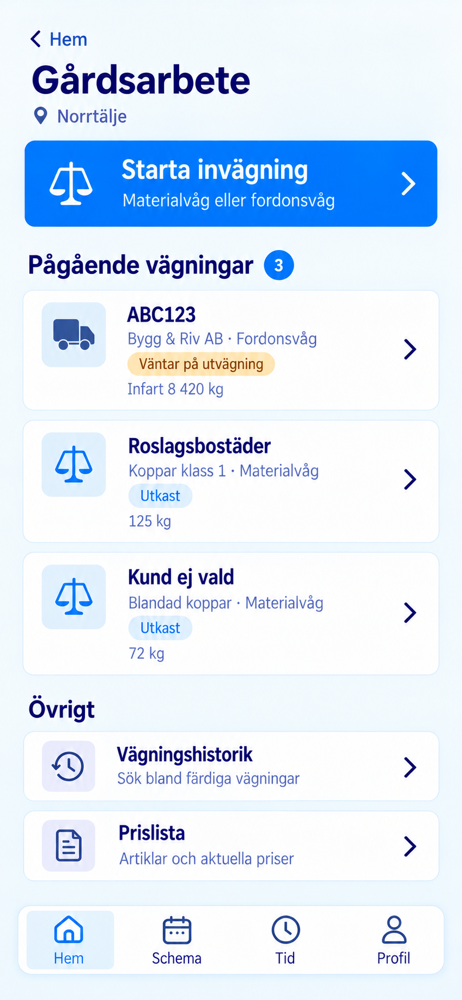

# Mobilappens huvudvyer

Fyra huvudvyer och en gårdssida som statiska designbilder, 2026-10-12.
En gemensam app med bottenmenyn
**Hem · Schema · Tid · Profil**. Fiktiva exempeluppgifter för Kalle Nilsson.
Bilderna är designreferens för [mobilappen 0.5.0](../../employee-mobile.md).
Appens gemensamma vyer, inloggning och tidsregistrering är nu implementerade.

Alla fem vyer har ett kompakt sidhuvud: JEROC-loggan, aviseringsklockan
och profilgenvägen högst upp tas bort för att ge innehållet mer plats.
Sidans rubrik och nödvändiga tillbaka-knappar finns kvar. Bottenmenyn
**Hem · Schema · Tid · Profil** ligger kvar; personens uppgifter visas på Profil.

## Hem

Dagens överblick och tydliga ingångar till gårdsarbete och egna uppdrag.
Funktionerna visas efter behörighet.

[Öppna Hem](01_Hem.png)

## Schema

Dag, vecka och månad visar arbetspass och planerade jobb. Den valda dagens
jobb listas direkt under kalendern. Ledighetsansökningar finns under Tid.

[Öppna Schema](02_Schema.png)

## Tid

Månadskalendern visar registrerade timmar i dagsmarkeringarna. Den valda
dagens tider listas per jobb eller aktivitet under kalendern. Här finns
även ledighetsansökningar och saldon. Planerade jobb blir inte automatiskt
rapporterad arbetstid.

[Öppna Tid](03_Tid.png)

## Profil

Egna kontouppgifter och inställningar.

[Öppna Profil](04_Profil.png)

## Gårdsarbete

Detaljsidan öppnas från **Hem → Gårdsarbete**. Den använder samma bottenmeny
med Hem markerad; Gårdsarbete är ingen egen flik i bottenmenyn.

**Starta invägning** öppnar det befintliga valet mellan Materialvåg och
Fordonsvåg. Pågående utkast och vägningar som väntar på utvägning visas
direkt under knappen, så att arbetet enkelt kan återupptas. Vägningshistorik
och Prislista är sekundära ingångar.

[Öppna Gårdsarbete](05_Gardsarbete.png)

[Tidigare förslag och chefens granskningsflöden](../personal-mobil/README.md).
