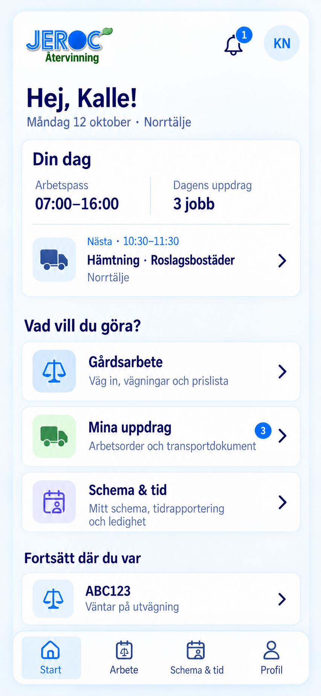

# Schema & tid – mobil självservice och chefens granskning

## Senaste statiska huvudvyer

[Öppna bilderna för Hem, Schema, Tid och Profil](../mobil-huvudvyer/README.md).
Den gemensamma appens bottenmeny är **Hem · Schema · Tid · Profil**.
Hem samlar gårdsarbete och egna uppdrag. Schema visar planeringen; Tid
samlar rapporterad arbetstid, ledighetsansökningar och saldon. Profil har
kontouppgifter och inställningar. Den verkliga appen är inte ändrad.

## Tidigare förslag: gemensam startsida

[Öppna bilden på den gemensamma startsidan](14_Gemensam_Startsida.png).



Startsidan samlar dagens arbetspass och nästa uppdrag samt tre ingångar:
**Gårdsarbete**, **Mina uppdrag** och **Schema & tid**. Samma upplägg föreslås
för alla, med funktioner utifrån behörighet. Pågående vägningar kan återupptas
längst ner. Bildens tidigare huvudmeny ersätts i de senaste förslagen av
**Hem**, **Schema**, **Tid** och **Profil**.
Namnet **Schema & tid** är valt för medarbetarens egna uppgifter. Chefens
personaladministration heter fortsatt **Personal**.

Detta är en tidigare statisk bild. Den klickbara prototypen och ZIP-filen nedan
visar fortfarande det tidigare navigationsförslaget med namnet Min personal; den riktiga appen är
inte ändrad av denna mockup.

## Tidigare klickbar prototyp

Klickbart designförslag 2026-10-12 i befintlig JEROC-design.
[Öppna mobilmockupen](https://jeroc-atervinning.onrender.com/mockups/personal-mobil/index.html#profil)
efter Render-deploy. [Öppna chefsvyn](https://jeroc-atervinning.onrender.com/mockups/personal-mobil/index.html#chef).

[Ladda ner den kompletta prototypen och bilderna](JEROC_Min_Personal_Mockup.zip).
Packa upp ZIP-filen och öppna `index.html` i webbläsaren för att prova lokalt.

Detta är en fristående prototyp med fiktiva exempeluppgifter i minnet.
Profilväljaren provar arbetsflöden och är ingen autentisering. Ingen personal,
tidrapport, semesterreservation, arbetsorder eller databaspost ändras i den
verkliga appen. Ladda om eller välj **Återställ** för att börja om.

## Mobilvyer

| Vy | Bild |
| --- | --- |
| Profil med ingång till Min personal | [01_Profil.png](01_Profil.png) |
| Min personal, egen översikt | [02_Min_Personal.png](02_Min_Personal.png) |
| Mitt schema | [03_Mitt_Schema.png](03_Mitt_Schema.png) |
| Min tid och veckorapport | [04_Min_Tid.png](04_Min_Tid.png) |
| Rapportera arbetad tid | [05_Rapportera_Tid.png](05_Rapportera_Tid.png) |
| Min ledighet och ansökningar | [06_Min_Ledighet.png](06_Min_Ledighet.png) |
| Ansök om ledighet | [07_Ansok_Ledighet.png](07_Ansok_Ledighet.png) |
| Mina saldon | [08_Mina_Saldon.png](08_Mina_Saldon.png) |
| Chefens granskningskö | [09_Chef_Granskning.png](09_Chef_Granskning.png) |
| Chefens granskning av ledighet | [10_Chef_Ledighet.png](10_Chef_Ledighet.png) |
| Chefens granskning av tidrapport | [11_Chef_Tidrapport.png](11_Chef_Tidrapport.png) |
| Godkänd ledighet och bemanning | [12_Chef_Godkand_Ledighet.png](12_Chef_Godkand_Ledighet.png) |
| Medarbetarens uppdaterade saldon | [13_Mobil_Uppdaterat_Saldo.png](13_Mobil_Uppdaterat_Saldo.png) |

Denna tidigare prototyp visar ingången **Profil → Min personal**. Det senaste
förslaget ovan har separata flikar för Schema och Tid. De egna vyerna visar egen information;
chefens kö ligger under kontorets Personal och anpassas även till mobilbredd.
Riktig implementation måste använda personalkopplingen, verklig inloggning
och serverns chefs-/anläggningsbehörigheter.

## Prova tidflödet

1. Öppna **Min tid**. Veckan 5–9 oktober har 40 schematimmar,
   38,5 rapporterade arbetstimmar och 2 timmar separat registrerad VAB.
   Tidsavvikelsen är +30 minuter och inväntar bedömning.
2. Öppna tisdagen. Ändra start/slut, obetald rast och kommentar. Spara.
3. **Skicka för granskning** låser rapporten för medarbetaren.
4. Välj Anna i prototypens profilväljare och öppna tidrapporten.
5. Godkänn rapporten eller återför den med obligatorisk kommentar.
   En återförd rapport kan rättas av Kalle och skickas igen.

Schemat visar planering. Tidrapporten visar faktiskt rapporterat arbete;
schemat räknas inte automatiskt som utfört. VAB-posten är tidigare registrerad
frånvaro, inte en ledighetsansökan som ska godkännas i denna kö.
Granskad arbetstid ger inte automatiskt övertidsersättning, komp eller flex.
Regler för dessa behöver beslutas inför implementation.

## Prova ledighetsflödet

1. **Min ledighet** har en tidigare godkänd semester 19–21 oktober och en
   väntande ansökan 26–30 oktober. En ny ansökan kan exempelvis avse 2–6 november.
2. Välj typ, datum, omfattning och eventuell kommentar. Ansökan skickas
   till ansvarig chef; schema och bemanning ändras inte vid sändningen.
3. I chefsvyn visar ansökan saldo och faktiskt berörda exempeluppdrag.
4. Godkänn eller avslå. Avslag behöver en kommentar. En väntande ansökan
   kan tas tillbaka av medarbetaren.
5. Godkännande reserverar semester, visar frånvaro i schemat och skapar
   bemanningsuppgifter för berörda uppdrag. Uppdragen behåller sin kund och tid.
6. Chefsvyn illustrerar tilldelning av Lina som ersättare. I produktion ska
   den befintliga bemanningsmotorn återanvändas för att kontrollera schema,
   frånvaro, överlapp, fordon och kompetenser.

Exemplet har 25 tilldelade semesterdagar, 12 uttagna och 3 reserverade för
godkänd kommande ledighet: **10 tillgängliga**. Den väntande ansökan om 5 dagar
visas separat. Efter godkännande är 8 dagar reserverade och 5 tillgängliga.
Mockupen har 8 timmar komp och 3 timmar 15 minuter flex som separata saldon.
Helgdagar, olika arbetsscheman, semesterår och kollektivavtalsregler behöver
hanteras av den senare produktionsmodellen; exemplet räknar måndag–fredag.

## Första implementation efter designgranskning

- Återanvänd befintlig personalprofil, schema, frånvaro och bemanningsuppgifter.
- Lägg till separata ledighetsansökningar och rapporterad arbetstid, med
  granskningsstatus, version och spårbara beslut.
- Saldon behöver en journal för tilldelning, reservation, uttag och rättelse.
- Skydda egna uppgifter på servern och använd verklig gemensam inloggning.
- Frånvarobeslut får inte skapa extra eller radera befintliga arbetsordrar.
- Chefens godkännande av tid är en HR-granskning, separat från ekonomisk
  attest av viktkort. Lönekörning, lönebesked och HR-integration ingår inte här.
- Tid rapporteras manuellt i första designen. In-/utstämpling kan läggas till
  senare om det önskas.

## Exportera bilder

Från repots rot:

```sh
node docs/mockups/personal-mobil/render-mockups.mjs
```

Renderingen använder en separat lokal filserver och befintlig Chromium.
Den provar prototypens tid-/ledighetskedjor och mobilbredd, sparar bilderna
och kontrollerar att prototypen inte kontaktar externa tjänster.
