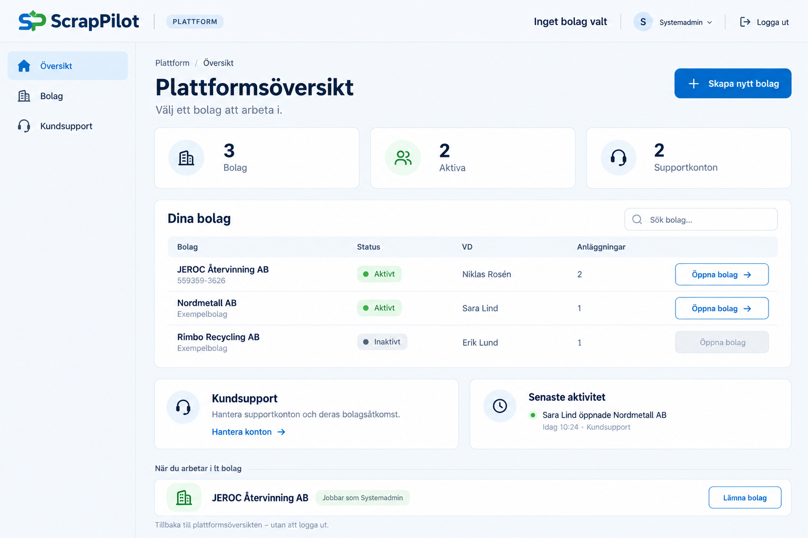
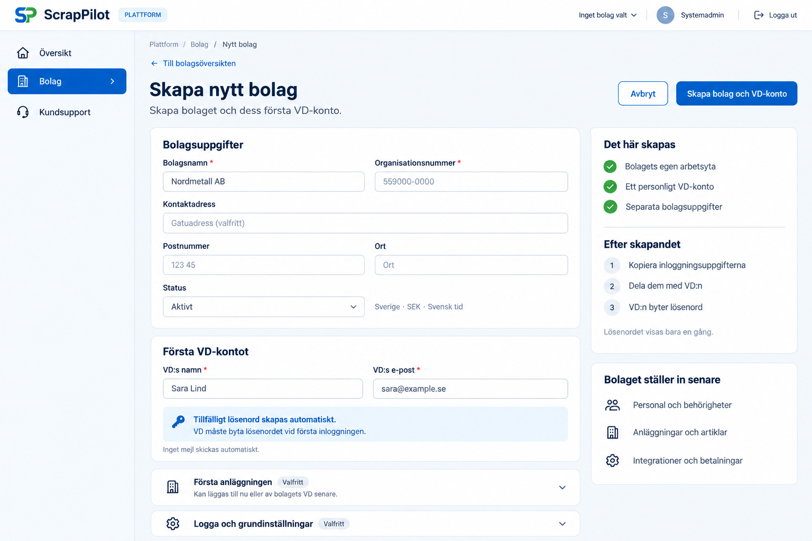
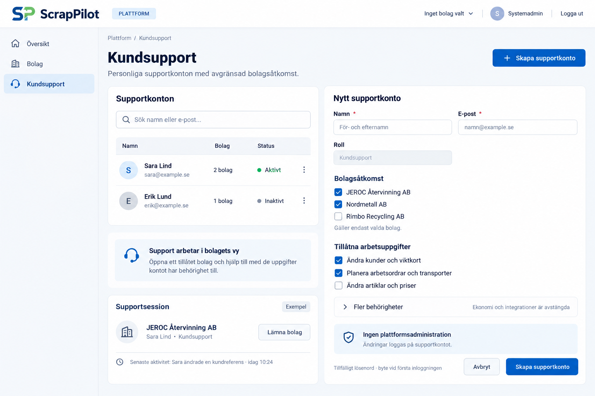

# ScrapPilot – plattformsadmin och kundsupport

Tre statiska designförslag, 2026-10-13. Bilder och planering; ingen appkod
eller interaktiv demo ingår. Funktionerna som föreslås här är inte införda
genom uppladdningen. Övriga bolag och supportpersoner är exempeluppgifter.

## Bolagsöversikt

[Öppna bilden](01_Bolagsoversikt.png)

Systemadmin landar på plattformens översikt innan ett bolag väljs.
Bolag, status, VD-konto och antal anläggningar ger en enkel överblick.
**Öppna bolag** går vidare till bolagets arbetsyta och dess befintliga
Jobba som-val. Plattformen behöver bara Översikt, Bolag och Kundsupport
i menyn; bolagets vanliga arbetsmeny visas inne i bolaget.

**Lämna bolag** återgår till plattformsöversikten och avslutar den aktuella
Jobba som-kontexten. **Logga ut** avslutar hela kontots inloggning.
Den nedersta remsan i bilden är ett exempel på hur återvägen kan visas
inne i ett bolag, inte ett aktivt bolagsval på startsidan.
Det nu rapporterade problemet att systemadmin inte kan lämna JEROC
åtgärdas i kommande implementation, inte av denna mockup.

## Skapa nytt bolag

[Öppna bilden](02_Skapa_bolag.png)

En egen sida med fyra obligatoriska uppgifter: bolagsnamn,
organisationsnummer, VD:s namn och VD:s e-post. Dessa motsvarar
grunduppgifterna i dagens bolagsskapande. Kontaktadress, status,
första anläggning och logga visas som föreslagna kompletteringar.
Anläggning och grundinställningar kan även fyllas i senare av bolagets VD.
Sverige, SEK och svensk tid är standard för det här förslaget.

**Skapa bolag och VD-konto** skapar bolagets arbetsyta och första personliga
VD-konto. Ett tillfälligt lösenord genereras och måste bytas vid första
inloggningen. Uppgifterna visas en gång och delas av systemadmin.
Inget automatiskt mejlutskick ingår i förslaget. Personal, artikelregister,
integrationer och betalningsinställningar ställs sedan in i bolaget.

## Kundsupport

[Öppna bilden](03_Kundsupport.png)

Systemadmin hanterar personliga supportkonton med namn, e-post,
aktivstatus, tillåtna bolag och arbetsuppgifter. Support kan exempelvis
hjälpa till med kunder, viktkort och transportplanering; rollen är alltså
användbar även för operativa ändringar.

Bolagsurval och behörigheter måste gälla på servern. En supportsession
ska behålla supportpersonens verkliga identitet och logga bolag,
tidpunkt och utförd ändring. En eventuell Jobba som-vy får inte höja
supportkontots tilldelade rättigheter eller ge åtkomst till andra bolag.
Befintliga låsningar av kundgodkända/attesterade kort gäller fortsatt.

Ekonomi, attest, integrationer och kontohantering är separata rättigheter
och avstängda som standard. Kundsupport får inte skapa eller ta bort bolag,
dela ut systemadminrollen eller läsa integrationshemligheter.
Supportrollen och dess kontohantering är nya förslag, inte befintliga
funktioner. Supportsessionen till vänster i bilden är endast ett exempel.

Planerat genomförande följs i [ÄL 104](../../Andringslistan.txt).
