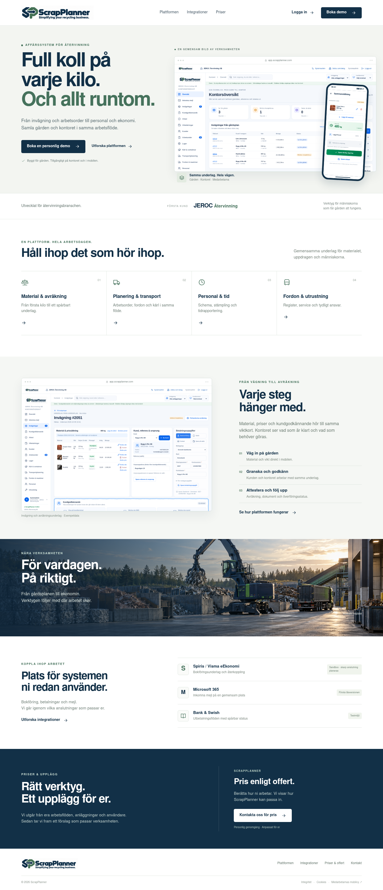
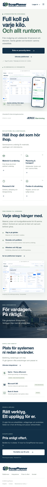
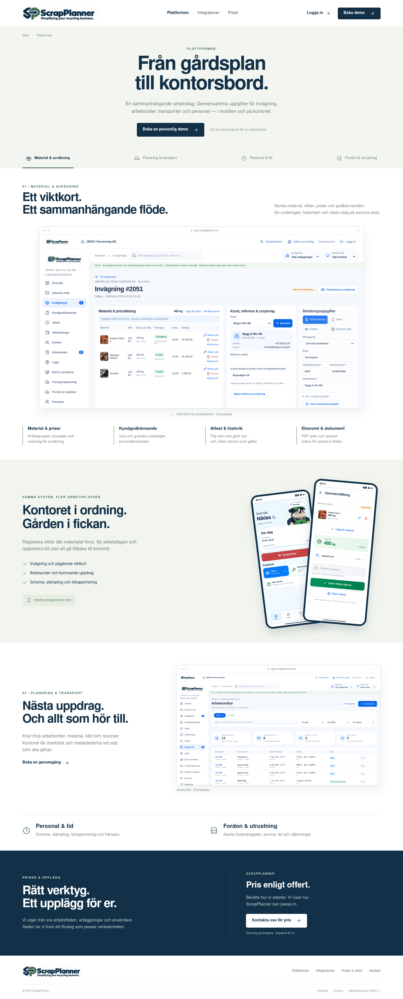

# ScrapPlanner – hemsidan

**Simplifying your recycling business.**

Tre statiska bildmockuper av ScrapPlanners publika SaaS-hemsida.
Mörk marinblå, dämpad grön och den korrigerade SP-loggan möter skärmbilder
från produktens lokala demo. JEROC Återvinning visas som första kund.

## 1. Startsida – dator

Produktöversikt, kontor och mobil, arbetsflöde, integrationer och
**Pris enligt offert**. Tydliga ingångar för **Boka demo** och **Logga in**.

[Öppna bilden i full storlek](01_Startsida_Dator.png)



## 2. Startsida – mobil

Samma budskap och innehåll anpassat till en smal skärm.

[Öppna bilden i full storlek](02_Startsida_Mobil.png)



## 3. Plattformen – produktsida

Viktkortet och arbetsflödet i fokus, följt av mobilappen, arbetsorder,
personal och fordonsregister.

[Öppna bilden i full storlek](03_Plattformen_Dator.png)



## Underlag och avgränsning

- Bildmockuper för designgranskning; ingen interaktiv demo eller publicerad
  säljsida. Knappar och navigation i bilderna har ingen funktion.
- Föreslagen adressuppdelning: `scrapplanner.com` för säljsidan,
  `app.scrapplanner.com` för kontoret och `mobile.scrapplanner.com` för mobilen.
  Bilderna bekräftar inte domänägande eller en driftsatt tjänst.
- Produktbilderna togs från den riktiga appkoden med isolerade, syntetiska
  lokala demoregister. Endast visat produktnamn och logga anpassades i
  webbläsarens DOM. Ingen kunddatabas eller extern leverans användes.
- Miljöbilden av återvinningsgården är AI-genererad illustrationsbild,
  inte ett fotografi av JEROC:s anläggning.
- Integrationernas status är utskriven i förslaget. Sandbox/test innebär
  inte verifierad produktionsanslutning eller skarpa utbetalningar.
- [Loggförslag och palett](../../branding/scrapplanner/README.md).

Renderingsunderlaget finns i `render-mockups.mjs`. Det skapar endast PNG-bilder
med en lokal headless-webbläsare och använder inga externa nätverksanrop.
`render-verification.json` redovisar bildmått, bildladdning och sidbredd för
senaste renderingen. Verifieringen avser bildkompositionerna, inte SaaS-drift.

```sh
node docs/mockups/scrapplanner-hemsida/render-mockups.mjs
```

Rendereraren använder projektets Playwright och lokal Chromium. Nimbus Sans
används när typsnittet finns installerat; annars används Arial/sans-serif.
