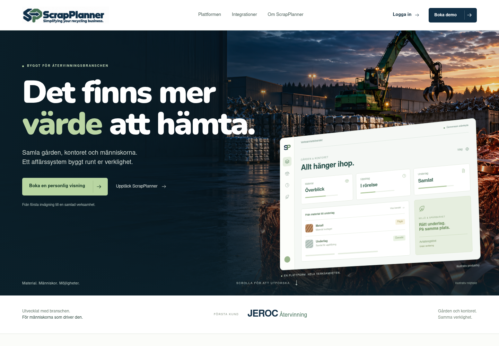
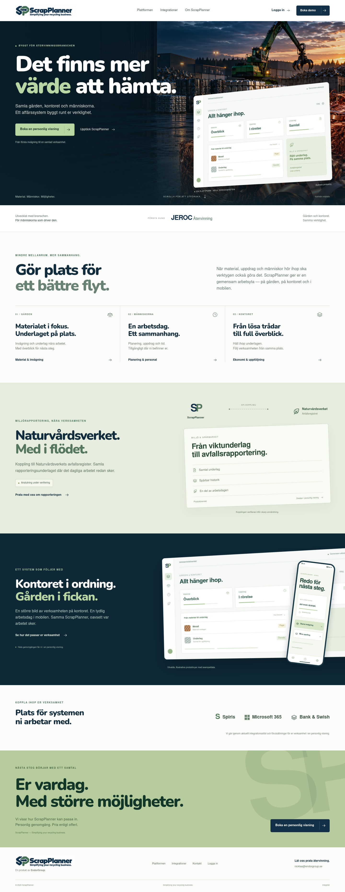
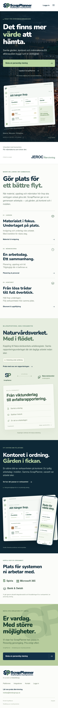

# ScrapPlanner – nytt premiumkoncept

**Simplifying your recycling business.** · Bildmockup · 20 oktober 2026

En mer formgiven riktning för ScrapPlanners publika hemsida: mörk marinblå,
industriell bildvärld, mjukare och rundare rubriker, dämpade gröna accenter
och en framträdande del för Naturvårdsverkets avfallsregister.

## Första intrycket

[Öppna bilden i full storlek](03_Forsta_intrycket.png)



## Hela startsidan på dator

[Öppna hela datorvyn](01_Startsida_Dator.png)



## Hela startsidan på mobil

[Öppna hela mobilvyn](02_Startsida_Mobil.png)



## Innehåll och produktbilder

- **Överblick och affärsnytta i fokus.** Mer detaljerade arbetsflöden och
  inställningar visas vid en personlig genomgång.
- **Särskilt skapade produktkompositioner.** Bilderna visar bara generell,
  syntetisk information. Inga riktiga kunduppgifter, personuppgifter,
  priser, konton, API-svar, regelverk eller kompletta inställningsvyer
  har lagts in i dessa produktillustrationer. Det finns inga skarpa
  produktbilder bakom någon suddig överlagring.
- **Naturvårdsverket lyfts som en egen del.** Kopplingen till avfallsregistret
  visas med status **Anslutning under verifiering**. Förslaget påstår inte
  godkänd skarp rapportering eller någon certifiering från myndigheten.
  Myndighetsnamnet visas tillsammans med en neutral symbol.
- **Pris enligt offert**, personlig visning och **en produkt av EndorGroup**.
- Miljöbilden är AI-genererad och illustrativ. Den föreställer inte en
  dokumenterad JEROC-anläggning.

Detta är **statiska bilder för designgranskning**. Den publicerade hemsidan
ändras inte av den här leveransen, och någon interaktiv demo publiceras inte.

## Typsnitt och rendering

Rubrikerna använder **Nunito**, med rundade former som knyter an till loggan.
Brödtexten hålls ren och återhållsam. Nunito hämtades från Google Fonts och
distribueras med sin [SIL Open Font License](assets/Nunito-OFL.txt).
Bildrenderaren använder lokalt installerad Nimbus Sans för brödtexten.

```sh
node docs/mockups/scrapplanner-premium/render-mockups.mjs
```

Renderaren producerar bara PNG-bilder. Den laddar inga externa webbplatser,
hämtar inga kunddata och gör inga anrop till SaaS-backend eller integrationer.
[Renderingskontrollen](render-verification.json) redovisar sidmått, bildladdning
och kontroll av horisontell scroll för dator- och mobilkompositionen.

[Tidigare hemsideförslag](../scrapplanner-hemsida/README.md)
