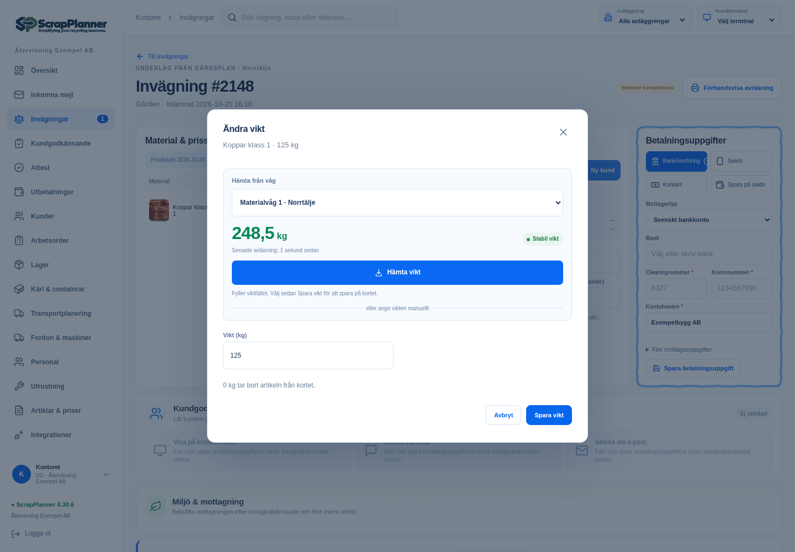
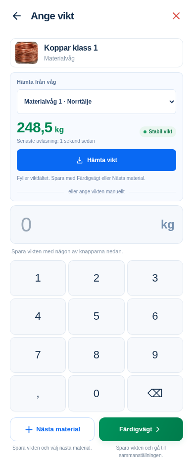
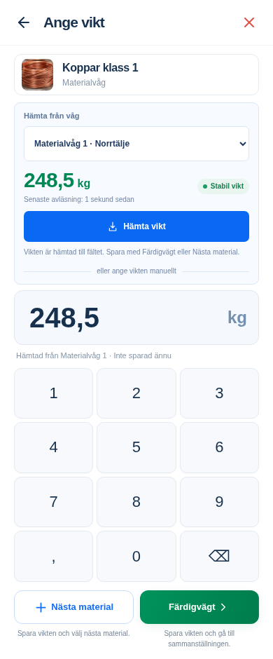

# Hämta vikt från våg – bildmockup

Förslag från 20 oktober 2026. Bilderna använder ScrapPlanners **befintliga React-vyer**, menyer, viktfält, tangentbord och sparknappar. Endast den inramade vågpanelen är tillagd för att visa förslaget.

**Detta är simulerade bilder, ingen färdig vågintegration.** Vågarnas namn, kund, skrotkort och avläsningen 248,5 kg är exempel. Ingen verklig våg eller kunddatabas används.

## Kontoret

Panelen ligger i den befintliga dialogen **Ändra vikt** på ett skrotkort. Samma upplägg kan senare användas när en artikel läggs till.

[Öppna kontorsbilden](01_Kontor_Hamta_fran_vag.png)



## Mobilen

Panelen ligger i den befintliga vyn **Ange vikt** för en materialrad. Det manuella viktfältet, siffertangentbordet, **Nästa material** och **Färdigvägt** finns kvar. Mobilbilden är 390 pixlar bred; tangentbordet är något kompaktare för att visa panel och sparknappar samtidigt.

[Öppna mobilbilden](02_Mobil_Hamta_fran_vag.png)



## Efter Hämta vikt

Här har avläsningen fyllt det vanliga viktfältet. Personalen kan granska
**248,5 kg**, se vilken våg värdet kom från och sedan spara som vanligt.

[Öppna bilden med hämtad vikt](03_Mobil_Vikt_Hamtad.png)



## Föreslaget beteende

1. Välj bland vågarna som är kopplade till den aktuella anläggningen.
2. Se senaste avlästa vikt, enhet, hur gammal avläsningen är och om vågen är stabil.
3. Tryck **Hämta vikt** för att kopiera en stabil och färsk avläsning till det befintliga viktfältet.
4. Granska vikten och spara med den befintliga sparknappen.

Livevärden får **aldrig automatiskt ändra eller spara en materialrad på skrotkortet**. Instabil, för gammal eller frånkopplad avläsning ska stoppa hämtningen och förklara varför. Manuell viktinmatning finns kvar. Stabilitets- och färskhetsgränser fastställs först när vågens faktiska protokoll är känt.

Den senast använda vågen bör vara förvald. Finns bara en våg behövs inget
extra val. Samma panel kan användas vid infart och utfart på fordonskortet,
med en tydlig knapp för det aktuella viktfältet.

## Grova tekniska exempel

- **Kabel och lokal brygga:** vågens display kopplas med USB/serieport
  till en dator eller liten gateway, som skickar vikten till ScrapPlanner.
  Både mobil och kontor kan då hämta samma avläsning.
- **Nätverksvåg:** ett dokumenterat API eller viktprotokoll kan läsas via
  nätverket, ibland genom en lokal brygga. Gatewayen kan använda Wi-Fi.
- **Bluetooth-våg:** möjlig med rätt våg och stöd i anslutningen. Direkt
  Bluetooth till dagens iPhone/webb/Expo Go-skal är inte färdigt stöd;
  därför är en gemensam lokal brygga ett bra första alternativ.

Förslaget gäller UI och arbetsflöde. Det förutsätter inget specifikt
vågfabrikat eller inköp.

## Återskapa bilderna lokalt

Starta först den befintliga appen med `npm run dev`. Kör därefter från projektroten:

```sh
node docs/mockups/vagkoppling/render-mockups.mjs
```

En annan lokal port kan anges med `MOCKUP_BASE_URL=http://127.0.0.1:5174`. Scriptet tillåter endast en lokal adress, blockerar extern trafik och ersätter samtliga API-anrop med syntetiska fixtures. Det använder `seedOffice` och `migrateOffice` från den byggda domänmodellen samt bygger `seedDemo` i minnet med esbuild. Om domänmodellen saknas behöver projektets ordinarie build köras först.

Scriptet öppnar de riktiga kontors- och mobilvyerna med Playwright, lägger till panelen i sidans DOM och tar tre PNG-bilder i denna mapp. Ingen produktionskod ändras och inga anrop skickas till en riktig våg, leverantör eller kunddatabas. Simulerade skrivförsök fångas också lokalt; scriptet klickar inte på de ordinarie sparknapparna.

Bildkörningen kontrollerar att ordinarie viktfält och sparknappar finns
kvar, att **Hämta vikt** fyller fältet, att bilder laddats och att vyerna
inte har vågrät överströmning. Alla nätverks- och skrivförsök hålls i
den lokala mockupfixturen.

[Tekniskt underlag för vågkoppling](../../integrationer/vagar.md) · [Alla bildmockuper](../README.md)
