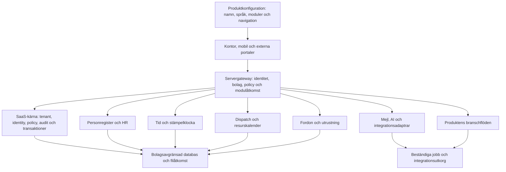

# SaaS-blueprint – återanvändbar grund från ScrapPilot

Datum: 17 oktober 2026. Kodreferens: `f5bf2f4`.

Det här är byggreceptet för att använda erfarenheterna från ScrapPilot i fler
SaaS-produkter. Målet är en gemensam grund för bolag, inloggning, behörigheter,
sidmallar, filer och drift, med valbara verksamhetsmoduler ovanpå.

**Status:** arkitektur och genomförandeplan. En körbar generell starter,
modulregistrering och begränsad plattformssupport behöver fortfarande byggas.
Dokumenten skiljer därför mellan **befintlig implementation**, **föreslaget
kontrakt** och **krav före återanvändning i skarp drift**.

## Läsordning

| Dokument | Använd det till |
| --- | --- |
| [1. SaaS-kärnan](01-saas-karnan.md) | Identitet, bolagsisolering, systemadmin, menyer, sidmallar, konfiguration och lagring. |
| [2. Valbara moduler](02-moduler.md) | HR/tid, dispatch, fordon, utrustning, mejl och AI; kontrakt och hur de kan flyttas mellan produkter. |
| [3. Säkerhet och drift](03-sakerhet-och-drift.md) | De 51 kraven, konkreta acceptansprov och vad som blockerar en säker release. |
| [4. Byggrecept](04-byggrecept.md) | Arbetsordning, startmall för en ny produkt, testmatris och definition av färdig leverans. |

## Grundbeslutet: tre lager

| Lager | Innehåll | När det ändras |
| --- | --- | --- |
| **SaaS-kärna** | Bolag, identitet, medlemskap, sessionsskydd, policy, sidmall, audit, filer, integrationsanslutningar och jobbkontrakt. | När plattformens gemensamma beteende utvecklas. |
| **Verksamhetsmoduler** | Exempelvis personregister, tid/stämpel, frånvaro, dispatch, utrustning, fordonsunderhåll och inkorg. | När en funktion behöver fler förmågor eller en ny produkt väljer den. |
| **Produkt-/branschlager** | ScrapPilots vägning, skrotartiklar, avräkning, kärlflöde och NVV; annan produkt kan ha helt andra arbetsflöden. | När den aktuella branschens regler och erbjudande ändras. |

En organisations behov av en kalender innebär inte automatiskt att den behöver
transportplanering. Kalenderns presentation, bokningsmotorn och branschens
arbetsorder blir därför separata delar. Samma princip gäller personregister,
anställning, tid, lönedata och sjukfrånvaro.

Utgångspunkten är en **modulär monolit**: separata kod- och datakontrakt i samma
produkt/deploy. En worker kan köras separat utan att varje modul blir en egen
mikrotjänst. Högfrekvent telematik har andra lagrings- och nätkrav och kan få
en separat mottagare när den riktiga driften kräver det.

## Vad vi faktiskt kan ta med oss

| Område | Befintlig grund | Arbete för en generell starter |
| --- | --- | --- |
| Bolag och inloggning | Plattformssession, bolagsregister, första VD, obligatoriskt lösenordsbyte, servervalt bolag och Jobba som. | Gemensam identitet för alla inloggningsytor, MFA och komplett inbjudnings-/återställningsflöde. |
| Bolagsisolering | Bolagsbundna tjänster/repositories, servervalda PostgreSQL-scheman, lokalt separata SQLite-filer och avgränsade klientcachar. | Ta bort JEROC:s legacy-undantag, verifiera databasrättigheter och fastställa total anslutningsbudget. |
| Behörigheter | Åtgärds-, objekt- och anläggningskontroller finns i domänerna. Faktisk och effektiv användare bevaras. | Samlat policykontrakt och konsekvent kontroll i alla API-, fil-, export- och jobbvägar. |
| Systemadmin och support | Bolagsadministration och egen plattformsbehörighet i valt bolag finns. | En begränsad supportroll med tilldelade bolag, tidsgräns och tydliga åtgärder. |
| UI | Delad sticky sidrubrik, kontorsskal, mobilskal, list-/detaljmönster och flera användbara komponenter. | Gemensamt UI-kit och navigation från ett modulregister. |
| HR och planering | Omfattande domänfunktioner och användarvyer finns. | Bryta dagens kopplingar till prisregister, transport och skrotarbetsorder. |
| Integrationer och jobb | Tenantbundna adaptrar, OAuth, krypterade token, idempotens och flera beständiga köer. | Gemensamma portar, driftlarm, retry-/dead-letter-regler och livscykel för avstängda moduler. |
| Säker leverans | Många negativa server- och browsertester finns. | Automatiska release-gates, full återställningsövning, staging och verifierat belastningsmål. |

Det här är en kodinventering för arkitekturval. Den daterade
[51-punktsgranskningen](../security/launch-readiness-2026-10-14.md) gäller en
äldre kodversion. **ÄL 123 – Before demo release är fortfarande planerad** och
behöver genomföras innan den här grunden används som säker produktionsstarter.

## Beslut som håller nästa produkt enkel

1. **En identitet, flera medlemskap.** Personprofil, inloggningskonto och
   plattformsbehörighet är olika begrepp. Ett personalregister ska fungera även
   för en person som saknar inloggning.
2. **Bolaget väljs av servern.** Tenant-id i en länk, header eller formulär är
   ett önskemål eller en kontrolluppgift. Det ger aldrig åtkomst i sig.
3. **Ett register äger varje objekt.** Fleet och Dispatch använder samma
   fordonsidentitet. HR och utrustning använder samma personreferens.
4. **Modulåtkomst och användarbehörighet kontrolleras var för sig.** Abonnemang,
   featureflagga, roll och objekträttighet får inte blandas ihop.
5. **Moduler talar genom kontrakt.** Ett tidsystem får fråga efter en
   arbetsuppgifts namn och status; det behöver inte importera skrotets viktkort.
6. **Privata fält stannar i rätt domän.** Planering får veta att en person är
   otillgänglig. Lön, sjukintyg och diagnoser följer inte med.
7. **Gemensamma visuella mönster.** Listor, detaljer, redigering och dialoger
   fungerar likadant även när produkternas innehåll skiljer sig.
8. **Osäkert externt utfall bevaras.** Förlorat betalningssvar blir en kontroll
   av samma instruktion; ett nytt försök får inte skapa en andra utbetalning.
9. **Avstängning har en datalivscykel.** Stoppa nya operationer och ta hand om
   pågående jobb. Behåll eller gallra data enligt beslutad policy.
10. **Kapacitet är ett testresultat.** Dokumentera last, svarstider,
    anslutningsbudget, backup och återställning innan kapacitet utlovas.

## Så blir det användbart i andra SaaS-produkter

Första leveransen är ett separat **starter-repo** med kärna, gemensamt UI,
testverktyg och en liten verklig modul. En ny produkt väljer namn, varumärke,
språk, moduler och branschadapter. Den ska kunna starta utan JEROC-data eller
en aktiverad skrot-, HR- eller betalningsintegration.

När en del verkligen används av minst två produkter kan den förvaltas som ett
versionerat internt paket. Ett frikopplat domänpaket, databasadapter och React-UI
kan då uppgraderas separat. Hela mappar som importerar ScrapPilots interna
state är fortfarande produktkod och behöver extraheras stegvis.

Exempel på kombinationer:

| Produkt | Valbara moduler | Egen branschdel |
| --- | --- | --- |
| Återvinning | HR/tid, Dispatch, Fleet, utrustning, inkorg, AI | Vägning, avräkning, material, kärl och miljörapportering. |
| Fältservice | Personregister, Dispatch, tid, utrustning, kundregister | Serviceuppdrag, checklistor och servicerapporter. |
| Personalsystem | Personregister, anställning, schema, tid, frånvaro | Branschens avtal, regler och export till lönesystem. |

**Nästa rekommenderade bygge:** genomför säkerhetsgaten, etablera kärnkontrakten
och extrahera personreferenser + utrustning som första avgränsade modul. Fortsätt
sedan med tid/stämpel och en generell kalenderadapter. ScrapPilot kan fortsätta
utvecklas under tiden med kompatibla adaptrar.

## Källor i nuvarande projekt

- [Plattformsidentitet](../../server/platform-auth.mjs),
  [gateway](../../server/tenant-gateway.mjs),
  [tenantmiljö](../../server/tenant-runtime.mjs) och
  [tenanttjänster](../../server/tenant-services.mjs).
- [Databastransaktioner](../../server/database-runtime.mjs) och
  [domänlagring](../../server/application-storage.mjs).
- [Plattformsgränssnitt](../../src/platform/PlatformGate.tsx),
  [kontorsnavigation](../../src/office/OfficeApp.tsx) och
  [sidmall](../../src/office/OfficePageHeader.tsx).
- [Historik: bolagsgrunden](../scrappilot-bolagsgrund-2026-10-12.md),
  [säkerhetsgranskningen](../security/launch-readiness-2026-10-14.md) och
  [framtida releasearbete](../planerade-uppdateringar.md).
