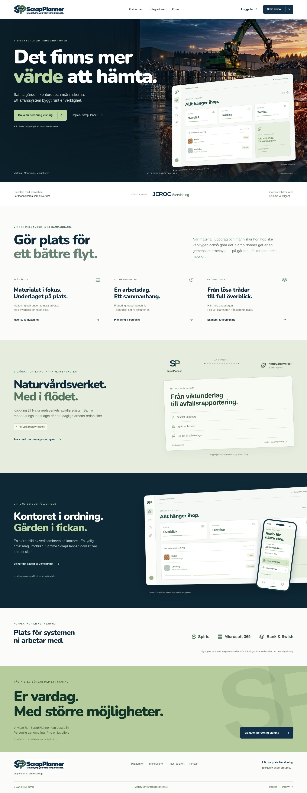

# ScrapPlanner – publik webbplats

Ett fristående hemsideprojekt för **ScrapPlanner**, en produkt från **EndorGroup**, och sloganen **Simplifying your recycling business.** Projektet byggs till statiska HTML-sidor och behöver varken SaaS-servern, en databas eller integrationsnycklar.

## Kör lokalt

Node.js **24.19.0** rekommenderas; lägsta version är **22.12**.

```sh
cd website
npm ci --include=dev --no-audit --no-fund
npm run dev
```

Använd adressen som startkommandot skriver ut. För en produktionsbyggnad:

```sh
npm run build
npm run preview
```

`dist/` innehåller hela den publicerbara webbplatsen. Den godkända premiumdesignen har mörkblå industrimiljö, dämpad grön färg och rundade Nunito-rubriker. Miljöbilden byggs till responsiva WebP-bilder; originalet finns i `source-assets/`. Nunito laddas lokalt från en WOFF2-fil med medföljande OFL-licens. SP-symbolen i `public/favicon.svg` är en vektor. Den godkända fullständiga logotypen är en optimerad rasterbild.

Produktvyerna är syntetiska illustrationer i HTML/SVG. Inga interna skärmbilder, kunduppgifter eller fullständiga arbetsflöden publiceras i bygget. Telefonillustrationen har ett fast bildförhållande på 390:810, så att dess innehåll inte kan göra den oproportionerligt lång. Den publika sidan beskriver NVV-kopplingen som **anslutning under verifiering**.

## Sidor

| Adress | Innehåll |
| --- | --- |
| `/` | Premiumstartsida med industriell miljöbild, utvalda produktillustrationer och NVV-koppling |
| `/plattformen/` | Material, planering, personal och fordon |
| `/integrationer/` | Integrationer med tydlig information om respektive läge |
| `/priser/` | Pris enligt offert och vägen till ett eget upplägg |
| `/kontakt/` | Boka demo och förbered en kontaktförfrågan |
| `/integritet/` | Hur den publika webbplatsen och kontaktflödet fungerar |

Okända adresser använder webbplatsens `404.html`. Sidorna är separata HTML-dokument och behöver ingen omskrivning som skickar alla adresser till startsidan.

## Konfiguration

Värdena läses när webbplatsen **byggs**. Bygg om efter en ändring.

| Variabel | Standard | Användning |
| --- | --- | --- |
| `PUBLIC_SITE_URL` | `https://scrapplanner.com` | Sidornas kanoniska adresser, delningslänkar och sitemap |
| `APP_URL` | `https://app.scrapplanner.com` | Logga in i kontorssystemet |
| `MOBILE_URL` | `https://mobile.scrapplanner.com` | Öppna mobilversionen |
| `CONTACT_EMAIL` | `nicklas@endorgroup.se` | Mottagare när besökaren väljer att öppna en förberedd förfrågan i sin mejlapp |

Formuläret skickar inte mejl och har ingen formulärserver. Det förbereder en text i besökarens webbläsare som kan kopieras. Med `CONTACT_EMAIL` konfigurerad kan besökaren också öppna ett förberett mejl och skicka det själv. E-postadressen blir publik i webbplatsens filer; lägg aldrig API-nycklar eller andra hemligheter i dessa variabler.

Publicera riktiga företags- och kontaktuppgifter när de är bestämda. Produktillustrationerna visar generiska exempel. Miljöbilden är en illustration och visar inte en faktisk kundanläggning. JEROC Återvinning presenteras som första kund, inte som leverantören av ScrapPlanner.

## Render – separat Static Site

För **hemsidan, appen/API:t och en ny databas tillsammans**, använd i stället
Blueprint Path **`render.scrapplanner.yaml`** enligt
[guiden för hela pilotmiljön](../docs/deployment/scrapplanner-render.md).
Stegen nedan gäller när bara hemsidan ska skapas.

Projektets [render.yaml](render.yaml) skapar bara marknadswebbplatsen. Den ändrar inte den befintliga SaaS-tjänsten, databasen eller demomiljön.

Skapa **New → Static Site** i rätt Render-workspace och välj GitHub-repot. Använd:

| Inställning | Värde |
| --- | --- |
| Branch | `main` |
| Root Directory | `website` |
| Build Command | `npm ci --include=dev --no-audit --no-fund && npm run build` |
| Publish Directory | `dist` |
| Node-version | `NODE_VERSION=24.19.0` |

Lägg till konfigurationen ovan under **Environment**. För att använda alla säkerhets- och cachningsrubriker automatiskt kan du i stället skapa tjänsten som en **Blueprint** och välja Blueprint Path **`website/render.yaml`**. Vid manuell Static Site-konfiguration lägger du samma regler under **Headers**. Render använder Blueprint-rubrikerna; projektet förlitar sig inte på en `_headers`-fil.

Blueprinten tillåter bara lokala skript, stilmallar, bilder och typsnitt. Den använder inga analysverktyg, externa bildservrar eller marknadsföringscookies. Tillgångar har en timmes cache eftersom filnamnen inte har innehållshashar.

När tjänsten har byggts visas dess riktiga `https://…onrender.com`-adress. Prova sidor, mobilmeny och kontaktflöde där först. Lägg sedan till `scrapplanner.com` och eventuellt `www.scrapplanner.com` under **Custom Domains** och använd de DNS-värden som Render visar för just den tjänsten. Render hanterar TLS-certifikatet efter att domänen har verifierats.

`app.scrapplanner.com` och `mobile.scrapplanner.com` ska kopplas till respektive SaaS-/mobiltjänst när dessa finns. Marknadswebbplatsens inloggningslänkar skapar inga sådana tjänster och innebär inte att produktionsmiljön är driftsatt.

Render-referenser: [Static Sites](https://render.com/docs/static-sites), [monorepo och Root Directory](https://render.com/docs/monorepo-support), [Blueprint-specifikation](https://render.com/docs/blueprint-spec), [egna domäner](https://render.com/docs/custom-domains).

## Kontroller

```sh
npm test
npx playwright install chromium
npm run test:e2e
```

Webbläsartesterna kontrollerar navigation, mobilmeny, bilder, telefonproportioner, 404, formulärvalidering och att en förfrågan stannar i webbläsaren tills besökaren själv skickar mejlet. Sidbredd kontrolleras vid 320, 390, 768 och 1440 pixlar. Separata kontroller säkerställer att produktillustrationen inte täcker startsidans knappar vid mellanbredder, att typsnitt laddas lokalt och att gamla interna skärmbilder inte blir nedladdningsbara. GitHub Actions kör projektets egna tester när hemsidan ändras.

I den gemensamma pilot-Blueprinten är automatisk deploy avstängd. Efter en push: **Render → scrapplanner-website → Manual Deploy → Deploy latest commit**. Denna hemsidesuppdatering behöver ingen databasändring och kräver ingen manuell deploy av appen.

## Förhandsbilder av den byggda hemsidan

[Startsida på dator](docs/startsida-dator.jpg) · [Startsida på mobil](docs/startsida-mobil.jpg)


